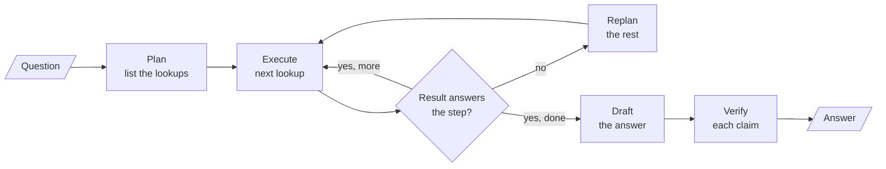

# M26 Theory: Planning, reflection and reasoning patterns

*Part VIII · Agent Foundations for RAG · [Module README](../../../course/p08_agent_foundations/m26_planning_reflection_reasoning/README.md) · [All theory pages](../../README.md)*

A ReAct agent decides its next step after every tool result, in one LLM call per step. This module pulls that call apart and spends extra calls in three places: before acting (a plan), between steps (a check that can trigger a new plan, or a search over several candidate steps), and after the draft (a verification of its claims). The M26 notebooks build on four ideas: plan-and-execute, replanning, chain-of-verification, and tree search with tree of thoughts and LATS. Each idea has a page in the folder of the lesson that teaches it, listed under [Lessons](#lessons). This page has the overview, the interview questions and the takeaways.

The running example is a Larkspur Cloud customer who wants to cancel an annual plan. The answer needs up to six handbook lookups: the refund rule, how long a refund takes, what happens to servers, how long data is kept, what an export includes, and how fast support answers. The lab plans and runs those lookups against the handbook chunks M11 to M13 use, and lesson 26.4 verifies a drafted answer against the same chunks.

## TL;DR

- A fixed plan makes 2 LLM calls (planner and synthesizer) however many lookups it holds. ReAct makes one per search plus one to answer, and each call re-reads the conversation so far. On the lab's four-lookup question that is 2 calls and about 504 tokens against 5 calls and about 918.
- A fixed plan cannot notice a wrong search result; it writes the answer from it. Evaluating every step and replanning on a failure raises the cost to 8 LLM calls when one of the four lookups comes back wrong, and it is the planner whose answer is still complete.
- A loop that can replan needs a cap, and `max_iterations` counts executed steps, retries included. Six lookups with one retry need 7; the notebook's cap of 6 leaves one lookup unanswered.
- Chain-of-verification answers one question per claim in a fresh call that never sees the draft, then revises. It costs 1 + 1 + N + 1 calls and removes unsupported claims; it does not add missing ones.
- Self-consistency, tree of thoughts and LATS spend extra calls on several reasoning paths. They pay off only when something can score a partial answer: the evaluator decides what survives.

## Mental model

<!-- animated: diagrams/plan-check-verify.anim.html -->

Every box is a place to spend an LLM call, and each one buys a different guarantee. The plan makes the work visible before it runs, the check stops a wrong result from reaching the answer, and verification catches claims the draft invented. ReAct folds plan, execute and check into one call per step. Tree search (lesson 26.6) replaces the single Execute box with several candidate steps and an evaluator that keeps the best.

## Lessons

| Lesson | Topic | Theory |
|---|---|---|
| 26.1 | Plan-and-execute vs ReAct; decompose, execute, replan | [Plan-and-execute](01_plan_and_execute_vs_react_decompose_execute_replan/README.md#plan-and-execute) [Replanning](01_plan_and_execute_vs_react_decompose_execute_replan/README.md#replanning) |
| 26.2 | Deep-research and reflective dynamic planners | *planned* |
| 26.3 | Reflection and Reflexion agents | *planned* |
| 26.4 | Chain-of-verification and constitutional critique | [Chain-of-verification](04_chain_of_verification_and_constitutional_critique/README.md#chain-of-verification) |
| 26.5 | Self-Discover and reflective code generation | *planned* |
| 26.6 | Self-consistency, tree of thoughts and LATS | [Tree of thoughts / LATS](06_self_consistency_tree_of_thoughts_and_lats/README.md#tree-of-thoughts--lats) |
| 26.7 | Simulator-in-the-loop, metacognition and exemplar memory | *planned* |

## Interactive lab

[**Plan or react: the call budget**](01_plan_and_execute_vs_react_decompose_execute_replan/interactive/plan-or-react-lab.html): open the file in a browser. Clear the wrong-result toggle and slide the lookups from 1 to 6: the fixed plan stays at 2 LLM calls while ReAct's tokens climb past the replanner's at six. Then press lookup 1 again and compare the three answers. Finally set six lookups, keep one wrong, and drop the cap from 7 to 6 to see a lookup go unanswered.

## How it connects

- **Before:** M23 and M24 build the agent loop and ReAct that this module measures against. In M25's workflow patterns (prompt chaining, routing, parallelization, orchestrator and worker, evaluator and optimizer) you draw every step; from this module on, the model writes part of the control flow.
- **Next:** M27 adds human approval before an agent acts. M18's query decomposition is a plan for retrieval, and M29's Self-RAG checks a generated answer for groundedness in the retrieved evidence, the RAG form of the verify step.

## Interview Spotlight: 5 Questions You Might Get Asked

*Production questions in the style of OpenAI, Anthropic and Google interviews for applied AI roles.*

### 1. Larkspur's cancellation assistant, a plan-and-execute agent, told a customer their data is kept for 12 months after cancelling. The handbook says 30 days. The trace shows the retention lookup ran. What went wrong, and what do you change?

**What a strong answer covers:**
- Reads the trace: the retention search returned the promotional-credits chunk ("expire 12 months"), and a fixed plan pops every step as done whatever it returned
- Adds a per-step evaluator that asks whether the result states the requested fact about the right subject, writes the verdict to state, and routes a failure to a replanner
- Passes only accepted results to the synthesizer and tells it to say a fact was not found rather than fill it in
- Reproduces the failure with a stub search that returns the wrong chunk on the first call, and adds the question to the golden set

### 2. The team is choosing between ReAct and plan-and-execute for two Larkspur assistants: one answers multi-part billing questions, the other troubleshoots a server that will not start. Which pattern goes where?

**What a strong answer covers:**
- Billing questions have lookups you can list up front, so a plan is cheaper (2 LLM calls) and inspectable before any search runs
- Troubleshooting is exploratory: the next check depends on the last result, which is what ReAct's per-step reasoning is for
- Names ReAct's failure from lesson 26.1: it can announce its next step as text and end, because nothing tracks what is left
- Suggests a middle ground for either: plan, execute, evaluate each step and replan, at N + 2 calls on a clean run

### 3. After adding replanning, the cost per question went up and the team wants to know whether it is paying for itself. What do you measure?

**What a strong answer covers:**
- Logs per run: planned steps, executed steps, rejected steps, replans, cap hits and LLM calls, from state rather than from prompts
- Tracks the replan rate and the share of rejected results that were really wrong, by sampling and labelling evaluator verdicts
- Compares answer completeness on the golden set with and without replanning, and the calls each extra complete answer cost
- Watches cap hits as their own alert, since a run that hits the cap returns a partial answer

### 4. A customer question needs six lookups, and the replanning agent runs with `max_iterations = 6`. On a day when one search returns the wrong chunk, one part of the answer goes missing. Why, and how should the cap be set?

**What a strong answer covers:**
- The cap counts executed steps, and a rejected step plus its retry is two executions: six lookups with one retry need seven
- The router checks the cap before it checks the verdict, so the run goes to the synthesizer with one lookup unanswered
- Sets the cap from the plan: planned lookups plus the retries you will pay for, or a per-step retry limit
- Keeps the honest fallback: the synthesizer reports the missing fact, and the response says the answer is partial

### 5. You add chain-of-verification to the RAG answer step, as the M26 lab brief asks. Unsupported claims fall on the golden set, but a reviewer finds one correct claim was removed. How do you evaluate and guard this?

**What a strong answer covers:**
- Scores before and after in code against labelled claims, counting removed correct claims as well as removed unsupported ones
- Expects precision to rise and recall not to: CoVe checks the claims that were made and adds none
- Answers verification questions from retrieved handbook chunks rather than the model's memory, and checks the reviser's output instead of trusting its list of corrections
- Reports the cost of 1 + 1 + N + 1 calls per answer and batches the N independent calls to hold latency

## Key Takeaways

- Plan when the steps are knowable up front; react when the next step depends on the last result. Count LLM calls and tokens for both on your own questions before choosing.
- A plan is only as safe as its check. Evaluate every step's result, replan from the reason it failed, and send only accepted results to the answer.
- Any loop that can grow needs a cap, set from planned steps plus allowed retries, and a fallback that says what is missing.
- Verify claims in calls that cannot see the draft, and spend tree search only where an evaluator can tell a good partial answer from a bad one.

---
*Previous: [M25 Agentic workflow patterns](../m25_agentic_workflow_patterns/README.md). Next: [M27 Human approval and applied single-agent builds](../m27_human_approval_applied_agents/README.md).*
