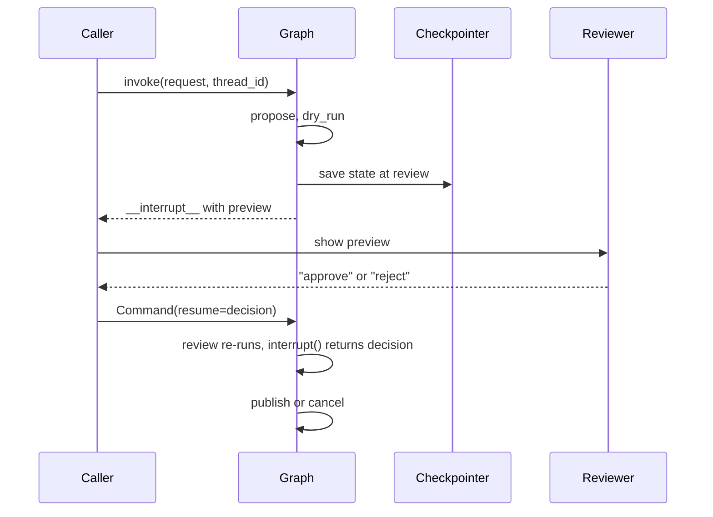

# M27.1 Theory: Dry-run harness and human approval

*[M27 theory](../README.md) · Lesson 27.1 · Notebooks: [`01a_dry_run_harness.ipynb`](../../../../course/p08_agent_foundations/m27_human_approval_applied_agents/notebooks/01a_dry_run_harness.ipynb) · [All theory pages](../../../README.md)*

## Dry run

A dry run executes an action's plan without its effect and reports what the effect would be. The idea is old: `rsync --dry-run`, `apt-get --simulate` and `terraform plan` all print the changes before anyone applies them. For an agent it separates two moments that a plain tool call joins: the model *proposing* an action, and the system *executing* it.

The notebook's tool is a mock social-media API. On the Larkspur status feed it works the same way: one method, `publish_post(post, dry_run=True)`, and one code path that renders the post for both modes.

| Call | Returns | Changes the feed |
|---|---|---|
| `publish_post(post, dry_run=True)` | `{"status": "DRY_RUN", "preview": text, "fingerprint": "c4e9e330698e"}` | No |
| `publish_post(post, dry_run=False)` | `{"status": "PUBLISHED", "post_id": "post_1"}` | Appends one post |

The fingerprint is `sha256(render(post))[:12]` in hex, so it identifies the exact text that was previewed. The value above is the lab's, for the eu-west post.

Three properties make a dry run worth trusting:

- **The preview comes from the live code path.** Both modes call `render(post)`, so the reviewer reads the text the platform will receive. A preview built by a separate "describe" function can drift from what the live call does.
- **"Nothing happened" is checked, not assumed.** The notebook's feed is a list it can inspect, and every claim is an `assert api.feed == []`. Give a real tool a sandbox, a staging target or a way to read state back, and test against it.
- **The dry run is its own graph node, before the pause.** On resume LangGraph re-runs the paused node from the top, so anything placed before `interrupt()` in the review node runs twice. A preview generated there could differ from the one the reviewer approved.

The cost is that every consequential tool needs a dry-run mode. Sending email, issuing a refund and deleting a server each need their own preview: the rendered message, the amount and the account, the server name and what is on it.

## Approval gates

The gate is the review node. It calls `interrupt(payload)` with the question, the preview and the fingerprint. LangGraph stops the run, saves its state in the checkpointer under the run's `thread_id`, and returns the payload to the caller under `"__interrupt__"`. Nothing more happens until someone invokes the graph again with `Command(resume=decision)` on the same thread.

`run_with_review` is that loop in code: invoke, and while the result holds an interrupt, pass the payload to a reviewer function and resume. The reviewer can be a script (the notebook's scripted reviewer approves the launch post and rejects the post that disparages competitors), a policy check, a console `input()`, or a UI that answers hours later from another process. Only the reviewer function changes. A later answer needs a persistent checkpointer such as SQLite or Postgres in place of `InMemorySaver`.

Three rules make the gate safe:

- **Fail closed.** `normalize_decision` strips and lowercases the answer and accepts only the exact word `approve`. `␣Approve␣` approves; `approved`, `yes` and `sure, why not` are rejections, logged as unclear answers.
- **Approve what was previewed.** The approval stores the preview's fingerprint. The publish node recomputes the fingerprint of the post it is about to send and refuses if the two differ.
- **Log every decision** with the reviewer, the reason, the fingerprint and the time.

The [interactive lab](interactive/approval-gate-lab.html) runs this harness in the page, with `normalize_decision` and the SHA-256 fingerprint ported from the notebook. Checked against the notebook's own graph on 315 runs (3 drafts, 3 kinds of edit, 35 typed answers), it agrees on every final status, fingerprint and audit entry. With the eu-west post approved:

| Change after the preview | Fingerprint at publish | Final status |
|---|---|---|
| None | `c4e9e330698e` | `PUBLISHED as post_1` |
| "72 hours" edited to "48 hours" | `11673ae3c1d4` | `REFUSED: the post differs from the approved preview` |
| " Buy now!!!" appended (the notebook's test) | `78879f196e7d` | `REFUSED: the post differs from the approved preview` |

<!-- lab: interactive/approval-gate-lab.html -->

A one-phrase edit changes the fingerprint as completely as a new sentence, so any edit after review needs a new preview and a new decision. In the refused runs the audit log still shows an `approve`. That entry is correct: the reviewer approved `c4e9e330698e`, and the text that tried to publish was something else.

The gate enforces whatever the reviewer decides. Approve the uptime post in the lab and it reaches the feed. A gate protects only as much as its reviewers read, and the module page's interview questions cover how to measure that.

`HumanInTheLoopMiddleware` (M24) gives a `create_agent` agent the same pause before a tool call, built on the same `interrupt()` and checkpointer (M10). Building the gate by hand adds the two parts this lesson needs: a preview of the effect and a fingerprint that ties the approval to it.

---
*Previous: [M27 overview](../README.md). Next: [27.4 Text-to-SQL: workflow vs ReAct agent](../04_text_to_sql_workflow_vs_react_agent/README.md).*
