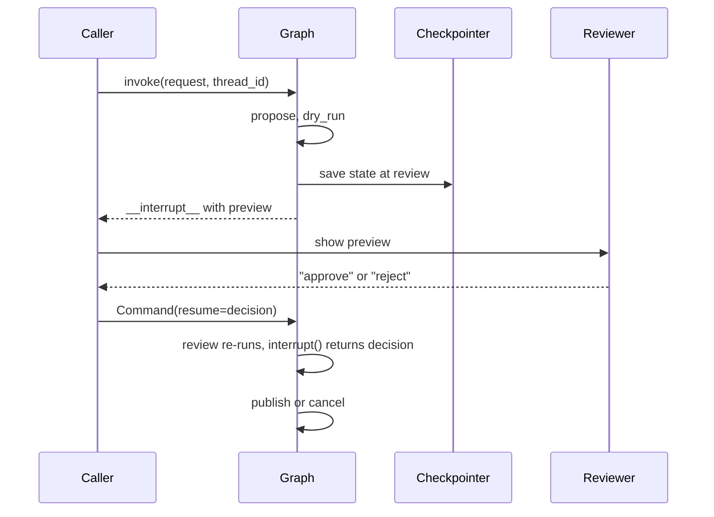

# M27.1 Theory: Dry-run harness and human approval

*[M27 theory](../README.md) · Lesson 27.1 · Notebooks: [`01a_dry_run_harness.ipynb`](../../../../course/p08_agent_foundations/m27_human_approval_applied_agents/notebooks/01a_dry_run_harness.ipynb) · [All theory pages](../../../README.md)*

## Dry run

Larkspur's agent drafts a status update about eu-west. A reviewer must approve the exact post that reaches the feed. You will preview the action without publishing, pause the graph, then try changing the text after approval to see why a decision needs to be tied to the preview.

### Step 1: Render the action without applying it

A dry run executes an action's plan without its effect and reports what the effect would be. The idea is old: `rsync --dry-run`, `apt-get --simulate` and `terraform plan` all print the changes before anyone applies them. For an agent it separates two moments that a plain tool call joins: the model *proposing* an action, and the system *executing* it.

The example tool is a mock social-media API. On the Larkspur status feed it works the same way: one method, `publish_post(post, dry_run=True)`, and one code path that renders the post for both modes.

| Call | Returns | Changes the feed |
|---|---|---|
| `publish_post(post, dry_run=True)` | `{"status": "DRY_RUN", "preview": text, "fingerprint": "c4e9e330698e"}` | No |
| `publish_post(post, dry_run=False)` | `{"status": "PUBLISHED", "post_id": "post_1"}` | Appends one post |

The fingerprint is `sha256(render(post))[:12]` in hex, so it identifies the exact text that was previewed. The value above is the lab's, for the eu-west post.

### Step 2: Check both state and the execution path

Three properties make a dry run worth trusting:

- **The preview comes from the live code path.** Both modes call `render(post)`, so the reviewer reads the text the platform will receive. A preview built by a separate "describe" function can drift from what the live call does.
- **"Nothing happened" is checked, not assumed.** The mock feed is a list it can inspect, and every claim is an `assert api.feed == []`. Give a real tool a sandbox, a staging target or a way to read state back, and test against it.
- **The dry run is its own graph node, before the pause.** On resume LangGraph re-runs the paused node from the top, so anything placed before `interrupt()` in the review node runs twice. A preview generated there could differ from the one the reviewer approved.

The cost is that every consequential tool needs a dry-run mode. Sending email, issuing a refund and deleting a server each need their own preview: the rendered message, the amount and the account, the server name and what is on it.

## Approval gates

### Step 1: Park and resume the same thread

The gate is the review node. It calls `interrupt(payload)` with the question, the preview and the fingerprint. LangGraph stops the run, saves its state in the checkpointer under the run's `thread_id`, and returns the payload to the caller under `"__interrupt__"`. Nothing more happens until someone invokes the graph again with `Command(resume=decision)` on the same thread.



`run_with_review` is that loop in code: invoke, and while the result holds an interrupt, pass the payload to a reviewer function and resume. The reviewer can be a script (the scripted reviewer approves the launch post and rejects the post that disparages competitors), an explicitly configured policy check, a console `input()`, or a UI that answers hours later from another process. Only the reviewer function changes. A later answer needs a persistent checkpointer such as SQLite or Postgres in place of `InMemorySaver`.

### Step 2: Bind the decision to the preview

Three rules make the gate safe:

- **Fail closed.** `normalize_decision` strips and lowercases the answer and accepts only the exact word `approve`. `␣Approve␣` approves; `approved`, `yes` and `sure, why not` are rejections, logged as unclear answers.
- **Approve what was previewed.** The approval stores the preview's fingerprint. The publish node recomputes the fingerprint of the post it is about to send and refuses if the two differ.
- **Log every decision** with the reviewer, the reason, the fingerprint and the time.

Before wiring a reviewer into a graph, test the decision boundary locally. This follows the reference rule: trim whitespace, ignore case, and accept only `approve`.

```python
def normalize_decision(answer: str) -> str:
    return "approve" if answer.strip().lower() == "approve" else "reject"

for answer in [" Approve ", "approved", "yes"]:
    print(repr(answer), normalize_decision(answer))
```

**Expected output**

```text
' Approve ' approve
'approved' reject
'yes' reject
```

Changing the reviewer interface does not change this acceptance rule. An audit entry should retain the original answer as well as the normalised decision.

### Step 3: Change approved text and inspect refusal

The [interactive lab](interactive/approval-gate-lab.html) runs this harness in the page, with `normalize_decision` and the SHA-256 fingerprint ported from the reference implementation. Checked against the reference graph on 315 runs (3 drafts, 3 kinds of edit, 35 typed answers), it agrees on every final status, fingerprint and audit entry. With the eu-west post approved:

| Change after the preview | Fingerprint at publish | Final status |
|---|---|---|
| None | `c4e9e330698e` | `PUBLISHED as post_1` |
| "72 hours" edited to "48 hours" | `11673ae3c1d4` | `REFUSED: the post differs from the approved preview` |
| " Buy now!!!" appended (the mutation test) | `78879f196e7d` | `REFUSED: the post differs from the approved preview` |

<!-- lab: interactive/approval-gate-lab.html -->

A one-phrase edit changes the fingerprint as completely as a new sentence, so any edit after review needs a new preview and a new decision. In the refused runs the audit log still shows an `approve`. That entry is correct: the reviewer approved `c4e9e330698e`, and the text that tried to publish was something else.

The gate enforces whatever the reviewer decides. Approve the uptime post in the lab and it reaches the feed. A gate protects only as much as its reviewers read, and the module page's interview questions cover how to measure that.

`HumanInTheLoopMiddleware` (M24) gives a `create_agent` agent the same pause before a tool call, built on the same `interrupt()` and checkpointer (M10). Building the gate by hand adds the two parts this lesson needs: a preview of the effect and a fingerprint that ties the approval to it.

### Try it yourself

In the lab approve the eu-west preview, then change 72 hours to 48 hours before publishing. Check that approval remains in the audit log while the final action is refused: the preview fingerprint is `c4e9e330698e`, but the edited post is `11673ae3c1d4`. Repeat with `yes` as the decision and no edit. Check that it fails closed because only normalised `approve` authorises publication.

### Practice notebook

Use the implementation below to test the exercise and inspect each state update. Follow its provider setup for live model calls. Recorded model responses and timings can change on a new run.

- [Preview and approval](../../../../course/p08_agent_foundations/m27_human_approval_applied_agents/notebooks/01a_dry_run_harness.ipynb).

## Key Takeaways

- A dry run renders the effect through the same code path as the live call and changes nothing. Check that by reading state back, and put the dry run in its own node before the pause.
- The gate pauses with `interrupt()`, saves state under the `thread_id` and waits for `Command(resume=...)`. Accept only the exact word `approve` and log every decision with reviewer, reason, fingerprint and time.
- Tie the approval to a fingerprint of the previewed text and recompute it before publishing. Any edit after review, even one phrase, needs a new preview and a new decision.

## Check yourself

<details>
<summary>1. Why must the dry run be its own graph node before the review node, rather than code inside the review node?</summary>

On resume LangGraph re-runs the paused node from the top, so anything placed before `interrupt()` in the review node runs twice. A preview generated there could differ from the one the reviewer approved.

</details>

<details>
<summary>2. The eu-west post is approved, then 72 hours is edited to 48 hours before it publishes. What happens, and what does the audit log show?</summary>

The fingerprint at publish is `11673ae3c1d4`, not the approved `c4e9e330698e`, so the publish node returns `REFUSED: the post differs from the approved preview`. The audit log still shows an `approve`, and that is correct: the reviewer approved `c4e9e330698e`. Any edit after review needs a new preview and a new decision.

</details>

<details>
<summary>3. A reviewer answers the approval prompt with yes. Does the post go out, and why is that the right behaviour?</summary>

No. The gate fails closed: `normalize_decision` strips and lowercases the answer and accepts only the exact word `approve`, so `yes` and `approved` are rejections, logged as unclear answers. An ambiguous answer should never publish.

</details>

---
*Previous: [M27 overview](../README.md). Next: [27.4 Text-to-SQL: workflow vs ReAct agent](../04_text_to_sql_workflow_vs_react_agent/README.md).*
