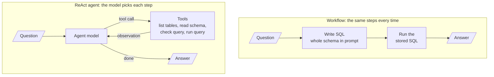

# M27.4 Theory: Text-to-SQL: workflow vs ReAct agent

*[M27 theory](../README.md) · Lesson 27.4 · Notebooks: [`04a_text2sql_workflow.ipynb`](../../../../course/p08_agent_foundations/m27_human_approval_applied_agents/notebooks/04a_text2sql_workflow.ipynb), [`04b_text2sql_react_agent.ipynb`](../../../../course/p08_agent_foundations/m27_human_approval_applied_agents/notebooks/04b_text2sql_react_agent.ipynb) · [All theory pages](../../../README.md)*

## Text-to-SQL

Text-to-SQL turns a question into a query, runs it, and writes the answer from the rows. Both notebooks use a comic-store database built from `comicdb_create_script.sql`: eight tables (Branch, Publisher, Comic, Customer, Employee, Inventory, Sale, SaleTransactions) holding 50 comics, 20 customers, 20 sales and 40 sale lines.

The workflow is a fixed chain of three steps, built with `RunnablePassthrough.assign` so the question, the SQL, the rows and the answer stay together in one dictionary:

1. **Write the query.** `create_sql_query_chain` fills the prompt's `{table_info}` with `db.get_table_info()`: the `CREATE TABLE` statement and 3 sample rows for each table. That text is everything the model knows about the schema.
2. **Run the stored query.** `itemgetter("query") | QuerySQLDatabaseTool(db=db)` executes the query from step 1. Piping the write chain into the executor a second time would generate a second query, and the SQL on screen would not be the SQL behind the answer.
3. **Answer from the rows**, with a prompt that says to use only the SQL result.

The prompt has to make the model return bare SQL. A reply that starts with `SQLQuery:` or sits in a code fence fails with `near "SQLQuery": syntax error`, which the notebook lists as the most common failure.

**Measure against SQL you wrote.** The evaluation set pairs seven questions with reference SQL, and running that SQL gives the expected answer. A number must appear as a whole number in the answer; a name must be the first known name the answer mentions, so a list of six customers that includes the right one does not pass.

| Question | Expected (from the reference SQL) |
|---|---|
| How many customers do we have? | 20 |
| Which comic has sold the most copies? | Wolverine: Old Man Logan |
| Which customer has purchased the most comics? | Tony Stark |
| How many comics in the Superhero genre have never been sold? | 9 |

The notebook names the typical miss: for "purchased the most comics" the generated SQL counts sale lines instead of summing `Quantity`. On this data that changes the answer. Natasha Romanoff has the most lines (5, for 6 copies); Tony Stark bought the most copies (8, on 4 lines). The query runs and the answer reads well, and only the ground-truth check shows it is wrong.

**When the data disagrees.** "Revenue" has two defensible sources: the header `Sale.TotalAmount`, or the line items `SUM(Quantity * Price)`. Running the notebook's check on its database, 16 of the 20 sales have a `TotalAmount` that differs from their lines by more than 0.01, and the top three salespeople change:

| Rank | By `Sale.TotalAmount` | By line items |
|---|---|---|
| 1 | John Doe, 255.89 | Alice Brown, 325.86 |
| 2 | Alice Brown, 234.94 | John Doe, 294.86 |
| 3 | Jane Smith, 234.88 | Michael Clark, 258.88 |

The chain picks one silently, and a stronger model would still be guessing. The business has to decide which source is authoritative and write it into the prompt ("Revenue is always computed from line items"). The notebook then checks the generated SQL in code: it must mention `SaleTransactions`.

## Workflow or ReAct agent

The second notebook gives the same task to a `create_agent` ReAct agent with the four tools of `SQLDatabaseToolkit`: `sql_db_list_tables`, `sql_db_schema`, `sql_db_query_checker` (an LLM that reviews a query before it runs) and `sql_db_query`. Its system prompt tells it to list the tables first, read the schemas it needs, check each query, and rewrite and retry on errors.

<!-- animated: diagrams/text-to-sql.anim.html -->

| | Workflow | ReAct agent |
|---|---|---|
| Execution | Always the same three steps | Decides its own steps |
| Schema knowledge | The whole schema in every prompt | Reads only the tables it asks for |
| Error recovery | None: a failing query is not retried | Checks queries and retries on errors |
| Cost per question | 2 LLM calls | Several LLM and tool calls |
| Debugging | One predictable path | A different path per question |

Both are scored on the same seven questions. Neither is reliably right on every one. The checker and the schema reads fix wrong column names and syntax errors; they do not fix a wrong definition, such as counting lines instead of summing `Quantity`. Seven questions are a sample, and a second run can change verdicts, so compare question by question rather than by one score.

**Read-only belongs in the connection.** The workflow only ever runs the one query it wrote. An agent runs whatever SQL it decides on, so the second notebook opens the file with `sqlite:///file:ComicStore.db?mode=ro&uri=true`. A `DELETE` then fails at the database, whatever the prompt says. The notebook's last test asks the agent to delete the customers in New York and compares the customer count before and after, instead of trusting the answer's wording.

Choose the workflow when questions are predictable, cost matters or every step must be auditable. Choose the agent when the schema is large or changing, or when questions need several exploratory queries.

## SQL or vectors

A vector retriever returns the `k` chunks most similar to the question, and the model reads only those ([M11](../../../p04_rag_foundations/m11_rag_lifecycle/02_indexing_from_scratch_with_tf_idf_and_nearest_neighbours/README.md#top-k)). That fits "What is the refund policy?", where the answer is a passage. It fails for "How many comics in the Superhero genre have never been sold?": the answer (9) depends on all 50 comics and all 40 sale lines, and no top-k slice of rows contains it. SQL computes over every row, then the model only phrases the result.

| Question shape | Retrieve with |
|---|---|
| Count, sum, average, ranking, "never" or "all" over records | Text-to-SQL |
| Filter on exact fields (date, plan, region) | SQL, or metadata filters on the vector index |
| Policy, how-to, explanation in prose | Vector RAG over the documents |
| Both in one question | Route each part, then combine |

The module's [lab brief](../../../../course/p08_agent_foundations/m27_human_approval_applied_agents/lab/README.md) measures this split: the same 20 questions over a product catalogue, answered by CSV RAG from M20 and by the text-to-SQL agent, with the winner recorded per question type.

## Check yourself

1. The ReAct agent reads schemas and checks each query before it runs. Which errors do those steps fix, and which do they not?

They fix wrong column names and syntax errors. They do not fix a wrong definition, such as counting sale lines instead of summing `Quantity`. That is why both designs are scored question by question against reference SQL.

2. For the question of which customer has purchased the most comics, the generated SQL counts sale lines. What answer comes back, and what is correct?

Counting lines gives Natasha Romanoff (5 lines, for 6 copies). Summing `Quantity` gives Tony Stark (8 copies, on 4 lines), which matches the reference SQL. The query runs and the answer reads well, so only the ground-truth check shows it is wrong.

3. Why can a vector retriever not answer how many Superhero comics have never been sold, when text-to-SQL can?

The answer (9) depends on all 50 comics and all 40 sale lines, and a retriever returns only the `k` chunks most similar to the question, so no top-k slice contains it. SQL computes over every row, then the model only phrases the result. Vector RAG fits prose answers such as policies.

---
*Previous: [27.1 Dry-run harness and human approval](../01_dry_run_harness_and_human_approval/README.md). Next: [27.5 LLM workflow apps: review analyst, IT support desk, tailored writer, quiz generator](../05_llm_workflow_apps_review_analyst_it_support_desk_tailored_writer_quiz_generator/README.md).*
