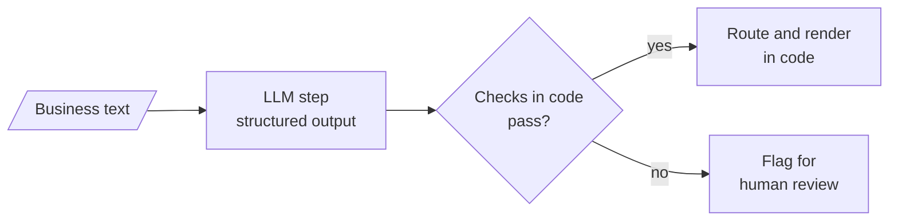

# M27.5 Theory: LLM workflow apps: review analyst, IT support desk, tailored writer, quiz generator

*[M27 theory](../README.md) · Lesson 27.5 · Notebooks: [`05a_review_analyst.ipynb`](../../../../course/p08_agent_foundations/m27_human_approval_applied_agents/optional/05a_review_analyst.ipynb) (optional), [`05b_multilingual_it_support_desk.ipynb`](../../../../course/p08_agent_foundations/m27_human_approval_applied_agents/optional/05b_multilingual_it_support_desk.ipynb) (optional), [`05c_audience_tailored_writer.ipynb`](../../../../course/p08_agent_foundations/m27_human_approval_applied_agents/optional/05c_audience_tailored_writer.ipynb) (optional), [`05d_quiz_generator.ipynb`](../../../../course/p08_agent_foundations/m27_human_approval_applied_agents/optional/05d_quiz_generator.ipynb) (optional) · [All theory pages](../../../README.md)*

## Workflow apps

A workflow app runs a fixed sequence of LLM steps over business text: reviews, support tickets, a fact sheet, a PDF. There is no tool loop. The model fills typed fields, and code does everything that has a right answer: routing, checking and assembling the final document. The four notebooks are four versions of one shape.

- **Review analyst.** The LLM returns one `ReviewAnalysis` per review, for six reviews with `.batch()`, then writes one email per review. Code picks the email writer by a dictionary lookup on `sentiment`: a thank-you for positive and neutral, an apology for negative. Code checks the sentiment against hand labels, and each email for "Dear Customer", "Service Agent", an apology only when the review is negative, and at most 140 words (the prompt asks for under 120).
- **IT support desk.** Design A makes one structured call per ticket that returns six fields; Design B chains detect, translate, answer and translate back. Both run on the same ten tickets in nine languages, and code checks the detected language, that each reply differs from its English version, that no prompt scaffolding leaks into the text, and the LLM calls and wall time.
- **Audience-tailored writer.** Three advert prompts, then three audience reports, each set run in parallel with `RunnableParallel`. Code checks the headings, a two-column table limited to five features, the 60-word limit, and that every number in the output appears in the source.
- **Quiz generator.** The LLM summarises the PDF, then writes questions from the material and the summary. Code checks for 5 questions with 4 distinct options and a valid `answer_index`, checks that every evidence quote appears in the cleaned PDF text, and renders the study sheet from a template.

The notebooks repeat five rules:

- **Ask for a closed type.** `sentiment: Literal["positive", "negative", "neutral"]` gives code a value it can branch on, and `answer_index` points at an option instead of restating it, so the answer cannot drift from the options.
- **Route in code when the signal is already structured.** The review analyst picks the email writer with a dictionary, with no extra LLM call. When the input is free text, as in its instruction router, classify into a closed set of intents and keep an `other` intent for requests the tool does not handle.
- **Check every output with code that cannot be talked round.** String and number checks are cheap enough to run on every call. The writer's fact sheet gives RAM, screen sizes and battery rating but no camera megapixels, so a "50 MP" in an advert is flagged as invented.
- **Render the final document in code.** Asking the model to merge a checked summary and checked questions into a report would let it reword them after the checks; a template cannot.
- **Measure the design choice.** One structured call per ticket makes a quarter of the LLM calls of the four-step chain, and the chain's free-text steps can leak a code fence or "The customer message in English is:" into the reply. The notebook measures both on the same tickets before choosing.

On the Larkspur handbook the same shape triages the support queue. One structured call per ticket returns the language, a category (refund, outage, sizing) and a draft reply. Code routes outage tickets to the incident template, checks that every number in a reply appears in the handbook (the 30-day refund window, the 99.95% availability target), and holds any reply that fails for a person. A reply that issues a refund is an action, so it goes through the approval gate from [27.1](../01_dry_run_harness_and_human_approval/README.md#approval-gates).

These apps are workflows in the sense of lesson 27.4: the same steps every time, cheap, easy to test. Choose an agent only when the next step depends on what the model finds.

## Check yourself

1. Why do the workflow apps render the final document from a template instead of asking the model to merge the checked parts?

A model asked to merge a checked summary and checked questions could reword them after the checks ran. A template cannot, so what the user reads is exactly what passed the checks.

2. The writer's fact sheet gives RAM, screen sizes and a battery rating but no camera figure, and an advert claims 50 MP. What catches it?

The code check that every number in the output appears in the source flags "50 MP" as invented. String and number checks are cheap enough to run on every call. The Larkspur triage version runs the same check against the handbook's numbers, such as the 30-day refund window.

3. For the multilingual support desk, should you use one structured call per ticket or the four-step translate chain?

The notebook measures both on the same tickets before choosing. One structured call makes a quarter of the LLM calls, and the chain's free-text steps can leak a code fence or "The customer message in English is:" into the reply.

---
*Previous: [27.4 Text-to-SQL: workflow vs ReAct agent](../04_text_to_sql_workflow_vs_react_agent/README.md). Next: [M27 interview questions](../README.md#interview-spotlight-5-questions-you-might-get-asked).*
