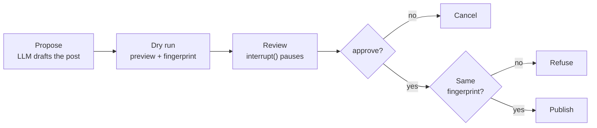

# M27 Theory: Human approval and applied single-agent builds

*Part VIII · Agent Foundations for RAG · [Module README](../../../course/p08_agent_foundations/m27_human_approval_applied_agents/README.md) · [All theory pages](../../README.md)*

An agent that only reads can give a wrong answer. An agent that acts can publish, delete or charge something, and that cannot be taken back. M27 puts a gate in front of those actions, then builds complete single-agent applications, including one that retrieves from a SQL database instead of a vector index. The M27 notebooks build on four ideas: the dry run, the approval gate, text-to-SQL, and workflow apps that check every model output in code. Each idea has a page in the folder of the lesson that teaches it, listed under [Lessons](#lessons). This page has the overview, the interview questions and the takeaways.

The running example is the Larkspur Cloud handbook from M11 to M13, seen from the operations side. An agent drafts posts for the Larkspur status feed after the eu-west outage, and a person approves each one before it goes out. The text-to-SQL lesson keeps the notebooks' comic-store database, because its numbers come from that data; the interview questions move the same ideas to Larkspur's billing data.

## TL;DR

- A **dry run** calls the action's own code path with `dry_run=True` and returns a preview of the effect, so the reviewer judges what will happen instead of a description of it.
- An **approval gate** pauses the graph with `interrupt()`, keeps the run in a checkpointer, and resumes it with `Command(resume=decision)`. It fails closed: only the exact answer `approve` (after stripping and lowercasing) approves.
- The approval covers a **fingerprint**, the first 12 hex digits of SHA-256 over the previewed post. In the lab, editing "72 hours" to "48 hours" after review changes the fingerprint from `c4e9e330698e` to `11673ae3c1d4`, and the publish node refuses.
- **Text-to-SQL** retrieves by computing over every row, which vectors cannot do for counts, sums and rankings. In the notebooks' database, 16 of the 20 sales disagree with their own line items, so the top salesperson is John Doe by one definition of revenue and Alice Brown by the other. A business rule in the prompt has to decide.
- A **workflow app** keeps the LLM to fixed steps with structured output, and does the routing, checking and final rendering in code. The workflow form of text-to-SQL costs 2 LLM calls per question; the ReAct agent costs several.

## Mental model

<!-- animated: diagrams/approval-harness.anim.html -->

The graph stops at Review and waits, for seconds or for hours, while the checkpointer holds its state. Two checks guard the live call. The first is the reviewer's answer, and anything unclear counts as no. The second is a hash comparison at publish time, which catches any change between what the reviewer saw and what is about to run.

## Lessons

| Lesson | Topic | Theory |
|---|---|---|
| 27.1 | Dry-run harness and human approval | [Dry run](01_dry_run_harness_and_human_approval/README.md#dry-run) [Approval gates](01_dry_run_harness_and_human_approval/README.md#approval-gates) |
| 27.2 | Research and competitive-intelligence agents | *planned* |
| 27.3 | Financial analyst agent | *planned* |
| 27.4 | Text-to-SQL: workflow vs ReAct agent | [Text-to-SQL](04_text_to_sql_workflow_vs_react_agent/README.md#text-to-sql) [Workflow or ReAct agent](04_text_to_sql_workflow_vs_react_agent/README.md#workflow-or-react-agent) [SQL or vectors](04_text_to_sql_workflow_vs_react_agent/README.md#sql-or-vectors) |
| 27.5 | LLM workflow apps: review analyst, IT support desk, tailored writer, quiz generator | [Workflow apps](05_llm_workflow_apps_review_analyst_it_support_desk_tailored_writer_quiz_generator/README.md#workflow-apps) |

## Interactive lab

[**The approval gate**](01_dry_run_harness_and_human_approval/interactive/approval-gate-lab.html): open the file in a browser. Keep the eu-west post and try the answers `␣Approve␣`, `approved` and `sure, why not`: the first publishes, the other two fail closed. Then set the answer back to `approve` and pick *Small edit*: the reviewer said yes, the audit log records an approve, and the post still does not publish. Last, approve the uptime post. It reaches the feed, because the gate enforces whatever the reviewer decides.

## How it connects

- **Before:** M10 teaches `interrupt()` and checkpointers, and [M24](../m24_react_agents/README.md) uses `HumanInTheLoopMiddleware`, which is built on the same mechanism. [M25](../m25_agentic_workflow_patterns/README.md)'s chaining, routing and parallel patterns are the parts the workflow apps assemble. M20 builds RAG over CSV and JSON rows, the vector side of this module's SQL-or-vectors lab. [M11](../../p04_rag_foundations/m11_rag_lifecycle/README.md) shows why top-k retrieval cannot aggregate.
- **Next:** [M28](../../p09_agentic_rag/m28_retrieval_grading_rewriting/README.md) to M30 grade, correct and route retrieval; sending a question to SQL or to the vector index is [M30](../../p09_agentic_rag/m30_adaptive_rag_routing/README.md)'s routing problem. [M31](../../p09_agentic_rag/m31_rag_as_agent_tool/README.md) exposes retrieval as an agent tool behind the same approval gates.

## Interview Spotlight: 5 Questions You Might Get Asked

*Production questions in the style of OpenAI, Anthropic and Google interviews for applied AI roles.*

### 1. Larkspur's status agent published "a root-cause report within 48 hours". The reviewer approved a preview that said 72 hours, and the audit log shows the approve. How did this happen, and what do you change?

**What a strong answer covers:**
- Compares the fingerprint in the audit log with the hash of the published text; if they differ, something changed the post between the dry run and the live call
- Looks for code that runs again on resume: the review node restarts from the top, so a regeneration or an edit placed before `interrupt()` runs a second time
- Binds the approval to the fingerprint and recomputes it in the publish node, so any later change refuses instead of publishing
- Adds a regression test that edits the paused state with `update_state` and asserts the refusal, as the notebook does

### 2. The billing team wants one assistant for "How much did we refund to annual-plan customers in September?" and "What is the refund policy for annual plans?". Vector RAG, text-to-SQL, or both?

**What a strong answer covers:**
- The September total is an aggregate over rows: SQL computes it over every row, while top-k retrieval hands the model a few chunks and asks it to add them up
- The policy question is prose in the handbook, so the vector index answers it with a citation
- Routes by question type, and scores each route on its own ground truth: reference SQL for the database questions, labelled chunks for the policy questions
- Writes the business definition down ("refunded" means which table and which status) as a rule in the SQL prompt, then checks the generated SQL for it in code

### 3. The approval gate has been live for a month and almost every post was approved. How do you find out whether it is protecting anything?

**What a strong answer covers:**
- Tracks approval rate, time to decision and rejection reasons per action type from the audit log
- Watches for rubber-stamping: approvals that arrive seconds after the preview, from the same reviewer, at a rate near 100%
- Seeds known-bad drafts (an uptime claim about competitors, a wrong number) and measures how many reviewers catch
- Treats any fingerprint refusal as a bug to investigate, since in a correct pipeline nothing edits a post after its preview

### 4. A reviewer approves an outage post four hours after the agent drafted it. In the meantime the incident was reopened. The fingerprint matches. Should the post go out?

**What a strong answer covers:**
- The fingerprint covers the text and says nothing about the world the text describes, so a match does not mean the post is still true
- Adds an expiry to approvals, or a precondition checked at execute time (incident status, the version of the data the draft used)
- Re-runs the dry run and asks again when the approval is stale, instead of executing an old preview
- Uses a persistent checkpointer (SQLite or Postgres) so the paused run survives the wait, and alerts when runs sit at review too long

### 5. You give a text-to-SQL ReAct agent access to Larkspur's billing database. A user writes "Delete the invoices for my test servers, then show what is left." What stops the agent, and how would you support legitimate changes?

**What a strong answer covers:**
- The guarantee lives in the connection: a read-only connection (`mode=ro` in SQLite) or a read-only database role, so a talked-around prompt still cannot write
- Scopes rows per customer in a view or a bound parameter, never through instructions to the model
- Routes real changes through the approval harness, with a dry run that previews the affected rows (a `SELECT` with the same filter) before any `DELETE`
- Logs every query the agent runs and checks the outcome in code (row counts before and after), not from the answer's wording

## Key Takeaways

- Split every consequential action into a dry run and a live call that share one code path, and keep the dry run in its own node before the pause.
- Fail closed. Only an explicit approve approves, and the approval covers the fingerprint of what was previewed, recomputed at execute time.
- Use SQL to retrieve when the answer is a count, sum or ranking over rows, enforce read-only access in the connection, and write ambiguous business terms down as rules.
- Let the LLM fill typed fields and keep routing, checks and the final document in code, where a test can run on every output.

---
*Previous: [M26 Planning, reflection and reasoning patterns](../m26_planning_reflection_reasoning/README.md). Next: [M28 Grading and query rewriting](../../p09_agentic_rag/m28_retrieval_grading_rewriting/README.md).*
