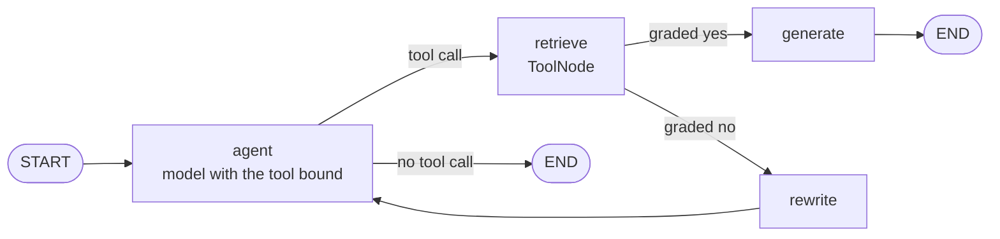

# M28.1 Theory: Retriever as a tool; grade then rewrite in LangGraph

*[M28 theory](../README.md) · Lesson 28.1 · Notebooks: [`01a_simple_agentic_rag.ipynb`](../../../../course/p09_agentic_rag/m28_retrieval_grading_rewriting/notebooks/01a_simple_agentic_rag.ipynb) · [All theory pages](../../../README.md)*

## Conditional edges

Notebook `01a` turns a plain RAG chain into a graph that can look at its own retrieval. It starts by wrapping the vector store retriever as a tool:

```python
retriever_tool = create_retriever_tool(
    retriever,
    "retrieve_info_from_papers",
    "Search and return information about a paper discussing usage of LLMs for human collaborative problem solving.",
)
```

The name and the description are all the model sees of the retriever. The `agent` node binds the tool with `model.bind_tools(tools)`, so the model decides whether to call it and with what query. A Larkspur assistant describes its tool as a search over the Larkspur Cloud handbook, so the model can answer "hello" without calling it.

A LangGraph edge is either fixed or conditional. `add_edge("rewrite", "agent")` always goes the same way. `add_conditional_edges(source, fn, path_map)` calls `fn` on the state after `source` runs, and the value it returns picks the next node. `01a` has two conditional edges:

| After node | Routing function | Returns | Goes to |
|---|---|---|---|
| `agent` | `tools_condition` (from `langgraph.prebuilt`) | `"tools"` if the last AI message has tool calls, otherwise `END` | `retrieve` through the path map `{"tools": "retrieve", END: END}`, or the end |
| `retrieve` | `grade_documents` | `Literal["generate", "rewrite"]` | The node with that name; no path map is needed when the function returns node names |



The grader in `01a` is the routing function itself, so it is not a node. It writes nothing to the state: after a run, the message history shows a rewrite but not the verdict that caused it, and the only record is the `---DECISION: DOCS NOT RELEVANT---` line the function prints. Lesson 28.3's notebook splits the same job in two. `assess_relevance` is a node that writes `retrieved_documents` and `should_generate` to the state, and `route_by_document_quality` is a small routing function that reads them. That costs one extra step per retrieval and makes every decision visible in the state and in a checkpointer.

`rewrite` sends the new question back to `agent`, not straight to `retrieve`. The model reads the rewritten question as the last message and decides again whether to call the tool, and with what query. Nothing on this path counts the trips: the loop ends only when the grader says yes, which lesson 28.3 fixes with [bounded retries](../03_guardrails_query_optimisation_and_a_retry_loop/README.md#bounded-retries).

## Document grader

A document grader is one LLM call that reads retrieved text next to the question and says whether the text helps answer it. The call uses `with_structured_output(<Pydantic model>)`, so the reply is a typed field the router can compare, not free text to parse. The two notebooks in this module grade differently:

| | `01a`: `grade_documents` | `03a`: `assess_document_relevance` |
|---|---|---|
| Place in the graph | Routing function on the edge after `retrieve` | Node, followed by a separate router |
| What it reads | Everything the tool returned, as one message | One chunk per call |
| Output schema | `binary_score: str`, described as `'yes'` or `'no'` | `relevance: str` (`RELEVANT` or `IRRELEVANT`) and `reasoning: str` |
| Decision | `score == "yes"` | `relevance.strip().upper() == "RELEVANT"` |
| What reaches the answer | Every retrieved chunk, relevant or not | Only the chunks that pass |
| Grader calls per retrieval | 1 | `k` (the notebook retrieves `k = 2`) |

Grading the block is cheap, but one relevant chunk carries the irrelevant ones into the prompt with it. Grading each chunk costs `k` calls per retrieval and filters what the model reads.

The schema decides what the router can trust. `binary_score` is a plain `str`, and the comparison is exact, so a model that answers `"Yes"` sends a relevant retrieval to `rewrite`. `03a` normalises with `.strip().upper()` before comparing, and its topic classifier goes further with `Literal["RELEVANT", "IRRELEVANT"]`, which makes Pydantic reject any other value.

The prompt sets the bar. `01a` grades a document relevant if it "contains keyword(s) or semantic meaning related to the user question". `03a` also accepts "context that helps understand the topic". On the Larkspur handbook, *How long does a refund take?* retrieves `refund-window` first: it is about refunds, and it says an annual plan can get a full refund within 30 days. It does not say how long a refund takes. A grader that accepts "related" passes it, and the model answers from a chunk without the answer. A grader that asks "does this answer the question?" fails it and sends the query to rewrite, which in the [lab](../03_guardrails_query_optimisation_and_a_retry_loop/interactive/grade-rewrite-retry-lab.html) finds `refund-timing` at 0.720.

The grader reads text because a similarity score cannot do its job. A retriever returns `k` chunks for every query, whatever they score. In the lab, *Do you offer a student discount?* shares no word with the handbook and still retrieves `billing` and `cancel` at 0.000. Its rewrite *Student discount pricing for plans* retrieves `support` at 0.503 and `billing` at 0.461, both above the 0.227 that `refund-window` scores for the refund question, and neither mentions a discount. No score threshold separates those cases; reading the chunk does.

## Check yourself

<details>
<summary>1. Why does the rewrite node send the new question back to the agent instead of straight to the retriever?</summary>

The model reads the rewritten question as the last message and decides again whether to call the tool, and with what query. Nothing on this path counts the trips, so the loop ends only when the grader says yes, which lesson 28.3 fixes with bounded retries.

</details>

<details>
<summary>2. The refund-duration question retrieves the refund-window chunk first. Does a grader that accepts related text pass it, and what follows?</summary>

Yes: the chunk is about refunds, but it only says an annual plan can get a full refund within 30 days, not how long a refund takes. The model then answers from a chunk without the answer. A grader that asks "does this answer the question?" fails it and sends the query to rewrite, which finds `refund-timing` at 0.720.

</details>

<details>
<summary>3. The first notebook's grader sends a clearly relevant retrieval to rewrite, and the model's verdict was Yes with a capital letter. Why?</summary>

`binary_score` is a plain `str` and the router compares it exactly with `"yes"`, so `"Yes"` fails. Normalise before comparing, as `03a` does with `.strip().upper()`, or type the field as a `Literal` so Pydantic rejects any other value.

</details>

---
*Previous: [M28 overview](../README.md). Next: [28.3 Guardrails, query optimisation and a retry loop](../03_guardrails_query_optimisation_and_a_retry_loop/README.md).*
