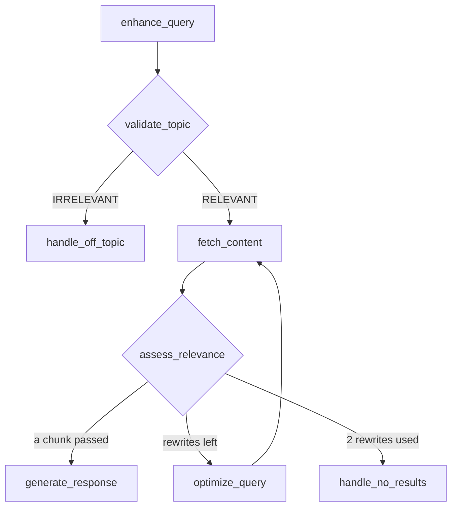

# M28.3 Theory: Guardrails, query optimisation and a retry loop

*[M28 theory](../README.md) · Lesson 28.3 · Notebooks: [`03a_advanced_rag_agent.ipynb`](../../../../course/p09_agentic_rag/m28_retrieval_grading_rewriting/notebooks/03a_advanced_rag_agent.ipynb) · [All theory pages](../../../README.md)*

## Topic guardrails

Notebook `03a` builds an eight-node support agent. Before it retrieves anything, it asks whether the question belongs to the assistant at all:

`generate_response`, `handle_off_topic` and `handle_no_results` each end the turn. The two handlers reply with fixed text and make no LLM call.

`validate_topic` is one structured-output call. Its schema is `TopicRelevance`, with `classification: Literal["RELEVANT", "IRRELEVANT"]` and `confidence: Literal["HIGH", "MEDIUM", "LOW"]`, and its system prompt lists what counts as on topic (the company's services, pricing, support procedures, company information) and what does not (general technology questions, other companies, weather and news). `route_by_topic` sends `RELEVANT` to retrieval and anything else to `handle_off_topic`, which replies with a list of what the assistant can help with.

The check has to run before retrieval because the grader cannot tell "off topic" from "not in the handbook". Both look like a retrieval where nothing passes, both spend the retry budget, and both end in the same no-results reply. The [lab](interactive/grade-rewrite-retry-lab.html) shows the difference on the Larkspur golden set with two rewrites allowed:

| Question | Topic check | Grader | Ends in | LLM calls |
|---|---|---|---|---|
| *Can I export my data after I cancel my plan?* | on topic | 2 of 2 pass on the first retrieval | answer | 4 |
| *Do you offer a student discount?* | on topic | 0 of 2 on each of 3 retrievals | no-results reply | 9 |
| *What's the weather like today?* | off topic | not reached | off-topic reply | 1 |
| *What's the weather like today?*, check off | none | 0 of 2 on each of 3 retrievals | no-results reply | 8 |

The guardrail and the grader catch different failures. The student-discount question is about pricing, so it passes the topic check; only the grader and the bound stop it.

The check costs one call on every question, on-topic ones included. Over the lab's five questions it saves 3 calls at two rewrites (31 with the check, 34 without), breaks even at one rewrite (24 and 24) and costs 3 at zero rewrites (14 and 11). It pays when off-topic traffic times the cost of a full retry loop is more than one call per question. It also changes what the customer reads: "I can help with pricing, refunds and servers" instead of "I couldn't find that in the handbook".

Three details in `03a` matter in production:

- **It classifies the enhanced query.** `enhance_user_query` runs first and folds the conversation history into a standalone question. A follow-up such as *What about annual plans?* names nothing the classifier can place; after enhancement it carries the refund question it follows.
- **Confidence is computed and ignored.** `route_by_topic` reads only `classification`, so a `LOW`-confidence `RELEVANT` goes to retrieval exactly like a `HIGH` one. Asking a clarifying question on low confidence needs a third branch in the router.
- **A false rejection is silent.** An on-topic question classified `IRRELEVANT` never reaches retrieval, so no grader and no retrieval log sees it. Track the off-topic rate and sample those replies.

## Bounded retries

Lesson 28.1's graph has no counter. `rewrite` feeds `agent`, `agent` calls the retriever, and the loop ends only when the grader says yes. When the handbook has no answer, LangGraph's recursion limit is the only stop. In the version this course pins (`langgraph` 1.2.18), the default `recursion_limit` is 10,007 steps. Run with stub nodes and a grader that always says no, the `01a` graph made 3,336 retrievals and 10,007 LLM calls before it raised `GraphRecursionError`. With `{"recursion_limit": 25}` in the config it stopped after 8 retrievals and 25 LLM calls.

`03a` bounds the loop in the state:

- `optimization_attempts` counts rewrites, and `enhance_user_query` resets it to 0 at the start of every turn, so the bound is per question, not per conversation.
- `route_by_document_quality` checks in order: any chunk passed, go to `generate_response`; 2 rewrites used, go to `handle_no_results`; otherwise go to `optimize_query`. A turn therefore makes at most 3 retrievals.
- `optimize_search_query` repeats the `>= 2` check and returns the state unchanged, a guard in case another edge ever reaches it.

The bound also caps the cost. With `03a`'s call pattern and `k = 2`, a question costs one call for the topic check, two grader calls per retrieval, one call per rewrite and one call for the answer if there is one. Answered on the first retrieval, that is 4. Never answered with two rewrites allowed, it is 1 + 6 + 2 = 9.

The [interactive lab](interactive/grade-rewrite-retry-lab.html) runs this loop on five Larkspur golden questions, with real TF-IDF retrieval over the M11 handbook chunks and the bound as its slider. Its totals for the golden set with the topic check on:

| Rewrites allowed | Answered | No-results reply | Off-topic reply | Retrievals | LLM calls |
|---|---|---|---|---|---|
| 0 | 1 | 3 | 1 | 4 | 14 |
| 1 | 2 | 2 | 1 | 7 | 24 |
| **2** | **3** | **1** | **1** | **9** | **31** |
| 3 | 3 | 1 | 1 | 10 | 34 |

Each step up the bound reaches one more question until 2, where the outage question is answered on its second rewrite. Going to 3 answers nothing new: the extra retrieval and three calls all go to the student-discount question, which the handbook cannot answer at any bound. Questions without an answer always pay the full bound, `1 + 2(m + 1) + m` calls for a bound of `m`, so the bound is set by how far the golden set's answered count keeps rising, and no further.

<!-- lab: interactive/grade-rewrite-retry-lab.html -->

Keep `recursion_limit` as a backstop even with a counter in the state. The counter bounds the loop you designed; the recursion limit bounds the one a later edit creates by accident.

## Two rewrites, two jobs

`03a` rewrites the query in two places, for different reasons:

| | `enhance_query` | `optimize_query` |
|---|---|---|
| Runs | Once per turn, before the topic check | After a retrieval where no chunk passed |
| Reads | The conversation history and the new question | The current query |
| Job | Make a follow-up standalone | Find words that retrieve better |
| On the first turn | Passes the question through, no LLM call | Same as any turn |

Each `optimize_query` call rewrites the previous rewrite, since it reads `enhanced_query` and writes the result back to it. Two rounds can drift from what the customer asked. `01a` rewrites `messages[0]`, the original question, every time.

A rewrite helps only if it moves toward the documents' words. In the lab, the outage question's first rewrite, *What happens when my server is unavailable?*, swaps one everyday phrase for another. TF-IDF matches exact tokens, so it retrieves `reboot` at 0.416 and `sizing` at 0.389 again, the same as the original. The second rewrite uses the handbook's vocabulary, "outage" and "availability", and retrieves `sla` at 0.470 and `incidents` at 0.253. M18 covers rewriting before retrieval as a stage of its own, including HyDE and multi-query.

## Check yourself

1. Why does the topic check run before retrieval instead of leaving off-topic questions to the document grader?

The grader cannot tell "off topic" from "not in the handbook": both look like a retrieval where nothing passes, both spend the retry budget and both end in the same no-results reply. In the lab the weather question costs 1 call with the check and 8 without.

2. With two rewrites allowed and two chunks per retrieval, how many LLM calls does a question the handbook cannot answer cost?

Nine: 1 for the topic check, 6 grader calls (2 per retrieval over 3 retrievals) and 2 rewrites, with no answer call. In general it is `1 + 2(m + 1) + m` for a bound of `m`, because unanswerable questions always pay the full bound.

3. Raising the bound from two rewrites to three costs three more calls on the golden set. What does it buy?

Nothing: the answered count stays at 3. The extra retrieval and calls all go to the student-discount question, which the handbook cannot answer at any bound. Set the bound where the golden set's answered count stops rising, and keep `recursion_limit` as a backstop.

---
*Previous: [28.1 Retriever as a tool; grade then rewrite in LangGraph](../01_retriever_as_a_tool_grade_then_rewrite_in_langgraph/README.md). Next: [M28 interview questions](../README.md#interview-spotlight-5-questions-you-might-get-asked).*
