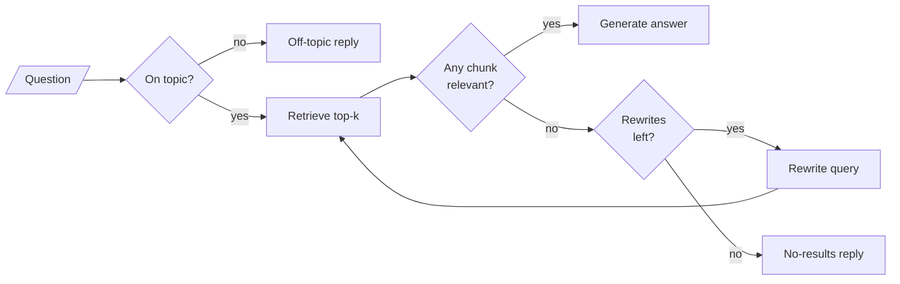

# M28 Theory: Grading and query rewriting

*Part IX · Agentic & Self-Correcting RAG · [Module README](../../../course/p09_agentic_rag/m28_retrieval_grading_rewriting/README.md) · [All theory pages](../../README.md)*

A plain RAG pipeline hands the model whatever the retriever returned. The smallest agentic step is to read what came back first, and to search again with a better query when it is wrong. The M28 notebooks build on four ideas: a grader that judges each retrieval, conditional edges that route on its verdict, a bound on how often the loop may retry, and a topic check that stops off-topic questions before retrieval. Each idea has a page in the folder of the lesson that teaches it, listed under [Lessons](#lessons). This page has the overview, the interview questions and the takeaways.

The notebooks run on a research paper (lesson 28.1) and a fictional company's support documents (lesson 28.3). These pages put the same graphs on the Larkspur Cloud handbook from M11: its twelve chunks, and five golden questions that each take a different path through the loop. *Can I export my data after I cancel my plan?* is answered on the first retrieval, *How long does a refund take?* after one rewrite, *What happens if my server goes down?* after two, *Do you offer a student discount?* has no answer in the handbook, and *What's the weather like today?* is off topic.

## TL;DR

- A document grader is an LLM call with structured output that reads retrieved text next to the question and says whether it helps answer it. A conditional edge turns that verdict into the next node: generate, or rewrite and retrieve again.
- A retriever returns `k` chunks for every query. In the lab, the student-discount question retrieves two chunks at 0.000, and a rewrite of it retrieves `support` at 0.503; neither says anything about discounts, and only the grader keeps them from the model.
- A rewrite loop without a counter runs until the grader says yes or LangGraph stops it. At the default recursion limit of the pinned `langgraph` 1.2.18 (10,007 steps), a grader that always says no costs 3,336 retrievals.
- Lesson 28.3's graph allows 2 rewrites per question. On the five golden questions, that bound answers 3 at 31 LLM calls; a bound of 3 answers the same 3 at 34.
- A topic check before retrieval costs one call per question and stops off-topic ones early: the weather question costs 1 call instead of 8, and gets an off-topic reply instead of "not found".

## Mental model

<!-- animated: diagrams/retry-loop.anim.html -->

Every self-correcting design in Part IX is this loop with more branches. The grader decides whether the loop runs again, and the counter decides when it must stop. Without the grader the model answers from whatever came back; without the counter an unanswerable question never ends.

## Lessons

| Lesson | Topic | Theory |
|---|---|---|
| 28.1 | Retriever as a tool; grade then rewrite in LangGraph | [Conditional edges](01_retriever_as_a_tool_grade_then_rewrite_in_langgraph/README.md#conditional-edges) [Document grader](01_retriever_as_a_tool_grade_then_rewrite_in_langgraph/README.md#document-grader) |
| 28.2 | The same agent on Databricks Vector Search | *planned* |
| 28.3 | Guardrails, query optimisation and a retry loop | [Topic guardrails](03_guardrails_query_optimisation_and_a_retry_loop/README.md#topic-guardrails) [Bounded retries](03_guardrails_query_optimisation_and_a_retry_loop/README.md#bounded-retries) [Two rewrites, two jobs](03_guardrails_query_optimisation_and_a_retry_loop/README.md#two-rewrites-two-jobs) |

## Interactive lab

[**Grade, rewrite, retry**](03_guardrails_query_optimisation_and_a_retry_loop/interactive/grade-rewrite-retry-lab.html): open the file in a browser. Pick *What happens if my server goes down?* and lower the bound from 2 to 1: the evidence is one rewrite out of reach. Pick *Do you offer a student discount?* and raise the bound to 3: three more calls and no answer. Then switch the topic check off and pick the weather question.

## How it connects

- **Before:** [M11](../../p04_rag_foundations/m11_rag_lifecycle/README.md) supplies the handbook, the golden set and the baseline this loop is measured against. M09 builds LangGraph state and conditional edges, M10 adds checkpointers and bounded loops, [M23](../../p08_agent_foundations/m23_agent_loop_and_tools/README.md) binds tools to a model, and M18 rewrites queries before retrieval.
- **Next:** [M29](../m29_crag_and_self_rag/README.md) adds a web-search fallback when the grade fails (CRAG) and checks the answer itself (Self-RAG). M30 routes each question to a knowledge base or the web before retrieving, M31 hands the whole RAG pipeline to an agent as one tool, and M32 detects unsupported answers and learns from user feedback.

## Interview Spotlight: 5 Questions You Might Get Asked

*Production questions in the style of OpenAI, Anthropic and Google interviews for applied AI roles.*

### 1. A week after the Larkspur handbook moved to a new document system, the support assistant's LLM bill doubled while traffic stayed flat. Traces show most questions now making three retrievals. What happened, and what do you check first?

**What a strong answer covers:**
- Reads the path log: the share of questions that use rewrites and end in the no-results reply rose, so retrieval or grading changed, not traffic
- Re-runs the golden set and prints retrieved chunks for a failing question: if the right chunk is missing, the migration broke loading, chunking or the index; if it is present and graded no, the grader or its prompt changed
- Explains why cost doubled: with a bound of 2 and `k = 2`, every failed question pays 9 calls instead of 4
- Adds an alert on the no-results rate and rewrites per question, so the next regression shows up the same day

### 2. Your retriever moves to `k = 8` for better recall. The grader currently reads all eight chunks as one block and answers yes or no. Do you switch to grading each chunk?

**What a strong answer covers:**
- One block grade lets a single relevant chunk carry seven irrelevant ones into the prompt; per-chunk grading filters them out
- Per-chunk grading costs `k` calls per retrieval, 8 instead of 1, and multiplies with every retry
- Mitigations: run the grades in parallel, put the grader on a small fast model, or ask for a list of per-chunk verdicts in one structured-output call
- Measures both on the golden set: answer faithfulness, tokens sent to the model, latency and cost per question

### 3. How do you know the grader is grading correctly in production?

**What a strong answer covers:**
- Labels a sample of (question, chunk) pairs by hand and measures the grader's precision and recall against them
- Names both errors: a false yes sends a non-answer to the model (`refund-window` for "how long does a refund take?"); a false no burns a rewrite and can end in "not found" for a question the handbook answers
- Logs the verdict and its reasoning field per chunk, since a grader on a routing edge leaves no trace in the state
- Re-checks after every change to the grader's model or prompt, and when a new document type enters the index

### 4. A customer asks about refunds, then sends "What about annual plans?" and gets the off-topic reply. What went wrong?

**What a strong answer covers:**
- The topic check saw the follow-up alone; it should classify the enhanced query, after the history is folded in
- Checks that the history was there: the conversation is checkpointed per `thread_id`, and a new thread starts empty
- Uses the confidence field the classifier already returns: route low confidence to a clarifying question instead of a refusal
- Adds follow-up questions to the golden set and tracks the off-topic rate, since a false rejection never reaches retrieval logs

### 5. A product manager asks to raise the retry bound from 2 to 5 "so more questions get answered". How do you respond?

**What a strong answer covers:**
- Plots answered questions against the bound on the golden set: in the lab, going from 2 to 3 answers nothing new and adds 3 calls
- Points out who pays: questions with no answer in the handbook always use the full bound, `1 + 2(m + 1) + m` calls at `k = 2`
- Looks at the questions still unanswered: a rewrite cannot find content that is not indexed, so the fix is the handbook, or better rewriting toward its vocabulary
- Keeps LangGraph's `recursion_limit` as a backstop under the counter, since a later edit can add a loop the counter does not see

## Key Takeaways

- Grade retrieved text against the question before the model reads it. A similarity score measures shared words; only reading the chunk tells you whether it answers.
- Put the verdict in the state and route on it with a conditional edge, so every path the graph takes can be logged and explained.
- Bound every retry loop with a counter in the state that resets each turn, and set the bound where the golden set stops gaining answers.
- Check the topic before retrieval when off-topic traffic is real, and watch the no-results rate it leaves behind: those questions are gaps in the handbook.

---
*Previous: [M27 Human approval and applied single-agent builds](../../p08_agent_foundations/m27_human_approval_applied_agents/README.md). Next: [M29 Self-correcting RAG: CRAG and Self-RAG](../m29_crag_and_self_rag/README.md).*
