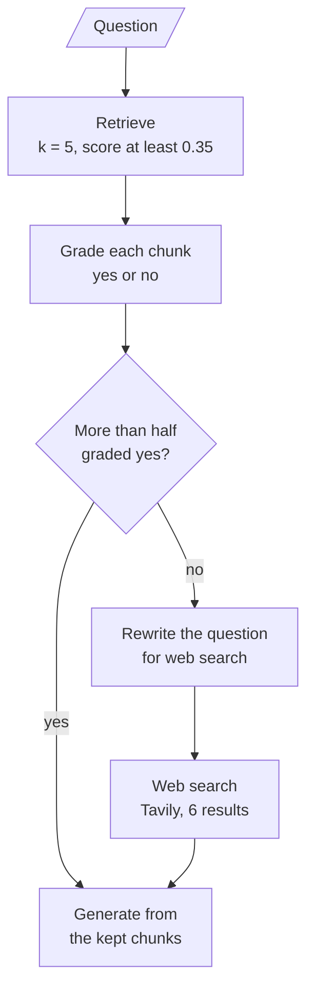

# M29.1 Theory: Corrective RAG in LangGraph with web-search fallback

*[M29 theory](../README.md) · Lesson 29.1 · Notebooks: [`01a_agentic_corrective_rag_langgraph.ipynb`](../../../../course/p09_agentic_rag/m29_crag_and_self_rag/notebooks/01a_agentic_corrective_rag_langgraph.ipynb), [`01b_crag_rag_techniques.ipynb`](../../../../course/p09_agentic_rag/m29_crag_and_self_rag/optional/01b_crag_rag_techniques.ipynb) (optional) · [All theory pages](../../../README.md)*

## Retrieval evaluator

Corrective RAG (Yan et al., *Corrective Retrieval Augmented Generation*, 2024, [arXiv:2401.15884](https://arxiv.org/abs/2401.15884)) adds one component to the baseline: a retrieval evaluator that judges the retrieved documents before the model sees them. Its verdict picks what happens next. If retrieval looks right, generate from it; if it looks wrong, find other context; if it is unclear, use both. The paper trains a small model (T5-large) as the evaluator. Both M29 notebooks prompt an LLM instead.

That is the graph notebook 01a builds in LangGraph, with nodes `retrieve`, `grade_documents`, `rewrite_query`, `web_search` and `generate_answer`. The two notebooks build the evaluator differently:

| | 01a, LangGraph | 01b, plain functions (optional) |
|---|---|---|
| Retriever | Chroma, `k = 5`, `similarity_score_threshold` 0.35 | FAISS, `k = 3` |
| Evaluator output | `binary_score`, yes or no per chunk (`gpt-4o`, temperature 0) | `relevance_score`, 0 to 1 per chunk (`gpt-4o-mini`) |
| Decision | Relevant fraction above 0.5: generate. At 0.5 or below, or nothing retrieved: rewrite and search the web | Best score above 0.7: Correct, use that document. Below 0.3: Incorrect, search the web. Otherwise Ambiguous: refine the document and add web results |
| Web search | Tavily, `max_results=6`, `search_depth='advanced'`, full page text | DuckDuckGo results, refined to bullet points |
| LLM calls | one per retrieved chunk, plus a rewrite on the fallback, plus generation | one per retrieved chunk, plus rewrite and refinement on the fallback, plus generation |

Three behaviours follow from 01a's rule, and the [M29 lab](../03_trade_offs_when_correction_is_worth_the_extra_calls/interactive/correction-cost-lab.html) shows each on the Larkspur handbook. Its grader is a stand-in that agrees with the golden labels, so these are routing effects, not grader mistakes.

- **The threshold is a fraction, so it moves with `k`.** Every golden question has two evidence chunks. A perfect grader keeps two, and 2 of `k` is more than half only when `k` is 3 or less. On *Can I export my data after I cancel my plan?* CRAG answers in 4 calls at `k = 3`. At `k = 5` it keeps both evidence chunks, still falls back, and spends 7 calls plus a web search.
- **It grades chunks, not answers.** At `k = 1` the export question retrieves only `retention`. One relevant chunk out of one passes the rule, and CRAG answers in 2 calls without the `export` chunk, which says how to export.
- **A correct verdict can trigger the wrong fix.** For *What happens if my server goes down?* TF-IDF returns `reboot`, `sizing` and `export`, and the grader rightly rejects all three. CRAG then searches the web for a private handbook's outage policy. The answer was in the corpus all along, under the words "outage" and "availability"; a rewrite and retry against the index (M18, M28) would have found it.

The web fallback suits a corpus of public facts that go stale, such as the research papers in 01a. For a private handbook, replace it or guard it: retry inside the index, then refuse.

## Knowledge refinement

Retrieval returns whole chunks, and a chunk can mix the sentence that answers the question with sentences that do not. Knowledge refinement cuts the context down to the useful parts before generation. The CRAG paper does it with decompose-then-recompose: split each document into short strips, score every strip with the evaluator, drop the low scorers and join the rest.

Notebook 01b uses a simpler version. `knowledge_refinement` sends a document to the LLM with the prompt "Extract the key information from the following document in bullet points" and returns the bullets as a list. Where it runs depends on the action:

| Action | Best score | Context sent to the generator |
|---|---|---|
| Correct | above 0.7 | the best retrieved document, as is |
| Incorrect | below 0.3 | refined bullets from the web results |
| Ambiguous | 0.3 to 0.7 | refined bullets from the best document, plus refined web results |

Notebook 01a has no refinement step. It filters at chunk level, keeping only chunks graded yes, and passes the web pages in full (`include_raw_content=True`), so a fallback can put six whole pages into the prompt.

On the Larkspur export question at `k = 3`, the retriever returns `retention`, `export` and `cancel`. Chunk-level filtering keeps the first two whole. Strip-level refinement would go one step further. As an illustration (written by hand, not notebook output):

| Strip | Keep? |
|---|---|
| `retention`: After a plan is cancelled, its data is kept for 30 days and then permanently deleted. | yes, it answers "after I cancel" |
| `retention`: Export it before that window closes. | yes |
| `export`: Export your data at any time from Settings, then Data. | yes, it says how |
| `export`: Exports include databases, object storage and server snapshots. | borderline, it answers a different question |
| `cancel`: You can cancel any plan from the Billing page. | no |

Refinement costs one more LLM call per document it rewrites, and an LLM that rewrites evidence can also change it. Keep the original chunk id beside each bullet so the answer can still cite the source.

## Key Takeaways

- CRAG grades the retrieved chunks before generation and falls back to a rewritten web search when too few pass. It grades chunks, not answers, so a passing set can still miss the evidence.
- A web fallback suits public facts that go stale. For a private handbook, replace it with a retry inside the index and then a refusal, because the web cannot see your documents.
- Knowledge refinement cuts chunks down to the parts that answer the question before generation. An LLM that rewrites evidence can also change it, so carry the source chunk id with every bullet.

## Check yourself

1. Why does the LangGraph CRAG notebook fall back to web search more often as k grows, even with a perfect grader?

Its rule is a fraction: generate only when more than half of the retrieved chunks are graded relevant. Every golden question has two evidence chunks, and 2 of `k` is more than half only when `k` is 3 or less. At `k = 5` the export question keeps both evidence chunks and still falls back, spending 7 calls plus a web search instead of 4.

2. On the outage question, retrieval returns the reboot, sizing and export chunks, and the grader rightly rejects all three. What does CRAG do next, and what should it have done?

It searches the web for a private handbook's outage policy, which the web cannot see. The answer was in the corpus all along, under the words "outage" and "availability". A rewrite and retry against the index (M18, M28) would have found it, so for a private handbook, retry inside the index and then refuse.

3. You add knowledge refinement that rewrites each retrieved document into bullet points. What does it cost, and how do you keep answers citable?

It costs one more LLM call per document it rewrites, and an LLM that rewrites evidence can also change it. Keep the original chunk id beside each bullet so the answer can still cite its source.

---
*Previous: [M29 overview](../README.md). Next: [29.2 Self-RAG: retrieve-or-not, relevance, groundedness, utility](../02_self_rag_retrieve_or_not_relevance_groundedness_utility/README.md).*
