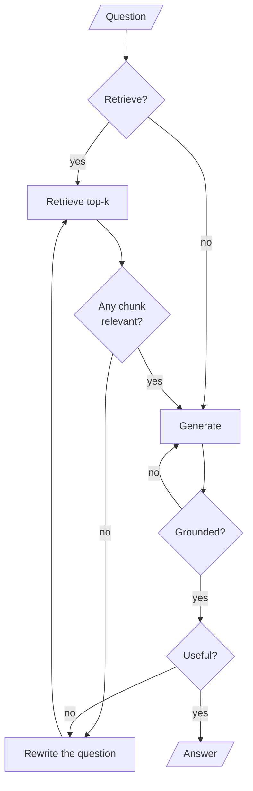

# M29.2 Theory: Self-RAG: retrieve-or-not, relevance, groundedness, utility

*[M29 theory](../README.md) · Lesson 29.2 · Notebooks: [`02a_self_rag_langgraph.ipynb`](../../../../course/p09_agentic_rag/m29_crag_and_self_rag/notebooks/02a_self_rag_langgraph.ipynb), [`02b_self_rag_rag_techniques.ipynb`](../../../../course/p09_agentic_rag/m29_crag_and_self_rag/optional/02b_self_rag_rag_techniques.ipynb) (optional) · [All theory pages](../../../README.md)*

## Reflection tokens

Self-RAG (Asai et al., *Self-RAG: Learning to Retrieve, Generate, and Critique through Self-Reflection*, [arXiv:2310.11511](https://arxiv.org/abs/2310.11511)) trains one model to emit special tokens that judge its own pipeline. The paper calls them reflection tokens, and there are four kinds:

| Token | Question it answers | Values in the paper | 02a (LangGraph) | 02b (optional) |
|---|---|---|---|---|
| Retrieve | Do I need documents for this? | yes, no, continue | `RetrieveDecision.need_retrieval`: yes or no | `RetrievalResponse`: Yes or No |
| ISREL | Is this passage relevant? | relevant, irrelevant | `RelevanceGrade.binary_score`, per chunk | `RelevanceResponse`: Relevant or Irrelevant |
| ISSUP | Is the answer supported by the passage? | fully, partially, no support | `GroundednessGrade.binary_score` plus `feedback` | `SupportResponse`: Fully supported, Partially supported or No support |
| ISUSE | Is the answer useful for the question? | a score from 1 to 5 | `UtilityGrade.binary_score` plus `feedback` | `UtilityResponse`: an integer from 1 to 5 |

In the paper the tokens are part of the model's vocabulary and come out of the same decoding pass as the answer. Neither notebook trains a model. Each judgment is a separate LLM call with a structured-output schema, so "reflection token" here means "one more call that returns a label".

Notebook 02a wires each judgment to its own conditional edge:

<!-- animated: diagrams/self-rag-loop.anim.html -->

Two loops go back to retrieval (no relevant chunk, or an answer that misses the question) and one goes back to generation (an unsupported answer). `max_iterations = 2` bounds the rewrite loops: after two rewrites, `route_after_relevance_grading` sends the question to `generate` even with no relevant chunk, and `route_after_utility` ends the run.

The first token is the one CRAG lacks. *What is 9 plus 10?* gets `need_retrieval = 'no'` in 02a and skips the vector store. Every Larkspur question is about the handbook, so on this corpus the Retrieve token saves nothing and costs one call.

The loops make the cost depend on the question. On *How much does the starter plan cost per month?* at `k = 5`, no chunk is ever relevant, and the [M29 lab](../03_trade_offs_when_correction_is_worth_the_extra_calls/interactive/correction-cost-lab.html) counts 20 LLM calls: 1 retrieve decision, 15 relevance grades over three passes, 2 rewrites, 1 generation and 1 utility grade. On the export question the same graph stops after one pass in 9 calls.

## Groundedness check

The groundedness check is the hallucination guard. In 02a, `grade_groundedness` sends the context and the answer to a "strict fact-checker" prompt; the schema returns `binary_score`, yes only if every claim is supported, and a `feedback` string naming the unsupported claims. On a no, the router sends the run back to `generate`, and the feedback goes into the prompt as "a previous attempt at this answer was rejected for this reason". Groundedness and utility are separate checks because they fail separately: an answer can be fully supported by the chunks and still miss the question.

Two details in 02a decide what the check catches.

**With no documents it passes without running.** If `documents` is empty, `grade_groundedness` returns `"yes"` and makes no call. That is exactly the out-of-corpus case: on the starter-plan question, Self-RAG exhausts its rewrites, generates with no context, and the check waves the answer through. The only guard left is the generation prompt's line "If the context does not contain enough information to answer confidently, say so plainly". Notebook 02b is weaker still. When no chunk is relevant it generates with the context "No relevant context found." and a prompt that asks only to "generate a response", so the model answers from memory; its own low-relevance test asks a climate-change corpus *how did harry beat quirrell?*

**The cap does not bound the regenerate loop.** `route_after_groundedness` writes `state["iteration"] = iteration + 1` inside the routing function. LangGraph keeps only what nodes return, so that write is lost and the counter never moves. Run against the notebook's own node and router code with a groundedness grader that always says no, the compiled graph (langgraph 1.2.18) regenerated until LangGraph raised `GraphRecursionError`: with `recursion_limit = 200`, that was 98 regenerations and 200 LLM calls. With the default config it ran to the limit that release reports, 10,007 steps. The fix is to count in a node: have `generate` return the new `iteration` when it is regenerating, or add a small `regenerate` node before it.

The paper's three support levels are worth keeping when you build this yourself. 02b ranks candidate answers by "fully supported" first and utility second (`max(responses, key=lambda x: (x[1] == 'fully supported', x[2]))`), which a yes or no grade cannot do.

---
*Previous: [29.1 Corrective RAG in LangGraph with web-search fallback](../01_corrective_rag_in_langgraph_with_web_search_fallback/README.md). Next: [29.3 Trade-offs: when correction is worth the extra calls](../03_trade_offs_when_correction_is_worth_the_extra_calls/README.md).*
