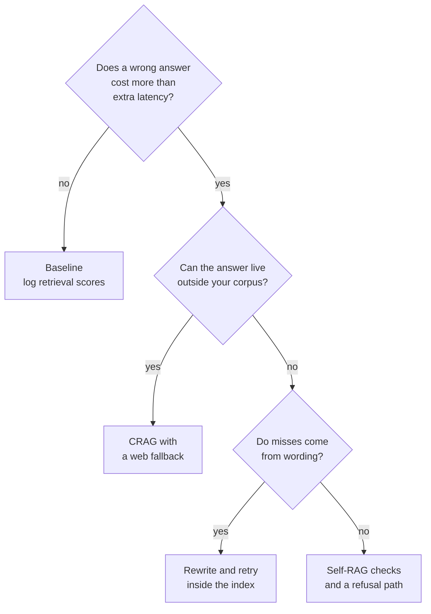

# M29.3 Theory: Trade-offs: when correction is worth the extra calls

*[M29 theory](../README.md) · Lesson 29.3 · [All theory pages](../../../README.md)*

## Cost per question

Every check in CRAG and Self-RAG is an LLM call, and every failed check sends the question round again. The calls are easy to count from the notebook graphs:

| Pipeline | LLM calls per question |
|---|---|
| Baseline | 1: generate |
| CRAG (01a) | one grade per retrieved chunk, plus 1 rewrite if it falls back, plus 1 generation; the web search is a tool call on top |
| Self-RAG (02a) | 1 retrieve decision, one grade per retrieved chunk on every pass, 1 rewrite per extra pass, and per generation 1 call, 1 groundedness grade (skipped with no documents) and 1 utility grade |

The [interactive lab](interactive/correction-cost-lab.html) runs those graphs on the M11 handbook with TF-IDF retrieval and stand-in graders: relevance agrees with the golden labels, groundedness says yes, utility says yes only when every evidence chunk reached the generator, and a rewrite repeats the question. The last rule makes the Self-RAG figures a worst case, since a real rewrite can find the evidence and end the loop early. Its counts, checked against the notebooks' own LangGraph code with the same stand-ins (50 runs, 0 mismatches):

| Question | Baseline | CRAG, `k = 3` | Self-RAG, `k = 3` | CRAG, `k = 5` | Self-RAG, `k = 5` |
|---|---|---|---|---|---|
| *Can I export my data after I cancel my plan?* | 1 | 4 | 7 | 7 + web | 9 |
| *How long does a refund take?* | 1 | 4 + web | 18 | 4 + web | 18 |
| *What happens if my server goes down?* | 1 | 5 + web | 14 | 5 + web | 14 |
| *Does Larkspur offer GPU servers?* (not in the handbook) | 1 | 5 + web | 14 | 5 + web | 14 |
| *How much does the starter plan cost per month?* (not in the handbook) | 1 | 5 + web | 14 | 7 + web | 20 |
| Mean | 1.0 | 4.6 | 13.4 | 5.6 | 15.0 |

<!-- lab: interactive/correction-cost-lab.html -->

Three patterns hold across the table:

- **Correction costs most where it helps least.** The two questions the handbook cannot answer are the expensive ones for Self-RAG, 14 to 20 calls, and they end with a generation that has no context to be grounded in. CRAG sends both to the web, which cannot see a private handbook.
- **Some misses no check can repair.** On the refund question, `refund-timing` shares no term with "How long does a refund take?", so it is never retrieved and never graded. Self-RAG's utility check sees the gap and spends 18 calls on three passes that return the same chunks. The fix is upstream, in retrieval (M14, M17) or in a rewrite that changes the words (M18).
- **On an easy question the checks are overhead.** At `k = 3` the export question is answered from both evidence chunks by all three pipelines; CRAG pays 4 calls and Self-RAG 7 for the same context the baseline read in 1.

The notebooks also make the calls one after another. `grade_documents` and `grade_relevance` loop over the chunks in Python, so `k` grades add `k` round trips of latency. Batching them (`doc_grader.batch(...)`) cuts the wait, not the bill.

## When correction pays

Correction earns its calls when a wrong answer costs more than the extra latency and tokens, and when the fix it reaches for can supply the missing evidence. A short chain of questions settles most cases:

For the Larkspur assistant that means:

- **Billing and refund questions** are worth a check, because a wrong refund window turns into a support ticket. A relevance grade per chunk and one groundedness check on the answer add `k + 1` calls.
- **The web fallback stays off.** Every Larkspur fact lives in the handbook. A question the handbook cannot answer should get a refusal and a handoff to support, not a search.
- **Retrieval misses are fixed in retrieval.** The outage question fails on wording; one rewrite against the index is cheaper than three Self-RAG passes or a web search.
- **Every loop gets a counter and a budget.** `max_iterations` caps the rewrite loops in 02a; the regenerate loop needs a counter updated in a node (lesson 29.2), and a per-request limit on LLM calls catches the next loop nobody bounded.

## Key Takeaways

- Count the calls before adding correction. On the lab's golden set at `k = 3`, the mean was 1 call for the baseline, 4.6 for CRAG and 13.4 for Self-RAG.
- No check repairs a chunk that retrieval never returns, and questions the corpus cannot answer cost the most. Fix wording misses upstream, with better retrieval or a rewrite against the index.
- Add correction where a wrong answer costs more than the extra latency, such as refund questions. Keep the web fallback off for a private corpus, and give every loop a counter and a per-request call budget.

## Check yourself

1. Why does correction cost the most on the questions where it helps the least?

The two questions the handbook cannot answer are the most expensive for Self-RAG, 14 to 20 calls, and they still end with a generation that has no context to be grounded in. CRAG sends both to the web, which cannot see a private handbook. The checks spend their budget looking for evidence that does not exist.

2. At k equal to 3, all three pipelines answer the export question from both evidence chunks. How many LLM calls does each one pay?

The baseline pays 1, CRAG 4 and Self-RAG 7, all for the same context. On an easy question the checks are pure overhead.

3. Self-RAG spends 18 calls on the refund question and never retrieves the refund-timing chunk. Where should the fix go?

Upstream, in retrieval. `refund-timing` shares no term with "How long does a refund take?", so it is never retrieved and never graded, and three passes return the same chunks. Fix it with better retrieval (M14, M17) or a rewrite that changes the words (M18), not with more checks.

---
*Previous: [29.2 Self-RAG: retrieve-or-not, relevance, groundedness, utility](../02_self_rag_retrieve_or_not_relevance_groundedness_utility/README.md). Next: [M29 interview questions](../README.md#interview-spotlight-5-questions-you-might-get-asked).*
