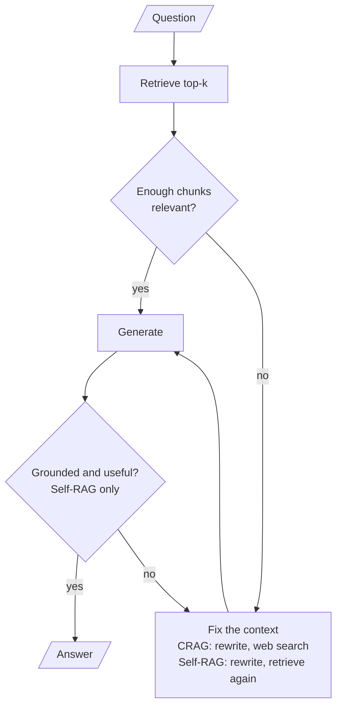

# M29 Theory: Self-correcting RAG: CRAG and Self-RAG

*Part IX · Agentic & Self-Correcting RAG · [Module README](../../../course/p09_agentic_rag/m29_crag_and_self_rag/README.md) · [All theory pages](../../README.md)*

A plain RAG pipeline generates from whatever the retriever returns. Corrective RAG (CRAG) grades the retrieved chunks first and finds other context when they fail. Self-RAG asks the model to judge each step, from whether to retrieve at all to whether its answer is supported and useful. The M29 notebooks build on four ideas: a retrieval evaluator, knowledge refinement, reflection tokens and a groundedness check. Each idea has a page in the folder of the lesson that teaches it, listed under [Lessons](#lessons). This page has the overview, the interview questions and the takeaways.

The running example is the twelve-chunk Larkspur Cloud handbook from M11 and its three golden questions, plus two questions the handbook cannot answer: *Does Larkspur offer GPU servers?* and *How much does the starter plan cost per month?* The handbook is private, so a web search cannot answer for it. That makes it a fair stress test for a pipeline whose fallback is the web.

## TL;DR

- CRAG puts a **retrieval evaluator** between retrieval and generation. In notebook 01a it grades each chunk yes or no and searches the web when half or fewer pass; in 01b it scores each chunk from 0 to 1 and picks Correct (above 0.7), Incorrect (below 0.3) or Ambiguous.
- **Knowledge refinement** cuts the context down to the parts that answer the question before generation. 01b does it with an LLM call that turns a document into bullet points.
- Self-RAG makes four judgments, the **reflection tokens** of the paper: retrieve or not, is this chunk relevant, is the answer supported, is it useful. Notebook 02a asks an LLM for each one and caps the retry loops at `max_iterations = 2`.
- The **groundedness check** is the hallucination guard, and in 02a it has two holes: it passes without a call when there are no documents, and its regenerate loop ignores the iteration cap.
- Correction is paid in LLM calls. In the lab at `k = 5`, the baseline makes 1 call per question, CRAG 5.6 on average and Self-RAG 15.0, up to 20 on a question the handbook cannot answer.

## Mental model

<!-- animated: diagrams/correction-points.anim.html -->

There are two places to catch a bad answer. CRAG checks the context before generation; Self-RAG also checks the answer after it. Each check is an LLM call, and each failed check sends the question round again, so the price of correction is set by how often the checks fail.

## Lessons

| Lesson | Topic | Theory |
|---|---|---|
| 29.1 | Corrective RAG in LangGraph with web-search fallback | [Retrieval evaluator](01_corrective_rag_in_langgraph_with_web_search_fallback/README.md#retrieval-evaluator) [Knowledge refinement](01_corrective_rag_in_langgraph_with_web_search_fallback/README.md#knowledge-refinement) |
| 29.2 | Self-RAG: retrieve-or-not, relevance, groundedness, utility | [Reflection tokens](02_self_rag_retrieve_or_not_relevance_groundedness_utility/README.md#reflection-tokens) [Groundedness check](02_self_rag_retrieve_or_not_relevance_groundedness_utility/README.md#groundedness-check) |
| 29.3 | Trade-offs: when correction is worth the extra calls | [Cost per question](03_trade_offs_when_correction_is_worth_the_extra_calls/README.md#cost-per-question) [When correction pays](03_trade_offs_when_correction_is_worth_the_extra_calls/README.md#when-correction-pays) |

## Interactive lab

[**What correction costs**](03_trade_offs_when_correction_is_worth_the_extra_calls/interactive/correction-cost-lab.html): open the file in a browser. Pick *Can I export my data after I cancel my plan?* and move `k` from 3 to 4: CRAG still keeps both evidence chunks, yet it now searches the web, because 2 of 4 is not more than half. Then pick *How much does the starter plan cost per month?* at `k = 5` and read the Self-RAG row: three retrieval passes, 20 LLM calls, and a final generation with no context that the groundedness check never examines.

## How it connects

- **Before:** [M11](../../p04_rag_foundations/m11_rag_lifecycle/README.md) supplies the handbook, the golden questions and the baseline these pipelines are compared against. [M18](../../p06_retrieval_quality/m18_query_transformation/README.md) teaches query rewriting, and [M28](../m28_retrieval_grading_rewriting/README.md) the relevance grader and bounded retry loop that CRAG and Self-RAG both reuse. [M26](../../p08_agent_foundations/m26_planning_reflection_reasoning/README.md) covers reflection as a general agent pattern.
- **Next:** [M30](../m30_adaptive_rag_routing/README.md) routes the question before retrieval and adds a hallucination grader of its own. [M32](../m32_reliability_feedback/README.md) turns these checks into feedback loops, and M45 weighs CRAG and Self-RAG against the other agentic RAG designs.

## Interview Spotlight: 5 Questions You Might Get Asked

*Production questions of the kind asked in applied AI engineering interviews.*

### 1. Larkspur's support assistant runs CRAG with a web fallback. A customer asks what happens when their server goes down, and the assistant quotes another provider's availability guarantee. The handbook has the right answer. What went wrong, and what do you change?

**What a strong answer covers:**
- Reads the trace first: which chunks came back, how each was graded, and whether the web branch fired. In the lab, TF-IDF retrieves `reboot`, `sizing` and `export` for this question, the grader correctly rejects all three, and CRAG goes to the web
- Names the two faults: a retrieval miss on wording ("server goes down" against "outage" and "availability"), and a fallback that searches a source which cannot know a private handbook
- Fixes retrieval inside the corpus first: a rewrite-and-retry against the index (M28), hybrid or embedding search (M17, M14)
- Restricts the web branch to questions about public facts, or replaces it with a refusal that says the handbook does not cover the question

### 2. Product wants Self-RAG on every Larkspur question "to stop hallucinations". The assistant already carries most of Larkspur's support traffic. How do you decide?

**What a strong answer covers:**
- Counts calls before arguing: in the lab at `k = 5` Self-RAG averages 15.0 LLM calls per question against 1 for the baseline, and the easy export question still costs 9
- Notes that 02a grades chunks one at a time in a loop, so calls add latency in series unless they are batched
- Proposes tiering: the baseline with a cheap check for most traffic, the full loop for high-stakes intents such as billing and refunds
- Measures on the golden set whether the extra calls change answers, and keeps the loop only where they do

### 3. CRAG has been live for a month. How do you tell whether the retrieval evaluator is helping or just adding cost?

**What a strong answer covers:**
- Logs the route for every request: chunks graded, chunks kept, relevant fraction, web fallback yes or no
- Tracks the web fallback rate by question type; a rate that jumps after an index change points at retrieval, not at the questions
- Samples cases where the grader kept everything and cases where it kept nothing, and grades them by hand to measure the grader's own precision and recall
- Watches for the threshold coupling with `k`: in the lab the export question falls back to the web at `k = 4` and `k = 5` with both evidence chunks kept

### 4. Someone asks the Self-RAG assistant "How much does the starter plan cost per month?" The handbook lists no prices. The groundedness check passed, yet the answer contains a price. How?

**What a strong answer covers:**
- Traces the loop: no chunk is relevant, so 02a rewrites and retrieves until the cap, then generates with no documents
- Points at `grade_groundedness`: with no documents it returns "yes" without calling the grader, so the check never ran
- Notes the only remaining guard is the generation prompt's instruction to say so when the context is missing; 02b drops even that and answers from the model's memory
- Fixes it by routing "no relevant documents after the cap" to a fixed refusal, and by adding out-of-corpus questions to the golden set

### 5. A cost dashboard shows one Self-RAG request that made about 200 LLM calls before it failed with a recursion error. The iteration cap is 2. Where do you look?

**What a strong answer covers:**
- Suspects a loop that does not move the counter, and reads the routers
- Finds it in 02a's `route_after_groundedness`, which writes `state["iteration"]` inside a routing function; LangGraph keeps only what nodes return, so the counter never moves and the regenerate loop runs until the recursion limit
- Moves the increment into a node (for example, `generate` returns the new iteration when it regenerates) and adds a test with a grader that always says "no"
- Sets an explicit `recursion_limit` and a per-request call budget as a second guard

## Key Takeaways

- Grade the context before you generate from it, and log the grade: the route a request took is the first thing to read when an answer is wrong.
- Pick the fallback by where the answer can live. A web search cannot answer for a private handbook; rewrite and retry against your own index first, and refuse when the corpus has nothing.
- A groundedness check guards only the cases it runs on. Make "no documents" a refusal, never an automatic pass.
- Count LLM calls per question on your golden set before you ship a correction loop, and bound every loop with a counter that a node, not a router, updates.

---
*Previous: [M28 Agentic RAG foundations: grading and query rewriting](../m28_retrieval_grading_rewriting/README.md). Next: [M30 Adaptive RAG and query routing](../m30_adaptive_rag_routing/README.md).*
