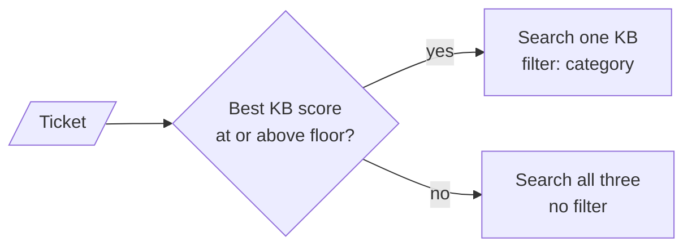

# M30.1 Theory: Router agentic RAG over multiple knowledge bases

*[M30 theory](../README.md) · Lesson 30.1 · Notebooks: [`01a_router_agentic_rag.ipynb`](../../../../course/p09_agentic_rag/m30_adaptive_rag_routing/notebooks/01a_router_agentic_rag.ipynb), [`01b_router_agentic_rag_modular.ipynb`](../../../../course/p09_agentic_rag/m30_adaptive_rag_routing/optional/01b_router_agentic_rag_modular.ipynb) (optional) · [All theory pages](../../../README.md)*

## Query classification

A router is a classifier whose output decides where a question goes. In 01a, `categorize_inquiry` fills the `route_category` prompt from `prompts.yaml` and calls the LLM with `with_structured_output(QueryCategory)`, where

```python
class QueryCategory(BaseModel):
    categorized_topic: Literal['Technical', 'Billing', 'General']
```

The `Literal` closes the label set. The parsed output can only be one of three strings, so `determine_route` can compare against them with no defensive parsing. The prompt gives each label a one-line definition ("Billing queries will focus more on payment and purchase related aspects"). Those definitions are the router's whole specification: a ticket that fits two of them gets whichever label the model leans toward that day.

Every notebook in M30 puts a classifier of this kind in front of something:

| Notebook | Labels | Output field | What the label decides |
|---|---|---|---|
| 01a | Technical, Billing, General | `Literal` | Which knowledge base filter to apply |
| 01a | Positive, Neutral, Negative | `Literal` | Escalate to a human or answer |
| 02a | Billing, Appointments, Records, Insurance | `Literal` | Which department's documents to search |
| 02a | Positive, Neutral, Negative, Distress | `Literal` | Human support, on-call team or answer |
| 03a | vectordb, web_search | `Literal` | Vector store or web search |
| 04a | Factual, Analytical, Opinion, Contextual | `str` | Which retrieval strategy runs |

The last row shows why the schema matters. The 04a classifier's field is a plain `str`, and its result indexes a dictionary of four strategies. If the model writes `factual` or `Factual query`, the lookup raises a `KeyError`. With a `Literal`, the structured-output parser rejects the value instead.

01a classifies category and sentiment in two sequential LLM calls. One call with a two-field schema would halve the classification cost; two prompts are easier to evaluate and change separately. Either way, keep the labels you route on in the schema, never in free text you parse afterwards.

An LLM classifier is one of two ways to route. M18 calls it logical routing; the other, semantic routing, compares the question with example text for each route and takes the closest. The lab below uses the semantic kind with TF-IDF, because it runs in the browser and its scores can be checked exactly.

## Multi-KB routing

01a builds one Chroma collection, `knowledge_base`, with cosine distance (`collection_metadata={"hnsw:space": "cosine"}`). Each document carries a `category` field in its metadata. The retriever returns at most three chunks scoring 0.2 or more (`search_type="similarity_score_threshold"`, `k=3`, `score_threshold=0.2`). The knowledge bases are separate only through the filter: before retrieving, a response node sets `search_kwargs["filter"] = {"category": category}`. 02a notes the other design, one vector store per category.

Three details in 01a decide whether a route works:

- **The label and the stored value must match exactly.** The classifier returns `Technical`; the metadata says `technical`. Chroma compares metadata values exactly, so each response node lowercases the label before filtering. The notebook runs the refund question with the filters `general`, `General` and `technical` to show the difference; the last is what a misroute retrieves.
- **A misroute is silent.** Filtered to the wrong knowledge base, the retriever returns whatever clears 0.2 there, or nothing. With no chunks, the response prompt tells the model to reply "Apologies I was not able to answer your question". Nothing in the graph records that the route was wrong.
- **The filter is written onto a shared retriever.** `retrieve_knowledge_base_content` mutates `kbase_search.search_kwargs`, so two requests served at once can overwrite each other's filter. Pass it per call instead: `kbase_search.invoke(query, filter={"category": category})`, which `VectorStoreRetriever` merges over its defaults.

The optional 01b notebook keeps the same graph and binds one `generate_support_response` to the three response nodes with `functools.partial`, so the three prompts become one `response_generation` template. Adding a fourth knowledge base then means a prompt entry, a node and a branch in `determine_route`.

The classifier in 01a must always answer, because its schema has no "unsure" label. A router that can abstain needs a confidence score and a rule for what happens below it:



The [interactive lab](interactive/kb-router-lab.html) runs this rule on eighteen Larkspur tickets. Each knowledge base is scored by its best chunk under TF-IDF (scikit-learn's weighting, the same index as the M11 lab), and the ticket goes to the highest. A fallback searches all three knowledge bases, so it always includes the right one but costs three searches instead of one. Its numbers:

| Floor | Misrouted | Fall back | Reach the right KB | Searches per ticket |
|---|---|---|---|---|
| 0.00 | 3 | 0 | 15 of 18 | 1.00 |
| 0.01 | 2 | 1 | 16 of 18 | 1.11 |
| 0.30 | 2 | 4 | 16 of 18 | 1.44 |
| 0.42 | 0 | 11 | 18 of 18 | 2.22 |

The three misroutes fail for different reasons:

- ***The dashboard keeps logging me out.*** shares no term with any chunk, so every knowledge base scores 0.000 and the always-route rule sends it to billing, the first in the list. Any floor above zero catches it, for 0.11 extra searches per ticket.
- ***How long do you keep my data after I cancel?*** goes to technical at 0.320, because "data" matches the export chunk. The retention chunk says "cancelled", not "cancel", and scores 0.184. A floor of 0.32 catches it, but by then three correctly routed tickets also fall back.
- ***My server went down for an hour. Will I be compensated?*** reduces to the single word "server" once stop words are removed ("down" is one of them), exactly like the correctly routed *How do I restart a server that stopped responding?*. Both score 0.416 for technical, so no floor can separate them. Catching it at 0.42 sends 8 correct tickets to the fallback with it.

<!-- lab: interactive/kb-router-lab.html -->

A floor removes the misroutes that have no signal, cheaply. Confident misroutes need a better classifier (embeddings, an LLM, or several example tickets per route) and a labelled routing set to find them, since the router's own score cannot.

## Key Takeaways

- Close the router's label set with a `Literal` in the schema so code never meets a value it cannot handle. The prompt's one-line label definitions are the router's whole specification.
- Map each label to its exact metadata value and pass the filter per call, not onto a shared retriever. A misroute leaves no trace, because the wrong knowledge base simply returns weaker chunks or none.
- A confidence floor with an all-KB fallback catches tickets that match nothing, in the lab for 0.11 extra searches per ticket. Confident misroutes need a better classifier and a labelled routing set.

## Check yourself

<details>
<summary>1. Why can the query-type classifier crash on a label such as factual, while the knowledge-base classifier never returns a label the code cannot handle?</summary>

The knowledge-base classifier's field is a `Literal['Technical', 'Billing', 'General']`, so the parsed output can only be one of those three strings. The query-type classifier's field is a plain `str` used to index a dictionary of strategies, so `factual` or `Factual query` raises a `KeyError`. With a `Literal`, the structured-output parser rejects the value instead.

</details>

<details>
<summary>2. The outage-compensation ticket scores 0.416 for technical, the same as a genuine restart ticket. Can a confidence floor catch this misroute?</summary>

Not without heavy cost. Once stop words are removed both tickets reduce to "server", so they score the same and no floor separates them; catching it at 0.42 sends 8 correct tickets to the fallback too. Confident misroutes need a better classifier and a labelled routing set, since the router's own score cannot find them.

</details>

<details>
<summary>3. Under load, two requests sometimes retrieve from each other's knowledge base. What in the notebook causes this, and what is the fix?</summary>

`retrieve_knowledge_base_content` writes the filter onto the shared retriever's `search_kwargs`, so concurrent requests overwrite each other's filter. Pass the filter per call instead, with `kbase_search.invoke(query, filter={"category": category})`, which `VectorStoreRetriever` merges over its defaults.

</details>

---
*Previous: [M30 overview](../README.md). Next: [30.2 Customer-facing routing with sentiment and human escalation](../02_customer_facing_routing_with_sentiment_and_human_escalation/README.md).*
