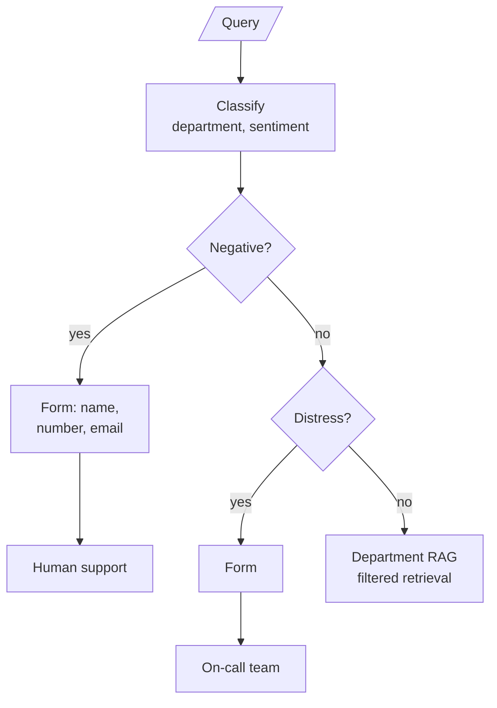

# M30.2 Theory: Customer-facing routing with sentiment and human escalation

*[M30 theory](../README.md) · Lesson 30.2 · Notebooks: [`02a_healthcare_router_agentic_rag.ipynb`](../../../../course/p09_agentic_rag/m30_adaptive_rag_routing/optional/02a_healthcare_router_agentic_rag.ipynb) (optional) · [All theory pages](../../../README.md)*

## Human-in-the-loop escalation

Some tickets should not be answered by retrieval at all. An angry customer wants a person; a customer in an emergency needs one now. Both router notebooks handle this by classifying sentiment as well as topic and checking sentiment first.

In 01a, `determine_route` reads:

```python
if support_state["query_sentiment"] == "Negative":
    return "escalate_to_human_agent"
elif support_state["query_category"] == "Technical":
    ...
```

The order is the policy. A negative billing ticket never reaches the billing knowledge base, however well the router would have classified it. 01a's `escalate_to_human_agent` returns a fixed apology and notifies nobody; it marks where a real handoff goes.

The healthcare notebook, 02a, builds that handoff for a clinic's support desk. It routes four departments (Billing, Appointments, Records, Insurance) and four sentiments, with a rule in the sentiment prompt that "Distress" applies "only when the customer is facing a health emergency":



Three parts of the design carry over to any support desk:

- **Two escalation targets.** Negative goes to the support queue; Distress goes to on-call doctors. For Larkspur the same split separates an unhappy customer (support) from a production server down right now (the on-call engineer). Each target gets its own form and its own message back to the customer.
- **Each label maps to a filter value.** The classifier returns `Records`; the documents are stored under `medical_records`. `generate_department_response` holds an explicit mapping from label to filter value, which is safer than lowercasing and hoping the strings agree.
- **The handoff carries context.** The form collects name, number and email into `escalation_cust_info` (or `oncall_cust_info`), and the escalation node writes them into the reply. A production handoff should also pass the query, both labels and anything already retrieved, so the person does not start from zero.

### How the graph waits for the person

02a's form node displays Jupyter widgets and then loops, polling UI events with a 0.3-second sleep, until the Submit button sets a flag. The node holds the graph open the whole time. That works in a notebook. In a service it ties up a worker per waiting customer, and a restart loses every form in progress.

Both notebooks already compile their graphs with a `MemorySaver` checkpointer and run each conversation under a `thread_id`. That is what LangGraph's `interrupt()` needs (M10): the node calls `interrupt(...)` with the form it wants filled, the graph saves its state and returns, and a later call with `Command(resume=form_values)` on the same thread continues from that node. Nothing waits in memory, and with a persistent checkpointer the paused ticket survives a restart.

### Choosing what triggers escalation

Sentiment is a proxy for "a person should handle this". It misses a calm customer with an urgent problem and catches a sarcastic one with a simple question. Count both errors on labelled tickets before trusting it:

| Error | What it costs at Larkspur | How to see it |
|---|---|---|
| Missed escalation | A customer with a production outage gets a handbook answer | Tickets reopened or escalated by the customer after an automated answer |
| Needless escalation | An agent's time on a question the handbook answers | Escalated tickets an agent closes with a handbook link |

Other triggers belong beside sentiment: a router that fell back to searching every knowledge base, an answer the hallucination grader rejected (lesson 30.3), or the same customer asking the same question twice.

---
*Previous: [30.1 Router agentic RAG over multiple knowledge bases](../01_router_agentic_rag_over_multiple_knowledge_bases/README.md). Next: [30.3 Adaptive RAG: vector store vs web, with hallucination grading](../03_adaptive_rag_vector_store_vs_web_with_hallucination_grading/README.md).*
