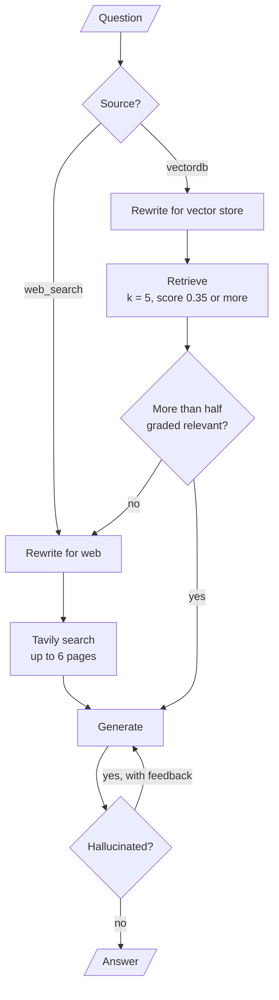

# M30.3 Theory: Adaptive RAG: vector store vs web, with hallucination grading

*[M30 theory](../README.md) · Lesson 30.3 · Notebooks: [`03a_adaptive_rag_langgraph.ipynb`](../../../../course/p09_agentic_rag/m30_adaptive_rag_routing/notebooks/03a_adaptive_rag_langgraph.ipynb) · [All theory pages](../../../README.md)*

## Routing between the vector store and the web

Adaptive-RAG (Jeong et al., NAACL 2024, [arXiv:2403.14403](https://arxiv.org/abs/2403.14403)) starts from the observation that a fixed pipeline does the same work for an easy question and a hard one. The paper routes by question complexity: no retrieval, one retrieval step or several, chosen by a small classifier trained for the job. The 03a notebook keeps the idea of deciding up front and routes by source instead: the vector store or the web.

The source classifier is one LLM call with a closed schema, `datasource: Literal["vectordb", "web_search"]`. Its system prompt lists what the vector store holds (chain-of-thought prompting, transformers and attention, DINO, diffusion models, parameter-efficient fine-tuning) and asks the model to choose `vectordb` when the question relates to any of them. That list is the router's only knowledge of the index. Add documents on a new topic and the router keeps sending those questions to the web until someone edits the prompt. For Larkspur, the list would be the handbook's sections: pricing, refunds, exports, outages and server sizing.

Each route rewrites the question for its own engine before searching. The vector-store rewriter makes it concise for semantic search; the web rewriter makes it a search-engine query.

| Path | Settings in 03a |
|---|---|
| Vector store | Research-paper PDFs split at 4,000 characters with 300 overlap; Chroma with cosine distance; up to 5 chunks scoring 0.35 or more |
| Web | Tavily with `max_results=6`, `search_depth='advanced'` and `include_raw_content=True`; pages with no content are dropped |

The whole graph:

<!-- animated: diagrams/adaptive-rag.anim.html -->

## Grading documents and answers

The graph checks its work twice, once on the evidence and once on the answer. M28 and M29 teach each check on its own; here they sit behind a router.

**The document grader** asks the LLM, once per retrieved chunk, whether the chunk is relevant (`binary_score`, yes or no). `grade_documents` keeps the chunks graded yes and computes the relevant fraction. The rule is `relevance_frac <= 0.5`, with `RELEVANCE_THRESHOLD = 0.5`:

| Chunks retrieved | Graded relevant | Fraction | Next step |
|---|---|---|---|
| 5 | 3 | 0.60 | Generate from the 3 |
| 4 | 2 | 0.50 | Web search, keeping the 2 |
| 5 | 2 | 0.40 | Web search, keeping the 2 |
| 0 | 0 | none | Web search |

Exactly half counts as failure. On the web route, `web_search` appends the pages to the chunks that passed, so the answer can draw on both sources.

**The hallucination grader** reads the answer and the documents and returns `binary_score` and `feedback`. The score is inverted from what the name suggests: `yes` means the answer may contain unsupported or contradicting content. On `yes`, the graph returns to `generate_answer`, which adds the feedback to the RAG prompt and tries again. On `no`, the graph ends.

Nothing counts the retries. The regeneration edge has no limit, so a grader that keeps saying `yes` loops until LangGraph's recursion limit stops the graph, and in the version this repo locks (langgraph 1.2.18) that limit is 10,007 steps by default. Each round costs two LLM calls. Add a counter to `GraphState`, stop after one or two retries, and return the best answer with a warning or escalate it (lesson 30.2).

The notebook tests the loop by uncommenting a hard-coded wrong answer in `generate_answer`. That line sits in the first-attempt branch only, so the retry, which takes the feedback branch, runs the real chain. The test exercises one rejection and one retry with feedback.

Counting the LLM calls per path from the graph, before any retry:

| Path | LLM calls | Web searches |
|---|---|---|
| Vector store, grading passes | Route, rewrite, up to 5 grades, generate, check: up to 9 | 0 |
| Vector store, grading fails | The same plus a web rewrite: up to 10 | 1 |
| Web from the start | Route, rewrite, generate, check: 4 | 1 |

A question the router sends to the vector store and the grader then rejects is the most expensive path. If many questions take it, the router's topic list is wrong or the index is missing content, and both are cheaper to fix than to grade around.

## Key Takeaways

- A source router picks the vector store or the web before retrieving. Its prompt's topic list is all it knows of the index, so update the prompt whenever you index a new topic.
- The document grader falls back to the web when half or fewer chunks pass. Many store-then-web runs mean the topic list or the index is wrong, which is cheaper to fix than to grade around.
- Bound the regeneration loop with a counter in the graph state, because each round costs two LLM calls and nothing else stops it before the recursion limit. A `yes` from this hallucination grader means unsupported.

## Check yourself

1. You index documents on a new topic, but the source router keeps sending questions about it to the web. Why?

The topic list in the router's system prompt is its only knowledge of the index. Until someone edits that prompt, questions on the new topic do not match the list and go to `web_search`. For Larkspur, the list would be the handbook's sections.

2. Four chunks are retrieved and two are graded relevant. Does the graph generate from them or search the web?

It searches the web, keeping the 2 chunks that passed. The rule is `relevance_frac <= 0.5`, so exactly half counts as failure, and `web_search` appends the pages to those chunks so the answer can draw on both sources.

3. The hallucination grader keeps returning yes for one question. What happens, and what should you add?

In this grader `yes` means the answer may contain unsupported content, so the graph returns to `generate_answer` every time. Nothing counts the retries, so it loops until the recursion limit (10,007 steps by default), at two LLM calls a round. Add a counter to `GraphState`, stop after one or two retries, and return the best answer with a warning or escalate it.

---
*Previous: [30.2 Customer-facing routing with sentiment and human escalation](../02_customer_facing_routing_with_sentiment_and_human_escalation/README.md). Next: [30.4 Strategy per query type](../04_strategy_per_query_type/README.md).*
