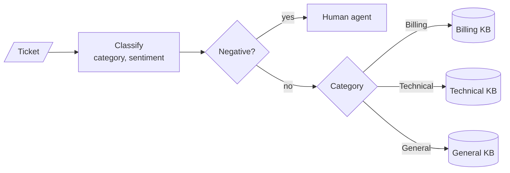

# M30 Theory: Adaptive RAG and query routing

*Part IX · Agentic & Self-Correcting RAG · [Module README](../../../course/p09_agentic_rag/m30_adaptive_rag_routing/README.md) · [All theory pages](../../README.md)*

A plain RAG pipeline sends every question down the same path. An adaptive one decides first: which knowledge base to search, whether to search the web instead, whether a person should take over, and how much retrieval work the question deserves. The M30 notebooks build on four ideas: classifying the query into a closed set of labels, routing each label to its own knowledge base, escalating to a human, and choosing a retrieval strategy per query type. Each idea has a page in the folder of the lesson that teaches it, listed under [Lessons](#lessons). This page has the overview, the interview questions and the takeaways.

The running example is the Larkspur Cloud support desk. The twelve handbook chunks from M11 are split into the three knowledge bases the 01a notebook routes between: billing (five chunks), technical (four) and general (three). The lab routes eighteen support tickets, each labelled with the knowledge base that holds its answer, such as *Why was I billed twice this month?* (billing) and *How long do you keep my data after I cancel?* (general).

## TL;DR

- A router is a classifier in front of retrieval. In the notebooks it is one LLM call with structured output that must return a label from a fixed set (`Literal['Technical', 'Billing', 'General']`), and the label becomes a metadata filter or a branch in a LangGraph graph.
- A misroute hides the answer: the filter restricts retrieval to a knowledge base that does not hold it. In the lab, a router that always picks sends 15 of 18 tickets to the right knowledge base at one search each. A score floor of 0.42 removes all 3 misroutes, but 11 tickets then fall back to searching all three knowledge bases, 2.22 searches per ticket.
- Escalation is checked before the category. A negative ticket goes to a person whatever it is about; the healthcare notebook adds a fourth sentiment, Distress, that goes to an on-call team.
- Adaptive RAG routes between the vector store and the web, then checks twice: a document grader sends the question to the web when half or fewer chunks pass, and a hallucination grader sends an unsupported answer back for regeneration.
- A strategy per query type spends LLM calls where the question needs them. In the 04a notebook a factual or contextual question costs up to 11 LLM calls and an analytical or opinion question 4.

## Mental model

<!-- animated: diagrams/router.anim.html -->

The router decides what retrieval is allowed to see. Each knowledge base then retrieves and the model answers from what came back. Grading and generation work only with what the chosen path returns, so a misroute surfaces as a confident wrong answer or an apology, never as an error.

## Lessons

| Lesson | Topic | Theory |
|---|---|---|
| 30.1 | Router agentic RAG over multiple knowledge bases | [Query classification](01_router_agentic_rag_over_multiple_knowledge_bases/README.md#query-classification) [Multi-KB routing](01_router_agentic_rag_over_multiple_knowledge_bases/README.md#multi-kb-routing) |
| 30.2 | Customer-facing routing with sentiment and human escalation | [Human-in-the-loop escalation](02_customer_facing_routing_with_sentiment_and_human_escalation/README.md#human-in-the-loop-escalation) |
| 30.3 | Adaptive RAG: vector store vs web, with hallucination grading | [Routing between the vector store and the web](03_adaptive_rag_vector_store_vs_web_with_hallucination_grading/README.md#routing-between-the-vector-store-and-the-web) [Grading documents and answers](03_adaptive_rag_vector_store_vs_web_with_hallucination_grading/README.md#grading-documents-and-answers) |
| 30.4 | Strategy per query type | [Per-query strategy](04_strategy_per_query_type/README.md#per-query-strategy) |

## Interactive lab

[**Routing confidence and the fallback**](01_router_agentic_rag_over_multiple_knowledge_bases/interactive/kb-router-lab.html): open the file in a browser. Start at floor 0.00 and find the three misroutes in the ledger. Move to 0.01: the ticket that shares no word with any chunk falls back, and the cost rises only to 1.11 searches per ticket. Then push the floor to 0.42 to catch the last misroute, and read what it costs: 11 of 18 tickets now search all three knowledge bases.

## How it connects

- **Before:** [M18](../../p06_retrieval_quality/m18_query_transformation/README.md) introduced logical and semantic routing and metadata filters built from the question; this module puts a router at the front of a whole graph. M10 covers checkpointers and interrupts, which a production escalation path needs. [M28](../m28_retrieval_grading_rewriting/README.md) and [M29](../m29_crag_and_self_rag/README.md) built the document grader and the hallucination check that lesson 30.3 combines with routing. The lab reuses the handbook and the TF-IDF index of [M11](../../p04_rag_foundations/m11_rag_lifecycle/README.md).
- **Next:** [M31](../m31_rag_as_agent_tool/README.md) hands retrieval to an agent as one tool among many, so the agent's choice of tool becomes the router. [M32](../m32_reliability_feedback/README.md) covers source attribution, unsupported-answer detection and feedback loops for systems like these.

## Interview Spotlight: 5 Questions You Might Get Asked

*Production questions of the kind asked in applied AI engineering interviews.*

### 1. Larkspur's support assistant started answering "Apologies, I was not able to answer your question" to customers who ask how long their data is kept after they cancel. The retention chunk is in the general knowledge base. How do you find the fault?

**What a strong answer covers:**
- Pulls the logged category for those tickets first: a ticket routed to technical or billing never searches the general knowledge base, whatever the retriever does
- Checks that the label matches the stored metadata exactly (`General` against `general`), since a filter that matches nothing returns no chunks and triggers the apology
- Replays retrieval with the correct filter to separate a routing failure from a retrieval failure (score below the 0.2 threshold, chunk missing from the index)
- Adds the failing tickets to a labelled routing set, and adds a fallback that searches without the filter when the filtered search returns nothing

### 2. The team is splitting the handbook into billing, technical and general knowledge bases. One Chroma collection with a `category` filter, or one collection per department?

**What a strong answer covers:**
- One collection with a filter (the 01a design) keeps one embedding model and one index to run, and a fallback is the same search with the filter removed
- Separate collections let each department choose its own chunking, embedding model and re-indexing schedule, at the cost of a fan-out query for the fallback
- A misroute costs the same in both designs, because both trust the label
- Access control never rests on a classifier's label: if some documents are restricted, enforce it with collections or filters derived from the user's identity

### 3. The router has been live for a month. How do you know whether it is still routing well?

**What a strong answer covers:**
- Keeps a labelled routing set (the lab's eighteen tickets are a small version) and reports accuracy per category and a confusion matrix on every prompt or model change
- Logs the label, its score or confidence, the fallback rate and the escalation rate per day, and watches the label mix: a launch can create a kind of question no knowledge base covers
- Tracks downstream signals per route, such as empty retrievals and apology answers, since a silent misroute shows up there first
- Samples routed tickets for human review, weighted toward low-confidence and fallback cases

### 4. A ticket reads: "I was charged twice and my server has been down all morning. This is ridiculous." What should the router do?

**What a strong answer covers:**
- Sentiment runs first in `determine_route`, so a negative reading sends it to a person; the handoff should carry both topics, the contact details and anything already retrieved
- A single-label classifier must drop one of the two problems; a schema that allows several labels, or decomposition into sub-questions (M18), keeps both
- An outage in progress may deserve the on-call path, the way the healthcare notebook separates Distress from Negative
- Measures both error costs: a missed escalation loses a customer, and a needless one costs an agent's time

### 5. The adaptive RAG graph from lesson 30.3 is much slower and costlier than the plain pipeline it replaced. Where do the calls go, and what do you cut?

**What a strong answer covers:**
- Counts LLM calls per path from the graph: on the vector route, one for routing, one rewrite, one grade per retrieved chunk (up to five), one answer and one hallucination check, plus a rewrite and a web search when grading fails
- Grades all chunks in one call, or skips grading when the top retrieval score is high
- Puts a retry counter in the graph state: the regeneration loop has none, so only LangGraph's recursion limit stops it, and that limit is 10,007 steps by default in the version this repo locks (langgraph 1.2.18)
- Moves routing and grading to a smaller model, traces latency per node, and re-checks answer quality against the baseline after each cut

## Key Takeaways

- Give the router a closed label set in its output schema, and normalise the label before it becomes a filter.
- Plan for the misroute. A score floor with an unfiltered fallback catches routes with no signal cheaply; confident misroutes only show up on a labelled routing set.
- Check escalation before the category, and make the handoff a pause with saved state rather than a node that blocks while it waits.
- Every grader loop needs a counter, and every query type should spend only the LLM calls its question needs.

---
*Previous: [M29 Self-correcting RAG: CRAG and Self-RAG](../m29_crag_and_self_rag/README.md). Next: [M31 RAG as an agent tool](../m31_rag_as_agent_tool/README.md).*
