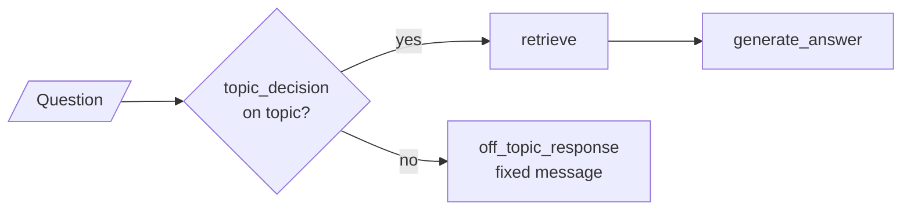
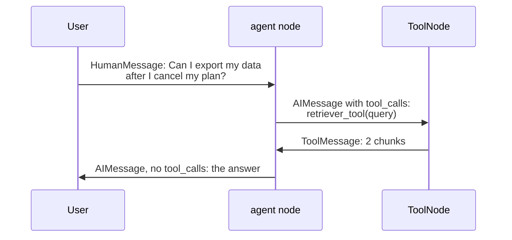

# M31.1 Theory: RAG as a tool inside a LangGraph agent

*[M31 theory](../README.md) · Lesson 31.1 · Notebooks: [`01a_rag_as_tool_in_agents.ipynb`](../../../../course/p09_agentic_rag/m31_rag_as_agent_tool/notebooks/01a_rag_as_tool_in_agents.ipynb) · [All theory pages](../../../README.md)*

## Agent-decided retrieval

The notebook builds two graphs over the same retriever: four short documents about a fictional cafe, embedded with `text-embedding-3-small`, stored in Chroma and searched with `k = 2`. These pages tell the same story with the Larkspur handbook.

The first graph lets the pipeline decide. A classifier node, `topic_decision`, asks the model a yes or no question with structured output (`GradeQuestion.score`), and a conditional edge sends the question either to `retrieve` and `generate_answer` or to a fixed off-topic reply. Every on-topic question is retrieved exactly once, with the user's words as the query.



The second graph lets the model decide. `create_retriever_tool` wraps the retriever as `retriever_tool`, a second tool `off_topic` handles unrelated questions, and both are bound to the model with `bind_tools`. The graph has two nodes: `agent` calls the model, and `ToolNode` runs whatever tools it asked for. `should_continue` routes to `tools` while the last message has `tool_calls`, and to `END` when it has none. The edge from `tools` back to `agent` makes it a loop.



Both graphs spend two model calls on a handbook question: classify and generate in the first, tool call and answer in the second. They differ in who decides and what the retriever receives:

| | Pipeline decides | Model decides |
|---|---|---|
| The retrieval decision | `topic_decision`, then fixed edges | the model, through `tool_calls` |
| What the decision reads | the classifier's system prompt | each tool's name, description and argument schema |
| Query sent to the retriever | the user's message, unchanged | the `query` argument the model writes |
| Retrievals per question | 0 or 1 | 0, 1 or more, because `tools` loops back to `agent` |
| Unrelated questions | `off_topic_response`, a fixed message | the `off_topic` tool, or a direct answer |
| Typical failure | the classifier says no and the handbook is never searched | the model answers from memory and never calls the tool |

The model-decided graph handles what the fixed one cannot: small talk that needs no retrieval, a follow-up whose query must be rewritten from the conversation, and a second search when the first chunks miss. It pays for that with a decision you no longer control in code. A question about Larkspur's refund window that the model answers without calling `handbook_search` gets an answer from its training data, with nothing to cite.

The tool's output loses the sources. `create_retriever_tool` joins the retrieved `page_content` strings with a blank line (`document_separator="\n\n"`) and drops the metadata, so the model sees the chunk text without the `source` field. To cite, pass a `document_prompt` that prints the source into each chunk, or `response_format="content_and_artifact"` to keep the Documents beside the text.

## Tool descriptions

When the model picks a tool, it reads what `bind_tools` sends with every call: each tool's name, its description and the JSON schema of its arguments. For the notebook's retriever tool that is:

```json
{"type": "function",
 "function": {"name": "retriever_tool",
              "description": "Information related to pricing, hours, or the founder of Cafe Lumiere.",
              "parameters": {"type": "object", "required": ["query"],
                             "properties": {"query": {"type": "string", "description": "query to look up in retriever"}}}}}
```

The description carries the scope that the first graph kept in its classifier prompt ("questions about Cafe Lumiere's founder, menu pricing, or opening hours"). It now has to separate `retriever_tool` from every other tool the model can call, and the model never sees the documents behind it.

The [interactive lab](interactive/tool-routing-lab.html) gives the Larkspur agent two tools, `handbook_search` and `web_search`, and routes twenty golden questions plus five held-out ones. Its router is a stand-in for the model: the M11 TF-IDF retriever, scoring each question against the two descriptions and picking the higher score, or no tool when neither shares a word with the question. Its scores match scikit-learn's `TfidfVectorizer` to within 4.5e-16. The four presets:

| Descriptions | Golden set, of 20 | Sent to the wrong tool | Held out, of 5 | Tokens per call |
|---|---|---|---|---|
| Names only: "Search tool." for both | 4 | 0 | 0 | 6 |
| Vague: "Information related to Larkspur Cloud plans and pricing." | 5 | 0 | 0 | 20 |
| Specific: the topics each tool covers | 15 | 1 | 2 | 84 |
| Tuned: Specific plus words taken from the golden questions | 19 | 0 | 4 | 133 |

- **Names only** routes nothing. The four questions it gets right are the small talk and arithmetic that needed no tool; all sixteen handbook and web questions are answered from memory.
- **Vague** catches *When are monthly plans billed?* on the word "plans" and nothing else. *Can I export my data after I cancel my plan?* misses because the lab, like TF-IDF, treats "plan" and "plans" as different words.
- **Specific** routes 15 of 20, with one question sent to the wrong tool: *What does Hetzner charge for a 4 GB server?* goes to `handbook_search`, because "server" appears only in the handbook description. A competitor's price answered from Larkspur's handbook is the worst miss in the set. Three handbook questions are right for the same thin reason: *goes down*, *reboot* and *size* match nothing, and "server" carries them.
- **Tuned** names PostgreSQL, AWS, Hetzner, Docker and Ubuntu, words copied from the golden questions, and reaches 19 of 20. On the held-out five it reaches 4 of 5: *What is the newest Node.js version?* still gets no tool. It also sends 133 tokens with every model call, against 84.

<!-- lab: interactive/tool-routing-lab.html -->

A model reads meaning, so word forms such as "refund" and "refunds" matter far less to it than to the stand-in. A missing scope fails for a model too. If neither description says which tool owns other providers' prices, the model has to guess, as the stand-in did with the Hetzner question. A description that works states four things:

- **What it searches, and whose data:** "the Larkspur Cloud handbook" against "the public web".
- **The topics, in the words users type:** refunds, cancelling, data export, outages, server sizing.
- **Where it stops:** Larkspur's own prices and policies belong to `handbook_search`; other providers' prices belong to `web_search`.
- **What it returns:** handbook passages as plain text, so the model knows what it will get back and that it must quote it.

Every description is sent with every call, so each added word costs tokens on every turn of every conversation. Treat the descriptions as a retrieval setting: keep a routing golden set of questions with the tool each one should use, score each change against it and against held-out questions, and add the misses you find in production traces.

---
*Previous: [M31 overview](../README.md). Next: [31.2 Managed RAG platforms: Contextual AI](../02_managed_rag_platforms_contextual_ai/README.md).*
