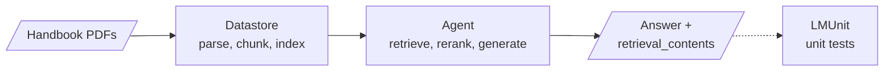

# M31.2 Theory: Managed RAG platforms: Contextual AI

*[M31 theory](../README.md) · Lesson 31.2 · Notebooks: [`02a_agentic_rag_contextual_ai.ipynb`](../../../../course/p09_agentic_rag/m31_rag_as_agent_tool/optional/02a_agentic_rag_contextual_ai.ipynb) (optional) · [All theory pages](../../../README.md)*

## Managed RAG

Lesson 31.1 assembles retrieval from parts you run yourself: an embedding model, a Chroma collection, a retriever and a prompt. A managed RAG platform runs those parts as a service. You upload documents to a datastore, create an agent over it, and send questions to one endpoint. The notebook does this with Contextual AI's Python SDK (`from contextual import ContextualAI`) over four PDFs, two of them quarterly revenue slides.



The question goes to the agent, and the answer comes back with the retrieved passages that support it. LMUnit sits outside the query path: it scores answers offline. Each box is a component you would otherwise build in an earlier module:

| Component | Call in the notebook | What it does | Built by hand in |
|---|---|---|---|
| Datastore | `client.datastores.create(name=...)`, then `client.datastores.documents.ingest(datastore_id, file=f)` | Parses, chunks and indexes each upload. A document reports `status='processing'` until it is `completed`. | M12 to M15 |
| Parser | `POST /parse` with `parse_mode="standard"`, `enable_document_hierarchy=True`, `figure_caption_mode="concise"` | Turns a PDF into Markdown per page, with the section hierarchy as structure | M12 |
| Reranker | `client.rerank.create(query=..., instruction=..., documents=..., metadata=..., model="ctxl-rerank-en-v1-instruct")` | Reorders passages by relevance and by a plain-language instruction about sources and dates | M19 |
| Grounded language model | `POST /generate` with `knowledge=[...]`, `avoid_commentary`, `temperature=0` | Answers only from the passages it is given, or says it has no relevant information | M32 |
| Agent | `client.agents.create(datastore_ids=[...], system_prompt=...)`, then `client.agents.query.create(agent_id=..., messages=[...])` | Runs retrieval, reranking and generation in one request | M20 |
| LMUnit | `client.lmunit.create(query=..., response=..., unit_test=...)` | Scores one answer against one natural-language test, from 1 to 5 | M11's golden set |

After every policy change the Larkspur index holds two versions of the same rule, and the instruction-following reranker is built for that case. The notebook's example ranks three passages about GPU pricing, an internal sales portal page from January 2025, an analyst report from November 2023 and an unrelated spec sheet, under the instruction "Prioritize internal sales documents over market analysis reports. More recent documents should be weighted higher." For Larkspur the instruction would read "Prefer the current handbook over archived handbook versions and community forum posts", with each passage's date and source passed in `metadata`. The notebook ships without saved outputs, so these pages quote no scores from it, and its claims about benchmark results are the vendor's own.

The grounded model's `avoid_commentary` flag decides whether the answer may add context beyond the passages. The notebook calls it once with the flag off and once with it on, then asks a quantum-computing question against renewable-energy passages to show the refusal path. For a support agent, the refusal path is the one to test first: a question the handbook does not answer should get "I don't have that information", not a plausible policy.

A managed platform fits behind the tool interface from lesson 31.1. Wrap the agent query in a tool, and the LangGraph agent calls it like any retriever:

```python
@tool
def handbook_search(query: str) -> str:
    """Search the Larkspur Cloud handbook: plans, billing, refunds, cancelling,
    data export and retention, outages, server sizing, support tickets."""
    result = client.agents.query.create(
        agent_id=agent_id, messages=[{"role": "user", "content": query}])
    return result.message.content
```

The calls are the notebook's; the tool and its description are the 31.1 pattern. The outer agent still decides when to search, and the platform decides how.

What you trade:

- **You run fewer parts.** Parsing, chunking, reranking and grounded generation come configured, and the platform's UI shows ingested documents and agent answers.
- **You control fewer settings.** Chunk size, embedding model and `k` are the platform's choices unless its configuration exposes them. Beyond its name and datastore, the notebook's agent sets only `system_prompt`, `suggested_queries` and `enable_multi_turn`.
- **Your documents leave your infrastructure.** Check data residency, access control on each datastore, and how a deleted document leaves the index.
- **You measure it the same way.** Run the M11 golden set through the platform agent and compare the row with your own pipeline's. A managed platform is one more change to test against the baseline.

## Check yourself

<details>
<summary>1. What do you trade when you replace your own retrieval pipeline with a managed RAG platform?</summary>

You run fewer parts, since parsing, chunking, reranking and grounded generation come configured. You control fewer settings, such as chunk size, the embedding model and `k`, and your documents leave your infrastructure, so check residency, access control and deletion. You measure it the same way, by running the M11 golden set through it.

</details>

<details>
<summary>2. After a Larkspur policy change, the index holds an old and a new version of the same rule. How would the instruction-following reranker handle it?</summary>

Pass each passage's date and source in `metadata` and an instruction such as "Prefer the current handbook over archived handbook versions and community forum posts". The reranker then orders passages by relevance and by that instruction, so the current rule ranks above the archived one.

</details>

<details>
<summary>3. Which behaviour of the grounded language model should a support agent test first?</summary>

The refusal path. A question the handbook does not answer should get "I don't have that information", not a plausible policy. The notebook tests it by asking a quantum-computing question against renewable-energy passages.

</details>

---
*Previous: [31.1 RAG as a tool inside a LangGraph agent](../01_rag_as_a_tool_inside_a_langgraph_agent/README.md). Next: [31.3 Exercise: LlamaIndex Wikipedia agent with Chainlit](../03_exercise_llamaindex_wikipedia_agent_with_chainlit/README.md).*
