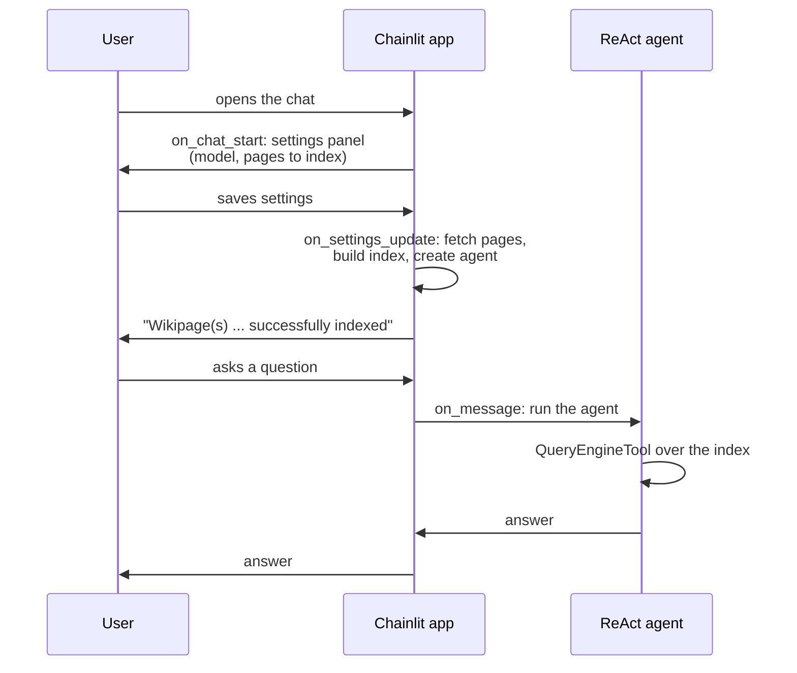

# M31.3 Theory: Exercise: LlamaIndex Wikipedia agent with Chainlit

*[M31 theory](../README.md) · Lesson 31.3 · Notebooks: [`03a_llamaindex_wikipedia_agent`](../../../../course/p09_agentic_rag/m31_rag_as_agent_tool/optional/03a_llamaindex_wikipedia_agent/README.md) (optional) · [All theory pages](../../../README.md)*

## Chat UI

The exercise builds the 31.1 pattern in LlamaIndex and puts it behind a chat window. A ReAct agent gets one tool, a `QueryEngineTool` over a vector index of Wikipedia pages, and Chainlit serves the conversation. The two scaffolds, `chat_agent.py.txt` and `index_wikipages.py.txt`, have `# REPLACE THIS WITH YOUR CODE` gaps to fill; copy each to its `.py` name first and install the `llamaindex` dependency group.

A chat UI is event-driven. Chainlit calls one function per event, and the scaffold fills three of them:

| Event | Scaffold function | What it does |
|---|---|---|
| Chat opens | `on_chat_start` | Sends `cl.ChatSettings` with a `Select` for the model and an input for the pages to index |
| Settings saved | `setup_agent`, under `@cl.on_settings_update` | Turns the request into a page list, fetches and indexes the pages, builds the agent, then confirms in the chat |
| Message sent | `main`, under `@cl.on_message` | Runs the agent on the message and sends its reply back |

`index_wikipages.py` turns a free-text request such as `/get wikipages: paris, lagos, lao` into a list of page titles with structured output: a Pydantic model, `WikiPageList`, filled by an LLM program. The folder's README notes that `llama-index-program-openai` does not support `llama-index-core` 0.14; use `FunctionCallingProgram` or `LLMTextCompletionProgram` from `llama_index.core.program` instead.

Four things the UI changes about the agent:

- **Indexing happens while the user waits.** The index is built when settings are saved, not offline as in M11. The scaffold answers with a confirmation message once it is ready; until then, questions have nothing to search.
- **State belongs to a session.** The scaffold keeps `index` and `agent` in module globals. Chainlit serves every connected user from one Python process, so the second user to save settings replaces the first user's index and agent. Store them per session with `cl.user_session.set("agent", agent)` and read them back with `cl.user_session.get("agent")`. Chainlit keeps a session for `session_timeout` seconds after the connection drops, 3600 in the scaffold's `config.toml`.
- **The tool description can change per session.** `QueryEngineTool` takes `metadata=ToolMetadata(name=..., description=...)`. When each user indexes different pages, build the description from their settings ("Wikipedia articles on London, Barcelona and Paris"), so the agent knows what this session's index holds. A fixed description such as "Wikipedia pages" says nothing about which ones.
- **Users can see the tool calls.** Chainlit shows the agent's intermediate steps in the chat. The scaffold's `config.toml` was generated by Chainlit 0.7.0 and turns this on with `hide_cot = false`. Chainlit 2.x, which this course installs, reads its settings from `.chainlit/config.toml` and uses `cot = "full"`, `"tool_call"` or `"hidden"` instead, with `"full"` as the default. For Larkspur's support chat, a visible step per `handbook_search` call lets a support lead check the answer against what was retrieved.

The same three events host the Larkspur agent from lesson 31.1: build the agent per session in `on_chat_start`, run it in `on_message`, and stream its tool calls as steps.

## Key Takeaways

- Chainlit calls one function per event. Build the index and agent when settings are saved, run the agent on each message, and confirm in the chat once indexing finishes.
- Keep the index and agent per session with `cl.user_session`, not in module globals, because one Python process serves every connected user.
- Build the tool description from each session's settings so the agent knows what its index holds. Show tool calls as steps, set with `cot` in Chainlit 2.x, so a reviewer can check answers against retrieval.

## Check yourself

1. Why does keeping the index and agent in module globals break the Chainlit app as soon as two people use it?

Chainlit serves every connected user from one Python process, so the second user to save settings replaces the first user's index and agent. Store them per session with `cl.user_session.set("agent", agent)` and read them back with `cl.user_session.get("agent")`.

2. A user indexes the Wikipedia pages on London, Barcelona and Paris. What tool description should that session's agent get?

One built from the user's settings, such as "Wikipedia articles on London, Barcelona and Paris", passed through `ToolMetadata` on the `QueryEngineTool`. A fixed description such as "Wikipedia pages" tells the agent nothing about what this session's index holds.

3. You keep the scaffold's setting that shows the agent's intermediate steps, but under the Chainlit version the course installs nothing changes. Why?

The scaffold's `config.toml` was generated by Chainlit 0.7.0 and uses `hide_cot = false`. Chainlit 2.x reads `.chainlit/config.toml` and uses `cot = "full"`, `"tool_call"` or `"hidden"` instead, with `"full"` as the default.

---
*Previous: [31.2 Managed RAG platforms: Contextual AI](../02_managed_rag_platforms_contextual_ai/README.md). Next: [M31 interview questions](../README.md#interview-spotlight-5-questions-you-might-get-asked).*
