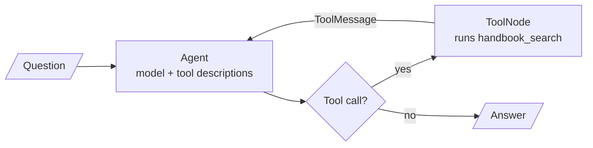

# M31 Theory: RAG as an agent tool

*Part IX · Agentic & Self-Correcting RAG · [Module README](../../../course/p09_agentic_rag/m31_rag_as_agent_tool/README.md) · [All theory pages](../../README.md)*

In M28 to M30 the graph decides when to retrieve: a grader, a router or a fixed edge sends every question down a path someone drew in advance. In M31 retrieval becomes one tool among several, and the model decides whether to call it and what query to send. The M31 notebooks build on four ideas: the agent deciding when to retrieve, the tool description as the only thing it knows about the retriever, managed platforms that run the whole RAG pipeline as a service, and the chat UI that puts an agent in front of users. Each idea has a page in the folder of the lesson that teaches it, listed under [Lessons](#lessons). This page has the overview, the interview questions and the takeaways.

The running example is the Larkspur Cloud support agent. It has two tools: `handbook_search`, a retriever over the handbook from M11 to M13, and `web_search` for everything outside Larkspur. The lab routes twenty mixed questions between them, ten about the handbook (*How long does a refund take?*, *Can I export my data after I cancel my plan?*), six for the web (*What does Hetzner charge for a 4 GB server?*) and four that need no tool at all (*What is 15% of 240?*).

## TL;DR

- As a tool, retrieval runs inside a loop: the agent node calls the model, the model may reply with a tool call, `ToolNode` runs the retriever, and the chunks go back to the model as a `ToolMessage`. The loop ends when the model replies without a tool call.
- All the model knows about a tool is its name, its description and its argument schema. In the lab, where TF-IDF stands in for the model, two tools both described as "Search tool." route 4 of 20 questions correctly, and only the four that needed no tool; specific descriptions route 15 of 20.
- Tune descriptions like any retrieval setting: on a golden set, then on questions held out from it. Fitted to the lab's twenty questions they route 19 of 20 and 4 of 5 held-out questions, and they cost 133 tokens on every model call instead of 84.
- A managed RAG platform (Contextual AI in lesson 31.2) runs the datastore, parser, reranker and grounded generator behind one API. The agent can call the whole platform as a single tool, so swapping it in leaves the agent loop unchanged.
- A chat UI adds sessions, settings and visible tool steps. State such as the index and the agent belongs to the user's session, not to module globals.

## Mental model

<!-- animated: diagrams/tool-loop.anim.html -->

Retrieval sits inside the loop, so the model decides whether it runs, how often, and with which query. A question that never triggers a tool call is answered from the model's weights, with no handbook text in front of it. The quality of the retriever matters only for questions the model sends to it.

## Lessons

| Lesson | Topic | Theory |
|---|---|---|
| 31.1 | RAG as a tool inside a LangGraph agent | [Agent-decided retrieval](01_rag_as_a_tool_inside_a_langgraph_agent/README.md#agent-decided-retrieval) [Tool descriptions](01_rag_as_a_tool_inside_a_langgraph_agent/README.md#tool-descriptions) |
| 31.2 | Managed RAG platforms: Contextual AI | [Managed RAG](02_managed_rag_platforms_contextual_ai/README.md#managed-rag) |
| 31.3 | Exercise: LlamaIndex Wikipedia agent with Chainlit | [Chat UI](03_exercise_llamaindex_wikipedia_agent_with_chainlit/README.md#chat-ui) |

## Interactive lab

[**Tool descriptions and routing**](01_rag_as_a_tool_inside_a_langgraph_agent/interactive/tool-routing-lab.html): open the file in a browser. Start on **Names only** and see all sixteen handbook and web questions get no tool. Switch to **Specific** and find the one question sent to the wrong tool, then add the word "refund" to the `handbook_search` description and watch *How long does a refund take?* move and the score reach 16 of 20. Finish on **Tuned** and compare its golden-set score with its held-out score.

## How it connects

- **Before:** M23 and M24 teach tool calling and the ReAct loop this module puts a retriever into. [M28](../m28_retrieval_grading_rewriting/README.md) to [M30](../m30_adaptive_rag_routing/README.md) make the retrieval decision inside a fixed graph; here the model makes it. [M11](../../p04_rag_foundations/m11_rag_lifecycle/README.md) gives the retriever and the golden-set habit the lab reuses.
- **Next:** [M32](../m32_reliability_feedback/README.md) checks whether an answer is supported by what was retrieved. M33 adds conversation memory to the chat. M40 exposes retrieval as a tool over MCP, so any agent can call it.

## Interview Spotlight: 5 Questions You Might Get Asked

*Production questions of the kind asked in applied AI engineering interviews.*

### 1. Larkspur adds a `web_search` tool to the support agent. A week later a customer asks "Can I get a refund on my annual plan?" and the agent quotes another provider's refund policy. How do you find out what happened?

**What a strong answer covers:**
- Opens the trace for that conversation and reads the model's `tool_calls`: which tool it called, with which query, and what came back
- If it called `web_search`: a routing failure. Compares the two descriptions for overlap ("refund", "plans", "pricing" in both, or in neither)
- If it called `handbook_search` and still answered wrongly: a retrieval or generation failure, debugged as in M11 by printing the returned chunks
- Rewrites the descriptions to state the boundary ("Larkspur's own policies" against "other providers"), adds the question to a routing golden set, and re-runs it

### 2. The Larkspur support bot today always retrieves before it answers. A teammate wants to replace it with an agent that calls `handbook_search` only when it decides to. What do you gain, what do you risk, and how do you decide?

**What a strong answer covers:**
- Gains: no retrieval for small talk or arithmetic, a query the model rewrites from the conversation, and a second call when the first chunks miss
- Risks: the model answers a policy question from memory without calling the tool, or loops on tool calls and adds latency
- Counts the cost per question from the graph: two model calls either way for a handbook question, more when the agent loops
- Decides on the golden set: answer quality, the share of handbook questions that triggered the tool, and p95 latency, against the always-retrieve baseline

### 3. The agent is live. How do you monitor tool selection in production, before customers notice a wrong answer?

**What a strong answer covers:**
- Logs every tool call with its name, the model-written query, the number of chunks returned and their top score
- Tracks per-tool call rates and the share of answers given with no tool call; a jump after a prompt, model or description change is the alert
- Samples conversations for an LLM judge or a reviewer to label the right tool, and grows the routing golden set from the misses
- Re-runs the routing golden set and a held-out set on every change to a description, a tool list or the model

### 4. A customer asks "Is a 4 GB server cheaper at Larkspur or at Hetzner?" What should the agent do, and how can it go wrong?

**What a strong answer covers:**
- The question needs both tools: `handbook_search` for Larkspur's price and `web_search` for the competitor's, then a comparison
- Failure modes: only one tool is called and the other price is filled in from memory, or a web result about Larkspur outranks the handbook
- Guards: descriptions that say which tool owns Larkspur's own facts, answers that cite each figure's source, and a refusal when one side is missing
- Adds multi-tool questions to the routing golden set, scored on whether both tools were called

### 5. The platform team proposes replacing the hand-built handbook retriever with a managed RAG platform. What do you evaluate before you agree?

**What a strong answer covers:**
- Runs the same golden set through both and compares answer quality, refusals on out-of-scope questions, and latency, as M11 does for any change
- Checks what the platform does with the handbook's tables and policy versions: its parser output, and whether reranker instructions can prefer the current policy
- Reviews data residency, access control on the datastore, per-query cost, and what leaving the platform would take
- Keeps the agent's tool interface fixed (`handbook_search(query)`), so the swap is one tool's implementation and the routing golden set still applies

## Key Takeaways

- An agent retrieves only when the model calls the tool. Measure how often it does on questions that need the handbook, and how often it does not.
- Write each tool description for the model: what it searches, the topics in users' words, and where it stops and the neighbouring tool starts. Keep it short, because it is sent on every call.
- Tune descriptions against a routing golden set and score them on held-out questions too, as you would any retrieval setting.
- A managed platform or a chat UI changes what sits behind or in front of the tool, not the loop. Keep the tool's name, description and arguments stable across both.

---
*Previous: [M30 Adaptive RAG and query routing](../m30_adaptive_rag_routing/README.md). Next: [M32 Reliability, feedback loops and diversity](../m32_reliability_feedback/README.md).*
