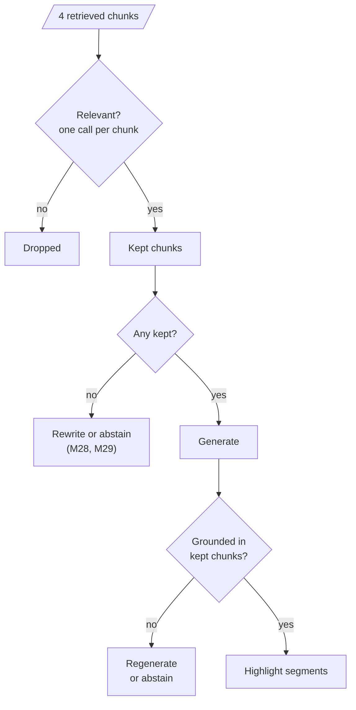

# M32.1 Theory: Reliable RAG: relevance checks, hallucination checks, source highlighting

*[M32 theory](../README.md) · Lesson 32.1 · Notebooks: [`01a_reliable_rag.ipynb`](../../../../course/p09_agentic_rag/m32_reliability_feedback/notebooks/01a_reliable_rag.ipynb) · [All theory pages](../../../README.md)*

## Relevance grading

`01a` indexes five posts from DeepLearning.AI's *The Batch* on agentic design patterns. It splits them with `RecursiveCharacterTextSplitter.from_tiktoken_encoder` into 500-token chunks with no overlap, embeds them with OpenAI's `text-embedding-3-small` into Chroma, and retrieves `k = 4` chunks for a question about the kinds of agentic design pattern.

Before generation, a grader reads each retrieved chunk with the question and returns a structured verdict:

```python
class GradeDocuments(BaseModel):
    binary_score: str = Field(description="Documents are relevant to the question, 'yes' or 'no'")

llm = ChatGroq(model="llama-3.1-8b-instant", temperature=0)
retrieval_grader = grade_prompt | llm.with_structured_output(GradeDocuments)
```

The prompt sets a low bar on purpose: a chunk is relevant if it shares keywords or meaning with the question, and "It does not need to be a stringent test. The goal is to filter out erroneous retrievals." Chunks graded `no` are dropped, and only the kept ones go to the model. That is one grader call per chunk, four per question at `k = 4`.



On the Larkspur handbook, the M11 TF-IDF retriever answers *How long does a refund take?* with `refund-window` first and `reboot` second; `reboot` wins only because both texts contain "does". A grader with this prompt should drop `reboot`. It cannot add `refund-timing`, the chunk that holds the answer, because that chunk was never retrieved. Grading removes noise and leaves recall where retrieval put it.

The notebook passes `docs_to_use` to generation without checking whether it is empty. If every chunk is graded `no`, the model receives no documents and answers anyway. Branch on the empty case: rewrite the query and retry a bounded number of times (M28), fall back to another source (M29), or say the handbook does not cover the question.

## Hallucination detection

After generation, a second grader reads the kept chunks and the answer, and returns `yes` when the answer is "grounded in / supported by the set of facts":

```python
class GradeHallucinations(BaseModel):
    binary_score: str = Field(..., description="Answer is grounded in the facts, 'yes' or 'no'")

hallucination_grader = hallucination_prompt | llm.with_structured_output(GradeHallucinations)
hallucination_grader.invoke({"documents": format_docs(docs_to_use), "generation": generation})
```

Three things about this check decide how far to trust it:

- **It checks support, not usefulness.** The question is not in the grader's input. An answer can be fully grounded and still miss the question; Self-RAG (M29) adds a separate check for that.
- **It returns one verdict for the whole answer.** One unsupported sentence fails the answer and the grader does not say which one. Per-claim checks, which split the answer into statements and verify each against a cited chunk, give the location as well as the verdict.
- **It is a model judgment.** The same 8B model writes and grades here, so they can share blind spots. Before relying on it, label a sample of answers by hand and measure how often the grader agrees, for `yes` and `no` separately.

The generation prompt in `01a` makes the grader's job harder than it needs to be. It says "Answer the question based upon your knowledge", which invites the model to add what it remembers. On the refund question, if only `refund-window` survives grading, any number of days in the answer is unsupported, because that chunk states the 30-day window and nothing about how long a refund takes. The grader should return `no`; a prompt that says "answer only from the documents, and say so when they do not cover the question" stops most of those answers before they are written.

The notebook prints the verdict and stops. In production, a `no` leads somewhere: regenerate with the stricter prompt, retry retrieval with a rewritten query, or answer that the handbook does not say and offer a person. Cap the retries; each one is another generation call and another grading call.

## Source highlighting

The last step asks the model which parts of the kept chunks the answer used. A Pydantic schema and `PydanticOutputParser` define the output:

```python
class HighlightDocuments(BaseModel):
    id: List[str]       # ids of the documents used
    title: List[str]
    source: List[str]
    segment: List[str]  # "direct segments from used documents that answers the question"
```

The prompt asks for segments that are "verbatim snippets from the documents, ensuring a word-for-word match", and to leave out documents the answer did not use. For the Larkspur question *Can I export my data after I cancel my plan?*, a correct highlight returns two exact sentences:

| Chunk | Segment |
|---|---|
| `export` | Export your data at any time from Settings, then Data. |
| `retention` | After a plan is cancelled, its data is kept for 30 days and then permanently deleted. |

The parser checks the JSON shape and nothing else. A model can paraphrase, merge two sentences or quote a chunk it was never given, and the output still parses. Check each segment in code before showing it:

```python
for doc_id, segment in zip(result.id, result.segment):
    text = chunks_by_id[doc_id].page_content
    start = text.find(segment)          # -1 means the segment is not in the chunk
```

A segment that is found gives character offsets to highlight in the interface. A segment that is not found falls back to citing the whole chunk, and goes in a log, because a rising miss rate means the highlighting prompt or model has drifted. The four parallel lists have a trap of their own: `zip` stops at the shortest list, so a response with three ids and two segments silently loses a row. Compare the lengths before zipping.

Highlights serve the reader, who can check the answer against the handbook in one glance, and they serve the team. Logged segments show which chunks answers actually use, and a chunk that is retrieved often and never highlighted is a candidate for the grader to drop or for retrieval to stop returning.

## Check yourself

<details>
<summary>1. The relevance grader drops off-topic chunks before generation. Why can it not raise recall?</summary>

It can only drop chunks that retrieval returned. On the refund question it should drop `reboot`, which ranked second only because both texts contain "does", but it cannot add `refund-timing`, which was never retrieved. Grading removes noise and leaves recall where retrieval put it.

</details>

<details>
<summary>2. Only the refund-window chunk survives grading, and the answer states how many days a refund takes. What should the hallucination grader return, and what prevents such answers?</summary>

`no`: that chunk states the 30-day window and nothing about how long a refund takes, so any number of days is unsupported. The notebook's prompt, "Answer the question based upon your knowledge", invites it. A prompt that says to answer only from the documents, and to say when they do not cover the question, stops most of these answers before they are written.

</details>

<details>
<summary>3. A highlighted segment parses correctly but is not found in the chunk it cites. What should the app do?</summary>

The parser checks only the JSON shape, so the model may have paraphrased or merged sentences. When `text.find(segment)` returns -1, fall back to citing the whole chunk and log the miss, because a rising miss rate means the highlighting prompt or model has drifted. Also compare the list lengths before `zip`, which silently drops rows.

</details>

---
*Previous: [M32 overview](../README.md). Next: [32.2 Retrieval with a user-feedback loop](../02_retrieval_with_a_user_feedback_loop/README.md).*
