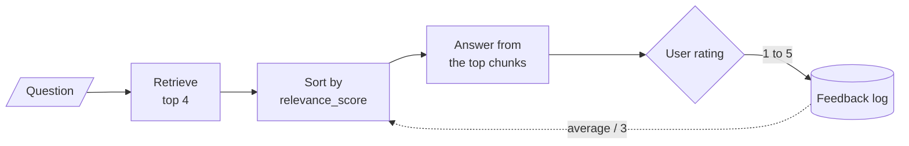

# M32.2 Theory: Retrieval with a user-feedback loop

*[M32 theory](../README.md) · Lesson 32.2 · Notebooks: [`02a_retrieval_with_feedback_loop.ipynb`](../../../../course/p09_agentic_rag/m32_reliability_feedback/notebooks/02a_retrieval_with_feedback_loop.ipynb) · [All theory pages](../../../README.md)*

## The feedback re-ranker

`02a` builds a `RetrievalQA` chain with `gpt-4o` over *Understanding_Climate_Change.pdf* and stores one feedback record per answer as a line of JSON:

```python
{"query": ..., "response": ..., "relevance": 5, "quality": 5, "comments": ""}   # relevance and quality on a 1 to 5 scale
```

On the next query, `adjust_relevance_scores` re-weights the retrieved chunks. For each chunk and each stored record it asks `gpt-4o` whether the record is relevant to the current query and that chunk. It averages the `relevance` of the records judged relevant and multiplies the chunk's score:

```python
doc.metadata['relevance_score'] *= (avg_relevance / 3)  # Assuming a 1-5 scale, 3 is neutral
return sorted(docs, key=lambda x: x.metadata['relevance_score'], reverse=True)
```


<!-- animated: diagrams/credit-flywheel.anim.html -->

Four properties of this rule decide what it can do:

- **Feedback sets the order on its own.** `encode_from_string` in `helper_functions.py` gives every chunk `relevance_score = 1.0`, so after the multiplication the order depends on the ratings alone. Similarity only breaks ties, because Python's `sorted` is stable and keeps the retriever's order for equal scores.
- **The multiplier is bounded.** It uses the average, so a chunk sits between 1/3 (every rating 1) and 5/3 (every rating 5). The first rating moves a chunk as far as it will go; later ratings only move the average.
- **It reorders the candidates and nothing else.** The chunks come from `retriever.invoke`, which returns 4 by default. A chunk outside those 4 never receives a rating.
- **It costs one model call per pair.** Every retrieved chunk is checked against every stored record, so 4 chunks and 1,000 records make 4,000 `gpt-4o` calls for one query.

The [interactive lab](interactive/feedback-flywheel-lab.html) runs this rule on the Larkspur handbook with the M11 TF-IDF retriever. Five golden questions take turns, 20 times each over 100 events. Each answer uses the top 2 of the 4 candidates, and the simulated user gives a 5 when every evidence chunk is in the answer and a 1 otherwise. The lab replaces the `gpt-4o` relevance call with a fixed rule: a record counts for a chunk when it was given on the same question and its answer used that chunk. Its port of the rule matches the Python function on all 202 settings it offers.

| Golden question | Recall@2 before | After 100 events | Wrong answers |
|---|---|---|---|
| *Can I export my data after I cancel my plan?* | 1.00 | 1.00 | 0 |
| *How long does a refund take?* | 0.50 | 0.50 | 20 |
| *What happens if my server goes down?* | 0.00 | 0.00 | 20 |
| *Is there a credit if my server plan has an outage?* | 0.00 | **1.00** | 1 |
| *Can I still use my server after I cancel the plan?* | 1.00 | 1.00 | 0 |
| Mean recall@2, and total wrong answers | 0.50 | 0.70 | 41 |

- **The credit question is fixed by one rating.** Its candidates arrive as `sizing`, `reboot`, `sla`, `export`. At event 4 the answer uses `sizing` and `reboot`, the user gives a 1, and both drop to 0.333. `sla` and `export` move up at 1.000, the next answer contains the evidence, and the thumbs-up at event 9 lifts them to 1.667.
- **The loop stops learning early.** No ranking changes after event 8 and no score changes after event 9. Events 10 to 100 add records and change nothing.
- **Feedback cannot reach a missing chunk.** `refund-timing` scores 0 for the refund question, and `sla` and `incidents` score 0 for the outage question, so none of them is ever a candidate. Those two questions account for 40 of the 41 wrong answers. On the outage question, every candidate has an average of 1 by event 8, all sit at 0.333, and the order is the retriever's again.

<!-- lab: interactive/feedback-flywheel-lab.html -->

Three lines of the notebook's code need fixing before the loop runs as described. The relevance check compares the model's answer with lowercase `'yes'` while the prompt asks for `'Yes'` or `'No'`; normalise with `.strip().lower()`. A FAISS store returns its stored `Document` objects, so `*=` on their metadata persists between calls and compounds: one rating of 5 gives 1.667 on the first query and 2.778 on the second. Copy the documents before adjusting them. And `retriever.search_kwargs['docs'] = adjusted_docs` has no effect: the FAISS retriever ignores a `docs` argument and searches the index again, so the re-ranked list has to be passed to the chain directly.

## Implicit vs explicit feedback

Explicit feedback is a judgment the user states: a thumbs-up, a star rating, the 1 to 5 `relevance` and `quality` fields in `02a`. Implicit feedback is inferred from what the user does next.

| | Explicit | Implicit |
|---|---|---|
| Examples | Thumbs up or down, a 1 to 5 rating, a comment | Opening a cited source, copying the answer, asking the same question again in other words, opening a support ticket |
| Meaning | Clear: the user said it | Inferred: a rephrased question probably means the answer missed |
| Volume | Only from users who choose to rate | From every session |
| What it rates | The whole answer | Often one source, such as the one the user opened |
| Bias | Raters choose themselves, so they may not be typical users | Users click what is shown first, so top-ranked chunks collect more signal |

The lab's second setting shows why the granularity matters. *Thumbs on the answer* gives every chunk in the answer the same rating, as `02a` does. *Clicks on each source* rates each chunk on its own: 5 for an evidence chunk the user opened, 1 for one they skipped. On *Can I still use my server after I cancel the plan?*, `sizing` is not evidence but sits in every good answer next to `cancel`. Rated through the answer, it rides along to 1.667; rated per source, it falls to 0.333. On the refund question the effect runs the other way: the answer is always incomplete, so thumbs on the answer push the evidence chunk `refund-window` down to 0.333 with the distractor, while per-source ratings lift it to 1.667.

The sharper signal does not change the lab's totals. With either setting, mean recall@2 ends at 0.70 and 41 of 100 answers are wrong, because neither signal reaches a chunk the retriever does not return. Per-source ratings keep reshuffling non-evidence chunks for longer, and the order settles at event 15 instead of event 8.

In practice, use both. Implicit signals give volume and per-chunk detail, after correcting for position: compare clicks at the same rank, or occasionally shuffle the order of sources. Explicit ratings are fewer but mean what they say; every thumbs-down is a candidate for the golden set, so the next change to retrieval is measured on the questions that failed.

## Folding good answers into the index

The second half of `02a` uses feedback to change the index itself. `fine_tune_index` keeps records with `relevance >= 4` and `quality >= 4`, joins each question and answer into one text, appends them to the original document text and re-encodes everything with `encode_from_string` (1,000-character chunks, 200 overlap) into a new FAISS store. The notebook calls it a periodic job, "daily or weekly".

This adds chunks that are worded the way users ask, which helps future questions phrased like past ones. It has limits:

- **Only answers that were already good get in.** In the lab, the refund and outage questions never earn a thumbs-up, so nothing about them would be added. The questions that most need new text get none.
- **Past answers become retrievable facts.** When Larkspur changes a policy, the stored answers still quote the old one and compete with the corrected handbook. Tag each added chunk with its date and the handbook chunks it was answered from, and drop it when those change.
- **It rebuilds the whole index.** Every run re-embeds the full corpus plus the feedback text; incremental upserts (M15) avoid that.

## Key Takeaways

- The feedback re-ranker multiplies each chunk's score by its average rating over 3, so a chunk stays between 1/3 and 5/3 and ratings alone set the order. It costs one model call per chunk and stored record.
- Feedback only reorders the candidates retrieval returns. In the lab, mean recall@2 rose from 0.50 to 0.70, but 40 of the 41 wrong answers came from chunks that were never candidates.
- Combine implicit and explicit feedback. Implicit signals give volume and per-source detail once corrected for position; explicit ratings are fewer but mean what they say, and each thumbs-down is a golden-set candidate.

## Check yourself

<details>
<summary>1. Why can the feedback re-ranker never fix the refund and outage questions in the lab?</summary>

It only reorders the 4 candidates the retriever returns. `refund-timing`, `sla` and `incidents` score 0 for those questions, so they are never candidates and never receive a rating. The two questions account for 40 of the 41 wrong answers.

</details>

<details>
<summary>2. For the question about using a server after cancelling, how do thumbs on the answer and clicks on each source treat the sizing chunk?</summary>

`sizing` is not evidence but sits in every good answer next to `cancel`. Rated through the answer it rides along to 1.667; rated per source it falls to 0.333. Either way the lab's totals stay at mean recall@2 0.70 and 41 wrong answers, because neither signal reaches a chunk the retriever does not return.

</details>

<details>
<summary>3. You plan to fold highly rated answers back into the index every week. What happens when Larkspur changes a policy, and how do you guard against it?</summary>

The stored answers still quote the old policy and compete with the corrected handbook as retrievable facts. Tag each added chunk with its date and the handbook chunks it was answered from, and drop it when those change.

</details>

---
*Previous: [32.1 Reliable RAG: relevance checks, hallucination checks, source highlighting](../01_reliable_rag_relevance_checks_hallucination_checks_source_highlighting/README.md). Next: [32.3 Dartboard RAG: relevance and diversity together](../03_dartboard_rag_relevance_and_diversity_together/README.md).*
