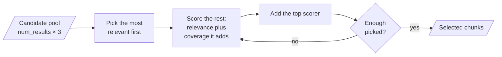

# M32.3 Theory: Dartboard RAG: relevance and diversity together

*[M32 theory](../README.md) · Lesson 32.3 · Notebooks: [`03a_dartboard_rag.ipynb`](../../../../course/p09_agentic_rag/m32_reliability_feedback/optional/03a_dartboard_rag.ipynb) (optional) · [All theory pages](../../../README.md)*

## Diversity-aware selection

When a knowledge base holds the same passage several times, top-k retrieval fills every slot with copies of the best match. `03a` makes that happen on purpose: it loads *Understanding_Climate_Change.pdf* with `documents = documents * 5`, splits it into 1,000-character chunks with 200 overlap, and shows that the top 3 results for *What is the main cause of climate change?* are repetitions of one chunk.

Its fix comes from *Better RAG using Relevant Information Gain* ([arXiv 2407.12101](https://arxiv.org/abs/2407.12101)), the dartboard method. Picture the query as the centre of a dartboard and darts thrown around it. A set of chunks scores by how close its nearest member lies to where the darts land. A second copy of a chunk already in the set lies exactly where the first one does, so it adds nothing; a chunk that covers ground nearby adds the most.

`greedy_dartsearch` builds the set one chunk at a time from a candidate pool of `num_results * oversampling_factor` nearest chunks (3 by default):

1. Turn distances (`1 - cosine similarity`) into log probabilities with a normal density of width `SIGMA = 0.1`, for query to chunk and for chunk to chunk.
2. Pick the chunk most probable under the query.
3. Treat every candidate as a place a dart can land, weighted by how close it is to the query (`RELEVANCE_WEIGHT`). For each remaining candidate, measure how close the set would come to each landing place if that candidate joined (`DIVERSITY_WEIGHT`), and sum over the landing places with `logsumexp`. Both weights are 1.0.
4. Add the highest scorer and repeat until `num_results` are picked.

Running the notebook's `greedy_dartsearch`, unchanged, on the twelve Larkspur chunks stored five times (60 chunks, TF-IDF vectors) shows both the gain and its limit. For *Can I export my data after I cancel my plan?*, whose evidence is `export` and `retention`, with `num_results = 3`:

| `oversampling_factor` | Pool | Distinct chunks in pool | Plain top-3 | Dartboard top-3 |
|---|---|---|---|---|
| 1 | 3 | 1 | `export` × 3 | `export`, `export`, `export` |
| 2 | 6 | 2 | `export` × 3 | `export`, `retention`, `export` |
| 3 (default) | 9 | 2 | `export` × 3 | `export`, `retention`, `export` |
| 4 | 12 | 3 | `export` × 3 | `export`, `retention`, `cancel` |

Plain top-3 has recall 0.50 on this question at every pool size. Dartboard reaches 1.00 once the pool holds `retention`, from an oversampling factor of 2. At the default of 3 its third pick is still a copy of `export`, because a pool of 9 drawn from five copies of each chunk holds only two distinct chunks. A selector can only choose among the candidates it is given: make the pool larger than the number of copies, or remove the copies at indexing time.

Dartboard and MMR ([M17.4](../../../p06_retrieval_quality/m17_retrievers_hybrid_search/04_maximal_marginal_relevance_for_diversity/README.md#mmr-λ)) solve the same problem the same greedy way and differ in the score. MMR subtracts a redundancy penalty with a linear λ; Dartboard adds log probabilities, so `SIGMA` sets how quickly closeness stops counting, and the two weights shift the balance between relevance and coverage. The notebook's notes point out that the method needs only distances, so it works the same on dense, hybrid or cross-encoder scores.

Two details to know when running `03a`. The first selection score is a placeholder of 1.0, not a computed score, so it cannot be compared with the scores after it. And the final cell calls `get_context_with_dartboard(test_query, k=3)`, while the function's parameter is `num_results`; Python raises a `TypeError`, and `num_results=3` is the fix.

## Check yourself

1. Why does a second copy of a chunk already in the set add nothing to the dartboard score?

A set scores by how close its nearest member lies to where the darts land. The copy lies exactly where the first one does, so it brings no landing place any closer. A chunk that covers ground nearby adds the most.

2. With the Larkspur chunks stored five times and the default oversampling factor of 3, what does dartboard return for the export question, and why?

`export`, `retention`, `export`. Recall reaches 1.00 against 0.50 for plain top-3, but the pool of 9 drawn from five copies of each chunk holds only two distinct chunks, so the third pick is a copy. At a factor of 4 the pool holds three and the picks become `export`, `retention`, `cancel`.

3. Your retriever scores with a cross-encoder rather than embeddings. Can you still use dartboard selection, and how does it differ from MMR?

Yes: the method needs only distances, so it works the same on dense, hybrid or cross-encoder scores. Both pick greedily; MMR subtracts a redundancy penalty with a linear λ, while dartboard adds log probabilities, with `SIGMA` setting how quickly closeness stops counting.

---
*Previous: [32.2 Retrieval with a user-feedback loop](../02_retrieval_with_a_user_feedback_loop/README.md). Next: [M32 interview questions](../README.md#interview-spotlight-5-questions-you-might-get-asked).*
