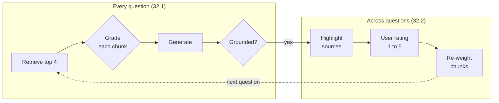

# M32 Theory: Reliability, Feedback Loops & Diversity

*Part IX · Agentic & Self-Correcting RAG · [Module README](../../../course/p09_agentic_rag/m32_reliability_feedback/README.md) · [All theory pages](../../README.md)*

A RAG pipeline returns an answer whether or not the chunks behind it were relevant, whether or not the answer stays inside them, and whether or not the reader can check it. M32 adds a check for each of those, then lets user ratings reorder retrieval, then makes sure the chunks the model reads are not copies of each other. The M32 notebooks build on four ideas: catching an answer the retrieved chunks do not support, showing the exact passages an answer used, the difference between ratings users give and signals they leave, and choosing chunks that are relevant without repeating each other. Each idea has a page in the folder of the lesson that teaches it, listed under [Lessons](#lessons). This page has the overview, the interview questions and the takeaways.

The running example is the Larkspur Cloud handbook from M11: the same twelve chunks and the same TF-IDF index as the [M11 top-k lab](../../p04_rag_foundations/m11_rag_lifecycle/02_indexing_from_scratch_with_tf_idf_and_nearest_neighbours/README.md#top-k). The golden set keeps M11's three questions and adds two: *Is there a credit if my server plan has an outage?*, whose evidence ranks third, and *Can I still use my server after I cancel the plan?*, whose top answer carries an unrelated chunk along with the right one.

## TL;DR

- `01a` wraps generation in two LLM graders: one answers yes or no for each retrieved chunk before generation, the other answers yes or no for whether the answer is grounded in the kept chunks. Both run `llama-3.1-8b-instant` on Groq at temperature 0 with structured output.
- Source highlighting asks the model for verbatim segments of the chunks it used. Nothing in the parser enforces "verbatim", so check every segment against its chunk in code.
- `02a` re-ranks with `relevance_score *= average rating / 3`, which keeps every chunk between 0.333 and 1.667. In the lab, 100 rated answers lift mean recall@2 on the golden set from 0.50 to 0.70, the order stops changing after event 8, and 40 of the 41 wrong answers go to two questions whose evidence the retriever never returns.
- A thumbs-up or thumbs-down on the answer lands on every chunk in it. In the lab an unrelated chunk rides a good answer up to 1.667, and an evidence chunk is pushed down to 0.333 next to the distractor it was served with.
- With the handbook stored five times, plain top-3 for the export question returns the `export` chunk three times. The notebook's dartboard search returns `export`, `retention`, `export` at its default oversampling of 3, and `export`, `retention`, `cancel` at 4.

## Mental model

<!-- animated: diagrams/reliability-loop.anim.html -->

The checks in the top row act on one answer and can only remove: a grader drops a chunk or rejects an answer, and neither can add the chunk that was missing. The loop in the bottom row acts across many answers and can only reorder the chunks retrieval already returns. A missing chunk is a retrieval problem in both rows, and the fixes for it sit in M14 to M19.

## Lessons

| Lesson | Topic | Theory |
|---|---|---|
| 32.1 | Reliable RAG: relevance checks, hallucination checks, source highlighting | [Relevance grading](01_reliable_rag_relevance_checks_hallucination_checks_source_highlighting/README.md#relevance-grading) [Hallucination detection](01_reliable_rag_relevance_checks_hallucination_checks_source_highlighting/README.md#hallucination-detection) [Source highlighting](01_reliable_rag_relevance_checks_hallucination_checks_source_highlighting/README.md#source-highlighting) |
| 32.2 | Retrieval with a user-feedback loop | [The feedback re-ranker](02_retrieval_with_a_user_feedback_loop/README.md#the-feedback-re-ranker) [Implicit vs explicit feedback](02_retrieval_with_a_user_feedback_loop/README.md#implicit-vs-explicit-feedback) [Folding good answers into the index](02_retrieval_with_a_user_feedback_loop/README.md#folding-good-answers-into-the-index) |
| 32.3 | Dartboard RAG: relevance and diversity together | [Diversity-aware selection](03_dartboard_rag_relevance_and_diversity_together/README.md#diversity-aware-selection) |

## Interactive lab

[**The feedback flywheel**](02_retrieval_with_a_user_feedback_loop/interactive/feedback-flywheel-lab.html): open the file in a browser. Pick *Is there a credit if my server plan has an outage?* and move the slider from 3 to 4 events: one thumbs-down drops `sizing` and `reboot` to 0.333 and the evidence chunk `sla` moves into the answer. Then slide to 100 and pick *How long does a refund take?*: 20 wrong answers, and no rating reaches `refund-timing`. Last, pick *Can I still use my server after I cancel the plan?* and switch between the two signals to watch `sizing` go from 1.667 to 0.333.

## How it connects

- **Before:** [M11](../../p04_rag_foundations/m11_rag_lifecycle/README.md) supplies the golden set and the baseline this module's lab reports against. [M28](../m28_retrieval_grading_rewriting/README.md) introduced the document grader that 32.1 reuses, and [M29](../m29_crag_and_self_rag/README.md) the groundedness check. [M17](../../p06_retrieval_quality/m17_retrievers_hybrid_search/README.md) taught MMR, the older answer to the problem Dartboard solves, and [M19](../../p06_retrieval_quality/m19_reranking_post_retrieval/README.md) the cross-encoder reranker, a second way to reorder the same candidates.
- **Next:** [M33](../../p10_memory_and_multi_agent/m33_conversational_memory_rag/README.md) adds conversation memory, where feedback and grading have to handle follow-up questions that only make sense with the turns before them.

## Interview Spotlight: 5 Questions You Might Get Asked

*Production questions of the kind asked in applied AI engineering interviews.*

### 1. A Larkspur customer asks how long a refund takes. The assistant answers with a number of business days that differs from the handbook, and the hallucination grader marked the answer grounded. How do you work out what failed?

**What a strong answer covers:**
- Pulls the trace: the retrieved chunks, the grader's verdict on each, the kept set, the answer and the hallucination grader's input
- Checks retrieval first: on the M11 TF-IDF index `refund-timing` scores 0 for this question, so the kept set may hold only `refund-window`, which gives no duration at all
- Checks the generation prompt: `01a` tells the model to answer "based upon your knowledge", which invites a remembered number; a grounded system says "only from the documents"
- Treats the grader as a model with an error rate: labels a sample of answers by hand, measures how often the grader agrees, and adds this case to that set

### 2. Product wants a thumbs-up and thumbs-down on every answer, feeding a re-ranker like the one in `02a`. What do you tell them it will and will not fix?

**What a strong answer covers:**
- It reorders the candidates retrieval returns, so it fixes questions whose evidence is retrieved but ranked low (the lab's credit question goes from recall@2 0.00 to 1.00 after one thumbs-down)
- It cannot reach a chunk retrieval never returns: in the lab 40 of the 41 wrong answers in 100 events go to the refund and outage questions, and no rating changes that
- A rating on the answer credits every chunk in it, so unrelated chunks ride along on good answers; per-source signals or a reranker trained on graded pairs are sharper
- Ships it with a holdout: re-runs the golden set before and after, and watches per-question recall so one popular question cannot hide a regression elsewhere

### 3. The relevance grader and the hallucination grader have been live for a month. How do you know they are working, and what do you alert on?

**What a strong answer covers:**
- Logs every verdict with the question, chunk ids and answer, so rates can be tracked per question type and per document
- Watches the share of questions where every chunk is graded irrelevant, and the share of answers graded not grounded; a jump after an index or prompt change points at the change
- Samples graded traffic for human labels each week and tracks the graders' agreement with them, separately for "yes" and "no", since a lenient grader fails in one direction
- Counts the cost: `01a` makes five grader calls per answer (one per chunk at `k = 4`, plus one grounding call) and a sixth for highlighting, and the latency they add belongs on the same dashboard

### 4. `fine_tune_index` has been folding highly rated question and answer pairs into the index every week. Larkspur then changes its refund rule. What goes wrong, and how do you guard against it?

**What a strong answer covers:**
- Old answers that quote the old rule are now chunks in the index, and they match refund questions better than the handbook does because they were written as answers to those questions
- The new handbook chunk competes with every highly rated answer that repeats the old rule
- Tags every feedback-derived chunk with its source, date and the handbook chunks it was answered from, and removes it when any of those chunks changes
- Keeps feedback chunks out of the citation path, or ranks them below primary documents, so the assistant never cites a past answer as policy

### 5. Larkspur ingests the handbook from the help centre, the PDF export and the internal wiki, so the export rule is stored three times. Top-3 retrieval returns it three times. Do you add Dartboard, MMR or deduplication?

**What a strong answer covers:**
- Deduplicates at indexing time first: exact or near-duplicate chunks waste storage and every later step, and a content hash catches the exact copies
- Uses Dartboard or MMR for the overlap that survives deduplication, such as two documents that state one rule in different words
- Sizes the candidate pool to the duplication: in the dartboard run, a pool of 9 drawn from five copies of each chunk holds only two distinct chunks, so the third pick is a copy again
- Measures on golden questions that need two or more distinct chunks, and checks that single-fact questions do not lose their second supporting chunk

## Key Takeaways

- Graders filter and verify; they never add evidence. When every chunk is graded irrelevant or the answer is not grounded, rewrite the query or abstain instead of answering anyway.
- Check source highlights in code: every segment must be found in the chunk it claims to come from.
- Feedback re-ranking moves only chunks that were shown. Read its result per question, and send questions it cannot fix to retrieval work.
- Remove duplicate chunks at indexing time, then use a diversity-aware selector with a candidate pool larger than the number of copies.

---
*Previous: [M31 RAG as an agent tool](../m31_rag_as_agent_tool/README.md). Next: [M33 Conversation memory and conversational RAG](../../p10_memory_and_multi_agent/m33_conversational_memory_rag/README.md).*
