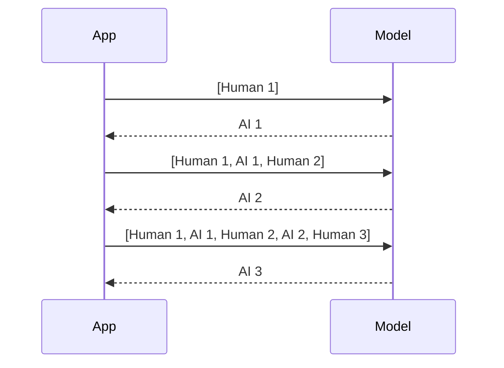

# M33.1 Theory: Why LLMs forget; classic memory classes

*[M33 theory](../README.md) · Lesson 33.1 · Notebooks: [`01a_why_llms_forget.ipynb`](../../../../course/p10_memory_and_multi_agent/m33_conversational_memory_rag/notebooks/01a_why_llms_forget.ipynb), [`01b_classic_memory_classes_and_chains.ipynb`](../../../../course/p10_memory_and_multi_agent/m33_conversational_memory_rag/optional/01b_classic_memory_classes_and_chains.ipynb) (optional) · [All theory pages](../../../README.md)*

## Message history

A chat model call is a function of the messages sent in that call and nothing else. Tell the Larkspur assistant *I'm on the annual Team plan*, then ask *Which plan am I on?* in a second call, and the second call receives only the question. The notebook shows the same thing with a name: the stateless chain `prompt | llm | parser` cannot answer *What's my name?*.

The fix is to send the earlier turns back. A **message history** is the ordered list of typed messages that make up the conversation so far:

| Type | Who wrote it | Stored in the history? |
|---|---|---|
| `SystemMessage` | You, the developer: instructions for the model | Usually not; the prompt adds it on every call |
| `HumanMessage` | The user | Yes |
| `AIMessage` | The model | Yes |

Each turn appends the user's message, sends the whole list, and appends the reply:

The notebook's hand-rolled loop is the whole idea in four lines: append the `HumanMessage`, `llm.invoke(history)`, append the reply, return it. `InMemoryChatMessageHistory` gives the same list a standard interface (`add_user_message`, `add_ai_message`, `messages`, `clear`) that file, SQLite and Redis backends share, which is what lesson 33.2 relies on.

The price is that a history which keeps everything resends everything. Turn N sends 2N − 1 messages: 1, 3, 5, 7, 9 and 11 over six turns, 36 messages in total, where six independent calls would send 6. Token cost and latency grow with the length of the conversation, and a long enough chat no longer fits the context window. Lessons 33.3 and 33.6 bound that growth.

## The classic memory classes

Before `RunnableWithMessageHistory` and LangGraph checkpointers, LangChain packaged memory as classes that a chain loaded before each call and saved after it. The optional notebook runs them through the load, invoke and save loop. Forgetting the save step is the classic bug: the chain runs, and the next turn has no history.

| Class | What the prompt receives | Keeps early facts | Extra LLM calls | Where the idea lives now |
|---|---|---|---|---|
| `ConversationBufferMemory` | Every message | Yes | None | A message history (this lesson) |
| `ConversationBufferWindowMemory` | The last `k` exchanges (2k messages) | No | None | A window or `trim_messages` (33.3, 33.6) |
| `ConversationSummaryMemory` | One running summary | Yes, compressed | One per turn | Summary memory (33.3) |
| `ConversationSummaryBufferMemory` | Summary plus recent turns | Yes, compressed | When over `max_token_limit` | Summary memory (33.3) |
| `VectorStoreRetrieverMemory` | The past exchanges most similar to the question | Only if retrieved | None | Long-term memory (M34) |

These classes live in `langchain_classic` now. You will meet them in older code; new code uses the patterns in lessons 33.2 to 33.6.

---
*Previous: [M33 overview](../README.md). Next: [33.2 RunnableWithMessageHistory, multi-user sessions and persistence](../02_runnablewithmessagehistory_multi_user_sessions_and_persistence/README.md).*
