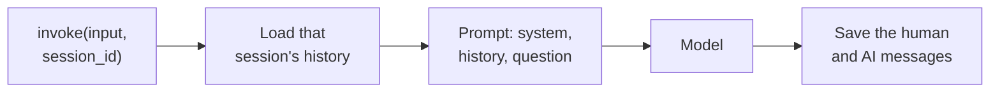

# M33.2 Theory: RunnableWithMessageHistory, multi-user sessions and persistence

*[M33 theory](../README.md) · Lesson 33.2 · Notebooks: [`02a_runnable_with_message_history.ipynb`](../../../../course/p10_memory_and_multi_agent/m33_conversational_memory_rag/notebooks/02a_runnable_with_message_history.ipynb), [`02b_multi_user_sessions_and_persistence.ipynb`](../../../../course/p10_memory_and_multi_agent/m33_conversational_memory_rag/notebooks/02b_multi_user_sessions_and_persistence.ipynb) · [All theory pages](../../../README.md)*

## One history per session

`RunnableWithMessageHistory` does the load and save of lesson 33.1 around any runnable. You give it the chain and a factory, `get_session_history(session_id)`, that returns the history for one conversation. Every call then carries the id in its config:

```python
chain_with_history.invoke({"query": "Which plan am I on?"},
                          config={"configurable": {"session_id": "cust-4821"}})
```



Two keys tell the wrapper where things go when the chain takes a dict. `input_messages_key` names the input that holds the new message (it is saved after the call), and `history_messages_key` names the `MessagesPlaceholder` that receives the stored history. The model then receives the system message, the history at the placeholder and the new question, in that order. A chain that returns a dict, like the retrieval chain of lesson 33.4, also needs `output_messages_key` to say which output to save as the AI message.

The `session_id` is the only thing that separates one customer's conversation from another's. In the notebook, two users talk to the same chain with their turns interleaved, and each one's *Summarize what we discussed* sees only their own messages; a new `session_id` starts empty. Any string works: a user id, a chat id, or both combined, so one customer can hold several separate chats. Because whoever supplies the id chooses which history loads, take it from the authenticated session on the server, never from text the user can edit.

## Where the history lives

Only the factory changes when the store changes; the chain and the wrapper stay the same.

| Backend | Survives a restart | Many users | Typical use |
|---|---|---|---|
| `InMemoryChatMessageHistory` in a dict | No | Yes, one per key | Tests and notebooks |
| `FileChatMessageHistory` | Yes | One JSON file per session | Single-user CLI or desktop tools |
| `SQLChatMessageHistory` | Yes | Yes, one table keyed by `session_id` | Web apps and services |

The notebook proves the database does the remembering. Run 1 stores a user's preferences through one chain and deletes the chain object; four rows sit in the `message_store` table. Run 2 builds a brand-new chain with no Python-side state, and it still answers *What's my name?* from those rows. Pass the database URL by keyword, `SQLChatMessageHistory(session_id=..., connection="sqlite:///x.db")`: the second positional argument is `table_name`, so the positional form creates no connection and fails only when invoked.

SQLite is fine for one process. For a service with concurrent writers, use the same interface on Postgres or Redis. These classes come from `langchain-community`, and `RunnableWithMessageHistory` is deprecated in `langchain-core`; lesson 33.6 does the same job with a LangGraph checkpointer, which is where new code should go.

## Key Takeaways

- `RunnableWithMessageHistory` loads and saves history around any runnable, and the `session_id` in the call's config alone separates conversations. Take that id from the authenticated server session, never from text the user can edit.
- Changing the store means changing only the factory. Use an in-memory dict for tests, one file per session for single-user tools, and SQL, Postgres or Redis for services that must survive restarts.
- Pass the database URL to `SQLChatMessageHistory` by keyword, because the second positional argument is `table_name`. Put new code on a LangGraph checkpointer, since `RunnableWithMessageHistory` is deprecated.

## Check yourself

<details>
<summary>1. Two customers send interleaved turns to the same chain wrapped in RunnableWithMessageHistory. What keeps their conversations apart?</summary>

The `session_id` in each call's config. The wrapper passes it to `get_session_history(session_id)`, which returns that conversation's history, loads it before the call and saves the new messages after it. A new `session_id` starts empty, so each customer's summary sees only their own turns.

</details>

<details>
<summary>2. A notebook prototype keeps histories in a dict of InMemoryChatMessageHistory. It must now serve a web app and survive restarts. What do you change?</summary>

Only the factory: return `SQLChatMessageHistory` keyed by `session_id`, and the chain and wrapper stay the same. The in-memory store loses everything on restart. For a service with concurrent writers, use the same interface on Postgres or Redis rather than SQLite.

</details>

<details>
<summary>3. SQLChatMessageHistory(session_id, "sqlite:///x.db") builds without complaint but fails on the first invoke. What went wrong?</summary>

The second positional argument is `table_name`, not the connection, so this form creates no database connection and fails only when invoked. Pass the URL by keyword: `SQLChatMessageHistory(session_id=..., connection="sqlite:///x.db")`.

</details>

---
*Previous: [33.1 Why LLMs forget; classic memory classes](../01_why_llms_forget_classic_memory_classes/README.md). Next: [33.3 Trimming, windowing and summary memory](../03_trimming_windowing_and_summary_memory/README.md).*
