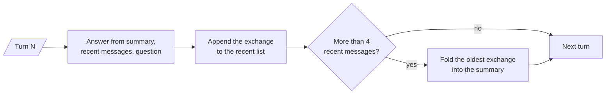

# M33.3 Theory: Trimming, windowing and summary memory

*[M33 theory](../README.md) · Lesson 33.3 · Notebooks: [`03a_trimming_windowing_and_summary.ipynb`](../../../../course/p10_memory_and_multi_agent/m33_conversational_memory_rag/notebooks/03a_trimming_windowing_and_summary.ipynb) · [All theory pages](../../../README.md)*

## Summary memory

A history that keeps everything grows on every turn (lesson 33.1). The cheap ways to bound it, a window or a token trim, drop the oldest messages, and the oldest messages are often the ones that set the context: the customer's plan, their region, the account the ticket is about. **Summary memory** compresses those messages instead of dropping them. The prompt carries a short running summary of the older turns, written by a second LLM call, plus the most recent messages word for word.

The notebook keeps the last `MAX_RECENT = 4` messages verbatim. After each answer it appends the exchange; when the recent list passes four messages, the oldest exchange goes to a summariser chain with the current summary, and the updated summary replaces the old one in the system prompt.

<!-- animated: diagrams/summary-fold.anim.html -->

Over five turns of a Larkspur billing ticket, the prompt never holds more than one summary, four recent messages and the question. From turn 3 on, every turn folds one exchange, so the summariser runs three times in five turns. On turn 5 the customer asks which plan they are on; they said so in turn 1, which by then survives only in the summary. A window of the last two exchanges would hold turns 3 and 4 and could not answer.

The summary costs something too. Each fold is an extra LLM call, so on a short chat summary memory is no cheaper than keeping everything. It is lossy: names and decisions survive, exact wording does not, and a summariser can drop a fact you needed. And the summary grows a little with every fold, so the prompt is bounded only as long as the summariser keeps it short. Lesson 33.6 builds the same idea as a LangGraph node, and `create_agent` agents get it ready-made as `SummarizationMiddleware`.

## Trim, window or summarise

`trim_messages` cuts a list to a token budget on the way to the model. The notebook's settings keep the newest messages that fit (`strategy="last"`), always keep the system message (`include_system=True`), never cut a message in half (`allow_partial=False`) and make the kept part start on a user message (`start_on="human"`), so it reads as a conversation. It runs locally; the model is only the token counter.

On the notebook's eleven-message chat, which counts 80 tokens with `gpt-4o-mini`'s counter, a 45-token budget keeps five messages (36 tokens): the system message and the last two exchanges. Bob's name and his vanilla ice cream are gone. Add a question and the trimmer keeps four of twelve messages, so neither *What ice cream do I like?* nor *What math problem did I ask?* can be answered from the conversation: *whats 2 + 2* falls outside the budget too. Those counts come from running the notebook's trimmer with `langchain-openai` 1.7.3; another counter gives other cuts.

A window does the same job in storage. The notebook's `WindowedChatHistory` keeps only the last `k = 2` exchanges, so after *My name is Paulo*, *I live in Seattle*, *I work as an AI engineer* and *I have 2 cats*, the question *What do you remember about me?* sees only the job and the cats.

| Strategy | What the model receives | Keeps early facts | Extra LLM calls | Stored history |
|---|---|---|---|---|
| Keep everything | Every message | Yes | None | Grows forever |
| Trim by tokens (`trim_messages`) | Newest messages within `max_tokens` | No | None | Complete; only the prompt is cut |
| Window of `k` exchanges | Last `2k` messages | No | None | Only the window |
| Running summary | Summary plus recent messages | Yes, compressed | One per fold | Summary plus recent |

Wrap a trimming chain in `RunnableWithMessageHistory` and the store keeps the full history while the model sees the trimmed part. That split between what is stored and what is sent is the question lesson 33.6 asks of a LangGraph thread.

## Check yourself

1. On turn 5 of the Larkspur billing ticket, the customer asks for the plan they gave in turn 1. Why can summary memory answer when a two-exchange window cannot?

A window drops the oldest messages, so it holds only turns 3 and 4 and the plan is gone. Summary memory folds old exchanges into a running summary instead of dropping them, and turn 1's plan survives there. The model sees the summary, the last four messages and the question.

2. The notebook's eleven-message chat counts 80 tokens. With a 45-token trim_messages budget, what does the model keep, and can it say which ice cream Bob likes?

It keeps five messages (36 tokens): the system message and the last two exchanges. Bob's name and his vanilla ice cream fall outside the budget, so it cannot answer. Those counts depend on the token counter; another counter gives other cuts.

3. A team adds summary memory to a support bot whose chats rarely pass three turns, hoping to cut cost. Is that a good choice?

No. Each fold is an extra LLM call, so on a short chat summary memory is no cheaper than keeping everything, and it is lossy: exact wording does not survive and a summariser can drop a fact you needed. Keep everything while the chat fits the budget.

---
*Previous: [33.2 RunnableWithMessageHistory, multi-user sessions and persistence](../02_runnablewithmessagehistory_multi_user_sessions_and_persistence/README.md). Next: [33.4 Conversational RAG with history-aware retrieval](../04_conversational_rag_with_history_aware_retrieval/README.md).*
