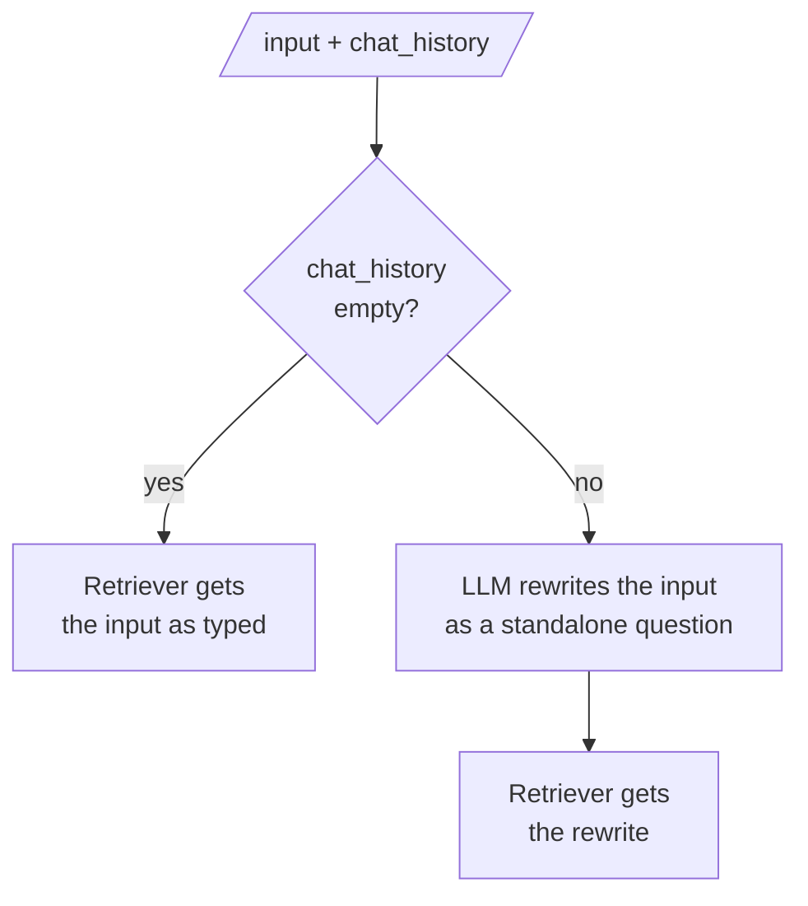

# M33.4 Theory: Conversational RAG with history-aware retrieval

*[M33 theory](../README.md) · Lesson 33.4 · Notebooks: [`04a_conversational_rag_with_history.ipynb`](../../../../course/p10_memory_and_multi_agent/m33_conversational_memory_rag/notebooks/04a_conversational_rag_with_history.ipynb) · [All theory pages](../../../README.md)*

## History-aware retriever

Lessons 33.1 to 33.3 gave the history to the model. In RAG the retriever reads the question too, and it reads only the literal text. *How long do I have?* contains one useful term, "long", and no Larkspur handbook chunk contains it: every chunk scores zero. The model would receive the history, so it knows the customer means their data after cancelling, but the chunks it receives were chosen for a question with no subject. The notebook shows the same failure on Lilian Weng's agents post: after *What is Self-Reflection?*, the follow-up *How do we achieve it?* retrieves chunks about "it".

A **history-aware retriever** adds one step before retrieval. An LLM reads the chat history and the latest question and writes a **standalone question**, one that makes sense without the history, and the retriever searches for that. The notebook's prompt tells the LLM to reformulate the question if needed, return it unchanged otherwise, and not answer it.

`create_history_aware_retriever(llm, retriever, prompt)` builds exactly this branch, so turn 1 costs no rewrite call. `create_retrieval_chain` then joins it to a stuff-documents chain whose prompt also carries `MessagesPlaceholder("chat_history")`, so the answer step sees the conversation as well. Wrapped in `RunnableWithMessageHistory` with `output_messages_key="answer"`, the chain loads and saves the history itself (lesson 33.2).

Two failure modes come with the rewrite. It is an LLM call on every follow-up, which adds latency and cost before retrieval can start. And it can be wrong: it can drop a constraint the customer gave, or carry an old topic into a new question.

## Rewrite, append or neither

The [interactive lab](interactive/follow-up-retrieval-lab.html) runs six three-turn Larkspur support chats against the twelve handbook chunks from the M11 lab, with the same TF-IDF (it matches scikit-learn's `TfidfVectorizer` to within 5e-16 on all 648 scores). It compares three things the retriever can receive on turns 2 and 3: the latest message as typed, the earlier questions with the latest appended, and a standalone rewrite. The customer messages are hand-written and the rewrites are representative, written by hand rather than generated; the rankings are real.

| Retriever receives | Turn 2 hits, `k = 1` | Turn 3 hits, `k = 1` | Hit rate, `k = 1` | Hit rate, `k = 2` |
|---|---|---|---|---|
| The latest message | 2 / 6 | 4 / 6 | 0.50 | 0.58 |
| Earlier questions + latest | 5 / 6 | 1 / 6 | 0.50 | 0.92 |
| A rewritten question | 5 / 6 | 5 / 6 | 0.83 | 0.92 |

- **The latest message misses the turns that point back.** *What do I get if you miss it?*, *How long do I have?* and *Can I get money back on it?* score zero against every chunk, and *Is that possible after I cancel?* finds the `cancel` chunk instead of the export evidence. Follow-ups that name their own subject, such as *Do my promo credits expire?*, hit either way.
- **Appending fixes turn 2 and breaks turn 3.** Turn 2 usually continues turn 1's topic, so the extra words help. Turn 3 often changes topic, and two earlier questions outweigh one new one: at `k = 1` the old topic takes the only slot in 5 of 6 chats. At `k = 2` appending catches up, by spending a context slot on the old topic every time.
- **The rewrite wins at `k = 1` and pays for it with 12 LLM calls**, one per follow-up. Its two misses are worth reading. *How long until the money is back?* misses whatever the query says, because the evidence chunk says "Refunds" and "business days" and no phrasing of the question uses those words; a rewrite restores the subject, not the handbook's vocabulary, which is M11's representation problem and the reason for embeddings ([M14](../../../p05_ingestion_and_indexing/m14_embeddings/README.md)). And *What happens if I cancel my annual plan instead of getting a refund?* is a rewrite that carried too much history: "refund" and "annual plan" pull the refund chunk above `cancel` at `k = 1`.

<!-- lab: interactive/follow-up-retrieval-lab.html -->

The lab is the module's lab brief in miniature. On your own corpus, write the multi-turn conversations, label the evidence for each turn, and report hit rate on turns 2 and 3 separately from turn 1, with and without the rewrite. A single average over all turns hides the follow-ups, because first questions are usually standalone.

---
*Previous: [33.3 Trimming, windowing and summary memory](../03_trimming_windowing_and_summary_memory/README.md). Next: [33.6 LangGraph threads, checkpoints and memory optimisations](../06_langgraph_threads_checkpoints_and_memory_optimisations/README.md).*
