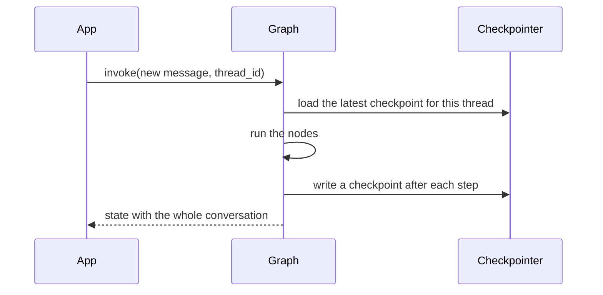
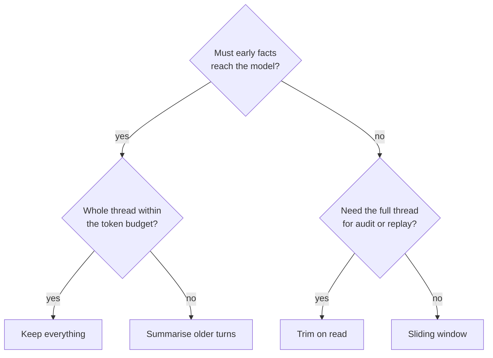

# M33.6 Theory: LangGraph threads, checkpoints and memory optimisations

*[M33 theory](../README.md) · Lesson 33.6 · Notebooks: [`06a_memory_and_conversational_agent.ipynb`](../../../../course/p10_memory_and_multi_agent/m33_conversational_memory_rag/notebooks/06a_memory_and_conversational_agent.ipynb), [`06b_memory_optimizations.ipynb`](../../../../course/p10_memory_and_multi_agent/m33_conversational_memory_rag/notebooks/06b_memory_optimizations.ipynb) · [All theory pages](../../../README.md)*

## Checkpointer / thread_id

A LangGraph graph keeps the conversation in its state, typically a `messages` channel with the `add_messages` reducer, so each node returns only its new messages and the reducer appends them. Compile the graph with a **checkpointer** and LangGraph saves a snapshot of that state, a **checkpoint**, after every step. The **`thread_id`** in the config names the sequence of checkpoints a run reads and extends:

```python
graph = builder.compile(checkpointer=InMemorySaver())
graph.invoke({"messages": "How long do I have?"},
             config={"configurable": {"thread_id": "cust-4821"}})
```



This replaces `RunnableWithMessageHistory` and `session_id` from lesson 33.2, and LangChain recommends it for new code. The same compiled graph serves every user; the id decides which history comes back. In the notebook, `user001` asks *Explain AI in 1 line* and then *Do the same for ML*, which only makes sense because the first turn is replayed; `user002` talks on another thread, and `user001`'s memory is untouched when the conversation switches back.

Checkpoints are snapshots of every step, not just of the end of a turn. A turn writes one for the input, one at the start of the run and one per node step: a one-node chat graph writes 3 per turn, and the notebook's tool-calling agent about 5 (two model calls and a tool call). `get_state(config)` returns the latest; `get_state_history(config)` walks all of them newest first, which is what replay, forking and debugging use.

| Checkpointer | Survives a restart | Use |
|---|---|---|
| `InMemorySaver` | No | Notebooks and tests |
| `SqliteSaver` | Yes, a plain SQLite file with `checkpoints` and `writes` tables | One process; a context manager, so compile inside the `with` block |
| `PostgresSaver` (`langgraph-checkpoint-postgres`) | Yes | Deployments with concurrent writers |

Two rules from the notebook. *Short-term* describes scope, not lifetime: a thread on `SqliteSaver` or `PostgresSaver` stays on disk until you delete it, so it is customer data with retention rules like any other. And the `thread_id` must come from trusted server-side config, never from user text, because whoever picks the id reads that thread.

## Delete or hide

A thread that keeps everything sends every earlier message on every turn. The notebook runs one six-turn support ticket through four graphs. Counted in messages (the token counts vary per run), the model receives:

| Turn | Sequential | Sliding window | Trim on read | Summary |
|---|---|---|---|---|
| 1 | 1 | 1 | 1 | 1 |
| 2 | 3 | 3 | 3 | 3 |
| 3 | 5 | 3 | 3 | summary + 1 |
| 4 | 7 | 3 | 3 | summary + 3 |
| 5 | 9 | 3 | 3 | summary + 1 |
| 6 | 11 | 3 | 3 | summary + 3 |
| Stored after turn 6 | 12 | 4 | 12 | summary + 4 |

These counts come from running the notebook's four graphs with a stub model in place of `gpt-4o-mini`; the graph logic decides them, not the model. Turn 3 asks *What is my favorite color?*, given in turn 1. Sequential can answer, and so can the summary graph if its summariser kept the colour; sliding window and trim on read cannot, since both send only the last `MAX_MESSAGES = 3` messages.

The two bounded strategies send the same prompt and differ in what they keep:

- **Sliding window deletes.** A `truncate` node returns `RemoveMessage(id=...)` for every message older than the window, and the `add_messages` reducer removes them from the checkpointed state. They are gone for every later turn, for `get_state()` and for anyone auditing the ticket. The reducer is the mechanism: `operator.add` can only append, so a deleting window needs `add_messages`.
- **Trim on read hides.** The model node calls `trim_messages` on a copy of the list and leaves state alone, so the thread still holds all 12 messages, turn 1's colour included. Trimming the prompt never trims the checkpoint: with `SqliteSaver` the full thread is written to disk on every step.

The summary graph keeps a `summary` string next to a `buffer` of recent messages. Once the buffer reaches `MESSAGE_THRESHOLD = 4`, a node folds all but the newest message into the summary and removes them, so it folds every other turn (turns 3 and 5 here) and each fold is an extra LLM call. Because `summary` has no reducer, any value written to it replaces the old one: pass `{"summary": ""}` only on the first turn, or each turn wipes the memory you are building.



For agents built with `create_agent`, LangChain 1.x ships the summary strategy as `SummarizationMiddleware`. M34 adds the memory a thread cannot hold: facts about a customer that should carry over to their next conversation.

## Key Takeaways

- Compile the graph with a checkpointer and take the `thread_id` from trusted server config. A checkpoint is written after every step, three per turn for a one-node chat graph, for replay and debugging.
- A sliding window deletes old messages from state through `RemoveMessage` and `add_messages`; trim on read hides them from the model and keeps the full thread. Use trim on read when audit or replay needs every message.
- Keep everything while the thread fits the budget, and summarise older turns once it does not. A persisted thread stays on disk until you delete it, so treat it as customer data with retention rules.

## Check yourself

<details>
<summary>1. The sliding-window and trim-on-read graphs both send the model the last three messages. What differs between them, and when does it matter?</summary>

The sliding window deletes: a `truncate` node returns `RemoveMessage` ids and the `add_messages` reducer removes them from checkpointed state. Trim on read hides: it trims a copy for the model, and the thread still holds all 12 messages. Pick trim on read when you need the full thread for audit or replay.

</details>

<details>
<summary>2. How many checkpoints does a one-node chat graph write per turn, and why more than one?</summary>

Three: one for the input, one at the start of the run and one per node step. Checkpoints snapshot every step, not just the end of a turn, so the notebook's tool-calling agent writes about 5. `get_state_history(config)` walks them newest first for replay, forking and debugging.

</details>

<details>
<summary>3. A summary graph runs its folds, yet each turn starts with an empty summary. What is the likely cause?</summary>

The app passes `{"summary": ""}` on every turn. The `summary` channel has no reducer, so any value written to it replaces the old one and wipes the memory being built. Pass the empty summary only on the first turn.

</details>

---
*Previous: [33.4 Conversational RAG with history-aware retrieval](../04_conversational_rag_with_history_aware_retrieval/README.md). Next: [M33 interview questions](../README.md#interview-spotlight-5-questions-you-might-get-asked).*
