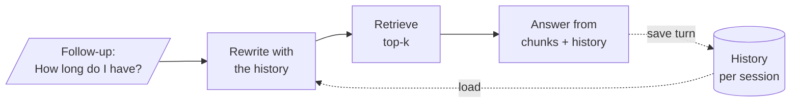

# M33 Theory: Conversation memory and conversational RAG

*Part X · Memory & Multi-Agent RAG · [Module README](../../../course/p10_memory_and_multi_agent/m33_conversational_memory_rag/README.md) · [All theory pages](../../README.md)*

A chat model keeps nothing between calls. What looks like memory is the application sending earlier messages back with each new one, and in RAG the retriever needs that history as much as the model does. The M33 notebooks build on four ideas: the message history, the summary that keeps a long history affordable, the history-aware retriever that rewrites a follow-up before searching, and the checkpointer and `thread_id` that give a LangGraph agent the same memory per user. Each idea has a page in the folder of the lesson that teaches it, listed under [Lessons](#lessons). This page has the overview, the interview questions and the takeaways.

The running example is the Larkspur Cloud support assistant answering from the same twelve handbook chunks as the [M11 lab](../../p04_rag_foundations/m11_rag_lifecycle/README.md). Customers ask a first question and then follow up: *Can I get a refund on my annual plan?* then *How long until the money is back?*, or *How do I export my data?* then *How long do I have?* The [lab](#interactive-lab) runs six of these three-turn chats.

## TL;DR

- The model is stateless. Turn N of a chat that keeps everything sends 2N − 1 messages, so six turns send 36 messages in total, and cost grows with every turn.
- A `session_id` (LCEL) or `thread_id` (LangGraph) picks whose history is loaded. The same chain or graph serves every user; the id is the whole isolation story, so it must come from your server, never from the user.
- Bounding a history is a choice between forgetting and paying: a window or a token trim drops early facts for free, and a running summary keeps them in compressed form for one extra LLM call per fold.
- A follow-up such as *How long do I have?* names no subject, so the retriever searches for the wrong thing. In the lab at `k = 1`, sending the latest message finds the evidence on 6 of 12 follow-ups; a rewritten standalone question finds it on 10.
- Appending earlier questions to the query recovers turn 2 (5 of 6) but drowns a change of topic on turn 3 (1 of 6 at `k = 1`). The rewrite costs an LLM call per follow-up and cannot fix a vocabulary mismatch.

## Mental model

<!-- animated: diagrams/conversational-turn.anim.html -->

One history feeds two consumers. The rewrite step reads it so the retriever searches for the real subject; the answer step reads it so the model can refer back. After the answer, both messages go into the history, keyed by the session, and the next turn starts from there.

## Lessons

| Lesson | Topic | Theory |
|---|---|---|
| 33.1 | Why LLMs forget; classic memory classes | [Message history](01_why_llms_forget_classic_memory_classes/README.md#message-history) [The classic memory classes](01_why_llms_forget_classic_memory_classes/README.md#the-classic-memory-classes) |
| 33.2 | RunnableWithMessageHistory, multi-user sessions and persistence | [One history per session](02_runnablewithmessagehistory_multi_user_sessions_and_persistence/README.md#one-history-per-session) [Where the history lives](02_runnablewithmessagehistory_multi_user_sessions_and_persistence/README.md#where-the-history-lives) |
| 33.3 | Trimming, windowing and summary memory | [Summary memory](03_trimming_windowing_and_summary_memory/README.md#summary-memory) [Trim, window or summarise](03_trimming_windowing_and_summary_memory/README.md#trim-window-or-summarise) |
| 33.4 | Conversational RAG with history-aware retrieval | [History-aware retriever](04_conversational_rag_with_history_aware_retrieval/README.md#history-aware-retriever) [Rewrite, append or neither](04_conversational_rag_with_history_aware_retrieval/README.md#rewrite-append-or-neither) |
| 33.5 | Memory apps: product recommender and research agent with SQL memory | *planned* |
| 33.6 | LangGraph threads, checkpoints and memory optimisations | [Checkpointer / thread_id](06_langgraph_threads_checkpoints_and_memory_optimisations/README.md#checkpointer--thread_id) [Delete or hide](06_langgraph_threads_checkpoints_and_memory_optimisations/README.md#delete-or-hide) |

## Interactive lab

[**Follow-ups and the retriever**](04_conversational_rag_with_history_aware_retrieval/interactive/follow-up-retrieval-lab.html): open the file in a browser. Start on *The latest message* at `k = 1` and open the *Exports* chat: turns 2 and 3 both miss. Switch to *Earlier questions + latest* and watch turn 2 recover while turn 3 stays stuck on the export chunk. Then pick *A rewritten question* and compare the three rows of the table, and try `k = 2` to see appending catch up by spending a second slot.

## How it connects

- **Before:** M08 builds the LCEL chains that `RunnableWithMessageHistory` wraps, and M10 introduces LangGraph checkpointers. The lab reuses the handbook and TF-IDF index from [M11](../../p04_rag_foundations/m11_rag_lifecycle/README.md); the vocabulary misses it shows are the problem [M14](../../p05_ingestion_and_indexing/m14_embeddings/README.md) solves with embeddings, and [M18](../../p06_retrieval_quality/m18_query_transformation/README.md) rewrites single questions the way lesson 33.4 rewrites follow-ups.
- **Next:** [M34](../m34_long_term_agentic_memory/README.md) keeps memory across threads: facts about a user that outlive one conversation. [M37](../m37_multi_agent_builds_deep_agents/README.md) compacts context at agent-harness scale with the summary idea from lesson 33.3.

## Interview Spotlight: 5 Questions You Might Get Asked

*Production questions of the kind asked in applied AI engineering interviews.*

### 1. After a refactor, Larkspur's assistant answers first questions well, but follow-ups like "How long do I have?" now cite billing chunks. Nothing in the retriever changed. How do you find the cause?

**What a strong answer covers:**
- Logs the query the retriever actually received on each turn, next to the user's message, before reading any prompt
- Checks that history reaches the rewrite step: the session id in the config, the `history_messages_key` matching the placeholder, and an empty `chat_history` (which makes `create_history_aware_retriever` skip the rewrite and search the raw text)
- Replays a follow-up golden set and compares hit rate on turns 2 and 3 with the last good release
- Adds those follow-ups to the regression suite so the next refactor is caught by a number, not a customer

### 2. The rewrite step adds an LLM call, and its latency, to every follow-up. A teammate wants to drop it and append the chat history to the query instead. What do you tell them?

**What a strong answer covers:**
- Appending is free and does recover elliptical turns: in the lab, turn 2 hits 5 of 6 either way
- It fails on topic changes, because earlier questions outweigh the new one: 1 of 6 turn-3 hits at `k = 1`, against 5 of 6 with a rewrite
- A larger `k` hides the problem by spending context slots on the old topic, which costs tokens and adds distractors
- Middle ground: skip the rewrite on turn 1 and when a cheap check says the question is already standalone, use a small fast model for the rewrite, and measure latency against hit rate

### 3. How do you know, week by week, whether conversational retrieval is getting better or worse in production?

**What a strong answer covers:**
- Logs per turn: turn number, raw message, rewritten query, retrieved chunk ids and scores, session id
- Tracks retrieval quality split by turn number, since first turns hide follow-up regressions in an overall average
- Samples rewrites for an LLM judge or human check: is the rewrite faithful to the history, and does it drop or invent constraints
- Re-runs a frozen set of multi-turn conversations on every prompt, model or index change, as the M33 lab brief describes

### 4. A product manager wants the conversation id in the URL so customers can share a chat with a colleague. What is the risk, and how would you build it?

**What a strong answer covers:**
- The `thread_id` or `session_id` is the only thing separating one customer's history from another's; whoever can choose it can read that history
- Derives the id on the server from the authenticated user (or checks ownership before loading), never from request text
- Builds sharing as an explicit, read-only copy or an access grant, with an audit entry
- Remembers that a persistent checkpointer keeps the thread until it is deleted, so retention and deletion rules apply to it like any customer data

### 5. Support tickets now run to 60 turns, and prompt cost per turn keeps climbing. Which memory strategy do you pick, and what do you check before shipping it?

**What a strong answer covers:**
- Full history sends every earlier message on every turn, so cost per turn grows without limit
- A window or trim on read flattens the prompt but loses early facts such as the plan or the region; a running summary keeps them for one extra call per fold
- Prefers trim on read or a summary over deleting messages, so the full thread stays available for audit and replay
- Tests recall of an early fact on a late turn, and watches the summary channel: with no reducer, writing `summary` again on a later turn overwrites the accumulated summary

## Key Takeaways

- Memory is the list of messages you resend. Decide on purpose which ones go back, because every one costs tokens on every later turn.
- Key every history by a session or thread id that your server controls, and choose a store that survives a restart before real users arrive.
- Rewrite follow-ups into standalone questions before retrieval, and measure hit rate on turns 2 and 3, not only on first questions.
- Bound long threads by hiding or summarising old turns rather than deleting them, and test that an early fact still reaches the model late in the thread.

---
*Previous: [M32 Reliability, feedback loops and diversity](../../p09_agentic_rag/m32_reliability_feedback/README.md). Next: [M34 Long-term and agentic memory](../m34_long_term_agentic_memory/README.md).*
