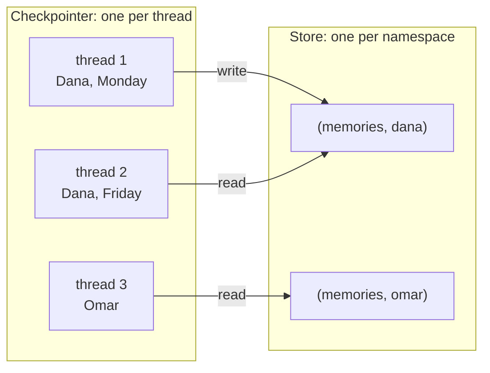

# M34.1 Theory: Cross-thread memory with a Store

*[M34 theory](../README.md) · Lesson 34.1 · Notebooks: [`01a_cross_thread_memory_store.ipynb`](../../../../course/p10_memory_and_multi_agent/m34_long_term_agentic_memory/notebooks/01a_cross_thread_memory_store.ipynb) · [All theory pages](../../../README.md)*

## Store namespaces

LangGraph has two persistence primitives, and they answer different questions:

| | Checkpointer | Store |
|---|---|---|
| Remembers | One conversation's messages and state | Anything you put in it, across conversations |
| Scoped by | `thread_id`, in `config["configurable"]` | A namespace tuple you choose |
| Written by | The graph, after every step | Your nodes, tools and admin code |
| Attached with | `compile(checkpointer=...)` | `compile(store=...)` |

A new thread starts with an empty checkpoint. If Dana tells the Larkspur assistant her plan in one chat and opens another chat tomorrow, only the store can bring that fact back.

A store item has three parts. The **namespace** is a tuple such as `("memories", "dana")`. The **key** names the item inside it. The **value** is a JSON-serialisable dict. The API is small:

- `put(namespace, key, value)` creates or overwrites an item
- `get(namespace, key)` reads one item, or `None`
- `search(namespace, filter=...)` lists a namespace, optionally filtered on value fields; it returns 10 items unless you pass `limit=`

The notebook runs exactly this: thread 1 stores "my name is Alice", thread 2 (same user, new thread) answers from the store, and thread 3 (another user) finds an empty namespace.

### The namespace is the access boundary

Nothing else in the store separates customers. Who may read what is decided by how you build the tuple, so the parts of it must come from trusted input:

- **Pass ids in the run's context.** `StateGraph(..., context_schema=Context)` declares a dataclass such as `Context(user_id: str)`, and every call passes `graph.invoke(..., context=Context(user_id=...))`, filled by the server from the login. Nodes read it as `runtime.context` and the store as `runtime.store`, through a `runtime: Runtime[Context]` parameter.
- **Keep ids out of tool schemas.** From lesson 34.2 on, memory tools take `runtime: ToolRuntime[Context]`. That parameter is injected by `ToolNode` and is not part of the schema the model sees, so the model cannot ask for `user_id="admin"`.
- **Keep `thread_id` for the checkpointer.** It stays in `config["configurable"]`. A store namespace built from `thread_id` makes "long-term" memory vanish with every new chat.

| Namespace | Scope | Larkspur example | What goes wrong if it is wrong |
|---|---|---|---|
| `("semantic", user_id)` | One customer, every visit | Dana is on an annual business plan | A global namespace leaks Dana's plan to Omar |
| `("episodic", user_id)` | One customer, every visit | Showed Dana how to export from Settings, then Data | Keyed by `thread_id`, it is gone in the next chat |
| `("session", session_id)` | One visit, any number of threads | Reply in French for this visit | Keyed by `user_id`, it never ends |
| `("procedures", agent_id)` | One agent or tenant | The approved refund procedure | Keyed by `user_id`, a customer could own a rule |

The notebook's first graph uses a deliberately naive write rule (save whatever follows the word "remember") to keep the focus on the store. Lesson 34.2 replaces it with tools and write rules per layer.

### Swapping the backend

`InMemoryStore` disappears with the process. `PostgresStore` implements the same interface, so the graph is recompiled with a different `store=` and no node changes. `PostgresStore.from_conn_string(...)` is a context manager that closes its connection when the `with` block ends, and `setup()` creates the tables on first use. The notebook probes for a local Postgres first and skips that part when none is running.

## Key Takeaways

- A checkpointer remembers one thread; a store holds items under a namespace tuple across threads. Only the store brings a fact back when the same customer opens a new chat.
- The namespace is the only access boundary in the store. Build it from ids the server puts in the run's context, keep them out of tool schemas, and never key long-term memory by `thread_id`.
- Choose the namespace by scope: `user_id` for facts and episodes, `session_id` for one visit, `agent_id` for procedures. Swapping `InMemoryStore` for `PostgresStore` changes only the `store=` argument.

## Check yourself

1. Dana gives the Larkspur assistant her plan in one chat and opens a new chat the next day. Why can the checkpointer not recall it, and what can?

The checkpointer is scoped by `thread_id`, and a new thread starts with an empty checkpoint. A store is scoped by a namespace tuple you choose, such as `("memories", "dana")`, so a node in the new thread can read what an earlier thread wrote there.

2. A memory tool takes user_id as an ordinary argument that the model fills in. What is the risk, and how should the id reach the tool instead?

The namespace is the only access boundary in the store, so a model that can choose `user_id="admin"` can read or write another customer's memories. Pass the id in the run's context, `context=Context(user_id=...)`, filled by the server from the login. Tools take `runtime: ToolRuntime[Context]`, which `ToolNode` injects and which is not in the schema the model sees.

3. A team keys the episodic namespace by thread_id, and customers say the assistant forgets past help in every new chat. What went wrong?

Every new chat has a new `thread_id`, so every chat writes to and reads from a fresh, empty namespace, and "long-term" memory vanishes with each chat. Key episodes by `("episodic", user_id)` and keep `thread_id` for the checkpointer only.

---
*Previous: [M34 overview](../README.md). Next: [34.2 Session, semantic, episodic and procedural memory on SQLite](../02_session_semantic_episodic_and_procedural_memory_on_sqlite/README.md).*
