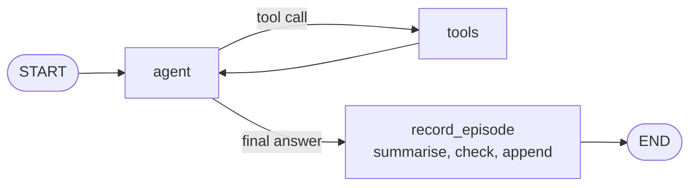

# M34.3 Theory: A combined-memory agent

*[M34 theory](../README.md) · Lesson 34.3 · Notebooks: [`03a_combined_memory_agent_sqlite.ipynb`](../../../../course/p10_memory_and_multi_agent/m34_long_term_agentic_memory/notebooks/03a_combined_memory_agent_sqlite.ipynb) · [All theory pages](../../../README.md)*

## Who writes each layer

The capstone runs five layers in one agent and one SQLite file, `agent_memory.db`. `SqliteSaver` owns the `checkpoints` and `writes` tables; `SqliteStore` owns the `store` table, and four layers share it, kept apart by namespace. The table that matters is the last column: each layer has exactly one writer.

| Layer | Scope id | Passed as | Read as | Writer |
|---|---|---|---|---|
| Short-term | `thread_id` | `config["configurable"]` | Full replay of the thread | The checkpointer, every step |
| Session | `session_id` | `context` | Preloaded | The app, with a 30-minute TTL |
| Semantic | `user_id` | `context` | Preloaded with keys | The model, through `save_user_fact` |
| Episodic | `user_id` | `context` | Newest first, preloaded | A graph node after each answer |
| Procedural | `agent_id` | `context` | Highest approved version | A human, after review |

The agent itself never writes session items or procedures. The capstone stores a `checklist` procedure as v1 approved and v2 still `proposed`; the agent reads v1 and ignores v2, because only the highest **approved** version counts.

### Episodes are written in code

The episodic notebook gave the model a `save_episode` tool and the user asked for the save. Without that request, in six test runs of this agent with the tool and a system-prompt rule to use it, gpt-4o-mini never saved one episode. So the capstone adds a node:

`record_episode` runs once per turn, after the final answer. It asks the model for a structured summary (`work_request`, `task`, `outcome`), and then code makes the decision: a turn counts as a task only if `work_request` quotes the user's own message, which code checks by looking for the quote's first 20 characters in it. A real task becomes a new episode under a fresh key, and the oldest episodes past `MAX_EPISODES = 3` are deleted.

The end-to-end run checks every layer in code. Priya introduces herself and asks for a credentials-rotation checklist in visit 1; the checklist ends with the procedure's `Risk:` line and stays within the session's 60-word limit. In visit 2 (new thread, new session) the agent recalls her role and the checklist, and a changed preference overwrites its key instead of adding a fact. Marco, a different user on the same agent, sees none of it but gets the same procedure, because procedures are scoped to the agent, not the user.

## The preload budget

The capstone preloads all four store layers into the system prompt on every model call: facts with keys, episodes newest first, the session instruction and the approved procedures. That is the right design while memory is small, and it has two limits.

- **A silent cap.** `store.search()` returns 10 items unless you pass `limit=`. The capstone passes `limit=100` everywhere; a preload without it drops the 11th fact with no error.
- **A growing bill.** Every preloaded item is paid for on every call, including the calls inside the tool loop. Cap each layer (pruning, `MAX_EPISODES`), and when a layer outgrows the prompt, retrieve from it instead of loading all of it (lesson 34.4).

The production path changes the backend, not the agent. `PostgresSaver` and `PostgresStore` replace the two SQLite primitives, and nodes and tools are untouched because they only see `runtime.store` and the compiled checkpointer. The move buys concurrent writers without `database is locked`, a working `omit_expired=True`, and `search(..., query=...)` over a pgvector index for recall by meaning. The notebook prints the snippet but does not run it, because it needs a Postgres server.

The same layers can be two hand-written SQL tables: `PRIMARY KEY (user_id, key)` with `INSERT OR REPLACE` is the semantic upsert, and a fresh id per row is the episodic append. Tables give you joins and constraints; the store gives you namespaces, TTLs, embedding search and the Postgres swap. Read `SqliteStore`'s own `store` table only through `get` and `search`, since its schema may change between versions.

## Key Takeaways

- Give each memory layer exactly one writer: the checkpointer for the thread, the app for the session, the model for facts, a graph node for episodes and a human for procedures.
- In six test runs gpt-4o-mini never called the save tool unprompted, so write episodes in a node after each answer and let code decide whether the turn was a real task.
- Preloading every layer works while memory is small, but each item is paid for on every call. Pass `limit=` to `search`, cap each layer, and retrieve once a layer outgrows the prompt.

## Check yourself

1. Why does the capstone record episodes in a graph node instead of relying on the model to call a save_episode tool?

In six test runs with the tool and a system-prompt rule to use it, gpt-4o-mini never saved one episode. So `record_episode` runs in code once per turn, after the final answer: the model writes a structured summary, and code decides it is a task only if `work_request` quotes the user's own message. Each layer then has exactly one writer.

2. The store holds the checklist procedure as v1 approved and v2 proposed. Which version does the agent follow for Priya, and which for Marco?

Both get v1, because only the highest approved version counts and v2 is still `proposed`. Marco gets the same procedure as Priya because procedures are scoped to `agent_id`, not to the user, while her facts and episodes stay in her own namespaces.

3. A customer has 14 saved facts, but the agent never uses the last few and nothing logs an error. What is the likely cause?

The preload calls `store.search()` without `limit=`, and it returns 10 items by default, so the 11th fact onwards is dropped silently. The capstone passes `limit=100` everywhere. When a layer grows past what the prompt should carry on every call, retrieve from it instead of preloading it all (lesson 34.4).

---
*Previous: [34.2 Session, semantic, episodic and procedural memory on SQLite](../02_session_semantic_episodic_and_procedural_memory_on_sqlite/README.md). Next: [34.4 Episodic + semantic stack and multi-hop graph memory](../04_episodic_semantic_stack_and_multi_hop_graph_memory/README.md).*
