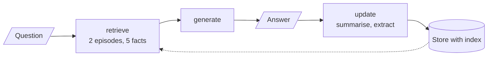
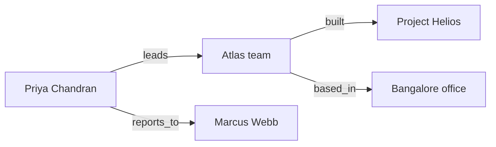

# M34.4 Theory: Episodic + semantic stack and multi-hop graph memory

*[M34 theory](../README.md) · Lesson 34.4 · Notebooks: [`04a_episodic_with_semantic_memory.ipynb`](../../../../course/p10_memory_and_multi_agent/m34_long_term_agentic_memory/notebooks/04a_episodic_with_semantic_memory.ipynb), [`04b_graph_memory_multi_hop.ipynb`](../../../../course/p10_memory_and_multi_agent/m34_long_term_agentic_memory/optional/04b_graph_memory_multi_hop.ipynb) (optional) · [All theory pages](../../../README.md)*

## Recall by similarity

Lessons 34.2 and 34.3 read memory by key and by recency. A "newest three episodes" preload cannot surface a conversation from three months ago, however relevant. This notebook recalls both kinds of memory the way a RAG pipeline recalls chunks: embed the question, return the nearest items.

The store is the same API with an index switched on: `InMemoryStore(index={"embed": embeddings, "dims": 1536, "fields": ["text"]})` with `text-embedding-3-small`. Every `put` embeds the value's `text` field, and `search(namespace, query=..., limit=k)` ranks items by similarity. Each user has two namespaces, `(user_id, "episodic")` and `(user_id, "semantic")`. A durable store with a vector index, such as `PostgresStore` with pgvector, takes the same calls.

The **update** node writes both memories after every answer, in the same graph call:

- **Episodic:** a one-sentence summary of the exchange, under a UUID key.
- **Semantic:** facts extracted from the **user's message only**, as `user --RELATION--> object`. The extractor never sees the assistant's reply, so the model's own suggestions cannot come back later as things the user said. Code writes the subject `user`, so "Alex", "I" and "the user" stay one person, and the key is the fact's normalised text, so restating a fact overwrites it.

The memory test is three turns. Alex says he is a conservative investor interested in established tech companies, then asks about Apple, then asks "Based on my goals, what's a good alternative to that stock?" The third question names neither the goal nor the stock. Its retrieved block holds the Apple episode and the conservative-investor fact, and the notebook checks both in code, along with the count of stored facts, which must not grow during the two questions.

Retrieval picks the memories; time orders them. The retrieve node sorts the two recalled episodes oldest first, so the prompt can tell the model to resolve "that stock" from the most recent conversation.

## Graph memory for multi-hop questions

Similarity search returns items that look like the question. It has no way to chase a relation from one fact to the next. Graph memory stores facts as `(subject, relation, object)` edges and answers by traversal.

The notebook ingests five separate sentences about a fictional company. No sentence mentions both Project Helios and Marcus Webb, yet the test question needs both: "Who manages the person who leads the team that built Project Helios?"

Three design choices make the graph usable:

- **A small relation vocabulary.** `leads`, `manages`, `reports_to`, `member_of`, `built`, `works_on`, `holds_role`, `based_in`. Without it one relation turns into `is`, `has` and `holds_role` on different edges.
- **The subject performs the action.** "Project Helios was built by the Atlas team" must become `(Atlas team, built, Project Helios)`. Left alone, the model keeps sentence order and writes an edge that says the project built the team.
- **Indexes in both directions.** The store keeps outgoing and incoming edges, normalises entity names (case, a leading "the"), and stores a repeated fact once, so a breadth-first search can walk `built` backwards from the project to the team.

The reader asks the model for one start entity, traverses up to `max_hops`, and answers only from the triples it reached. From Project Helios, three hops reach the team, then Priya Chandran, then Marcus Webb, and the answer names him. With `max_hops=1` the traversal stops at the team, and the reader has to say the facts are insufficient. The printed path is the evidence: you can see which edges produced the answer.

The optional Part 5 loads the same triples into Neo4j and lets the model write Cypher against the schema, run read-only. M43 builds on that.

## Key Takeaways

- Index the store on a text field and `search(namespace, query=..., limit=k)` recalls memories by meaning, so an old but relevant episode can surface where a newest-N preload cannot.
- Extract facts from the user's message only, write the subject `user` in code and key on the normalised fact. The model's suggestions never return as user statements, and a restated fact overwrites the old one.
- Similarity cannot chase a relation from fact to fact; graph memory traverses `(subject, relation, object)` edges for multi-hop questions. Keep the relation vocabulary small and index edges in both directions.

## Check yourself

1. Why does the update node extract semantic facts from the user's message only, and never from the assistant's reply?

So the model's own suggestions cannot come back later as things the user said. Code also writes the subject as `user`, so "Alex", "I" and "the user" stay one person, and keys each fact by its normalised text, so restating a fact overwrites it instead of adding a copy.

2. Alex asks for a good alternative to that stock, naming neither his goal nor the stock. What must retrieval return, and how is that stock resolved?

It must return the Apple episode and the conservative-investor fact; the notebook checks both in code. The retrieve node sorts the two recalled episodes oldest first, so the prompt can tell the model to resolve "that stock" from the most recent conversation.

3. Graph memory says the facts are insufficient to answer the Project Helios question. What setting do you check, and why would similarity search not answer it either?

Check `max_hops`: at 1 the traversal stops at the Atlas team, and the answer needs three hops (team, Priya Chandran, Marcus Webb). Similarity search returns items that look like the question, and no single sentence mentions both Project Helios and Marcus Webb, so it cannot chase the relations between them.

---
*Previous: [34.3 A combined-memory agent](../03_a_combined_memory_agent/README.md). Next: [34.5 MemGPT tiers, Voyager skill library, Agent Workflow Memory](../05_memgpt_tiers_voyager_skill_library_agent_workflow_memory/README.md).*
