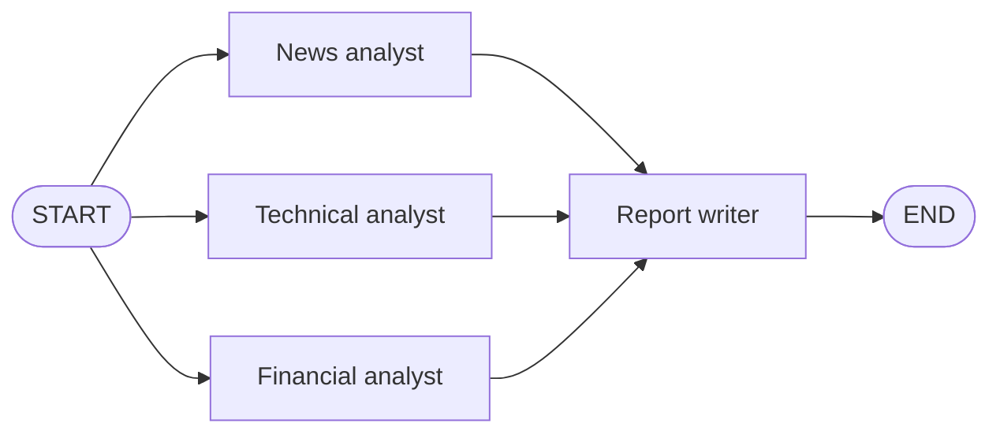

# M35.1 Theory: Monolithic vs multi-agent; a crew from scratch

*[M35 theory](../README.md) · Lesson 35.1 · Notebooks: [`01a_multi_agent_vs_monolithic_agent.ipynb`](../../../../course/p10_memory_and_multi_agent/m35_multi_agent_architectures/notebooks/01a_multi_agent_vs_monolithic_agent.ipynb), [`01b_multiagent_pattern_from_scratch.ipynb`](../../../../course/p10_memory_and_multi_agent/m35_multi_agent_architectures/optional/01b_multiagent_pattern_from_scratch.ipynb) (optional) · [All theory pages](../../../README.md)*

## When one agent becomes a team

A monolithic agent is one ReAct loop with one system prompt and every tool. The 35.1 notebook gives such an agent a web search tool (`TavilySearch`, 3 results per search) and asks it for a market report with three sections: news and sentiment, a technical read of the price trend, and financial performance. Then it builds a team for the same request: a news analyst, a technical analyst and a financial analyst, each a ReAct agent with its own persona and the same search tool, and a report writer that merges their three sections.

| | Monolithic agent | Specialist team |
|---|---|---|
| Prompts | one, covering every domain | one per specialist, each about one domain |
| Tool choice | every tool, every step | a few tools per agent |
| Model calls | one ReAct loop | three ReAct loops and a synthesis call; the notebook puts it at roughly four times the calls |
| Latency | sequential | the specialists run in parallel, so the slowest one sets the time |
| Failure you debug | one long transcript | which specialist went wrong, and whether the writer used its section |

The team runs as fan-out and fan-in. `START` has an edge to all three analysts, and each analyst has an edge to the writer. LangGraph runs the three analysts in the same super-step and starts the writer only when all three have finished.

The notebook does not declare a winner from one run. It measures both reports in code (word count, markdown headings, whether each requested topic is covered) and asks a judge to score each report on its own, so the judge never knows which approach wrote it. One request on one company is one sample, and a gap of a point or two on the judge alone is noise.

For Larkspur the same question decides whether to split the support assistant. One agent with the whole handbook and every tool has to tell a refund question from an outage question on every step. Three agents (billing, operations, data) each search one part of the handbook, at the cost of a decision about which of them should answer. The rest of this module is about that decision.

## A crew is a dependency graph

The optional notebook rebuilds the core of CrewAI without a framework, on the raw OpenAI SDK. An `Agent` has a role, a task and an expected output. `agent_1 >> agent_2` (borrowed from Airflow) records that agent 2 needs agent 1's output, and agent 2 receives that output in its context, labelled with the agent that produced it.

A `Crew` collects agents in a `with` block and runs them in topological order: an agent runs only after everything it depends on. A cycle has no topological order, so the crew raises an error before any model is called. `[analyst_a, analyst_b] >> editor` is fan-in: the editor waits for both and reads both outputs.

The last part of the notebook draws the same fan-in crew as a LangGraph `StateGraph`, with one `add_edge` per dependency. A crew is a fixed dependency graph. Everything in lesson 35.2 onward adds a node that chooses the next agent at run time.

## Check yourself

1. The specialist team makes roughly four times the monolithic agent's model calls. Why is its latency set by the slowest analyst, not the sum of all three?

`START` has an edge to all three analysts, so LangGraph runs them in the same super-step, in parallel. The report writer has an edge from each analyst and starts only when all three have finished. The time is the slowest analyst plus the synthesis call.

2. On one company, the team's report scores a point higher than the monolithic report from the judge. Is that enough to switch to the team?

No. One request on one company is one sample, and a gap of a point or two on the judge alone is noise. The notebook also measures both reports in code (word count, headings, whether each requested topic is covered), and the judge scores each report without knowing which approach wrote it.

3. A crew built from the optional notebook declares writer >> reviewer and reviewer >> writer. What happens when you run it?

The crew raises an error before any model is called. It runs agents in topological order, and a cycle has no topological order. A crew is a fixed dependency graph; choosing the next agent at run time needs the patterns from lesson 35.2 on.

---
*Previous: [M35 overview](../README.md). Next: [35.2 The five multi-agent architectures and agent communication](../02_the_five_multi_agent_architectures_and_agent_communication/README.md).*
