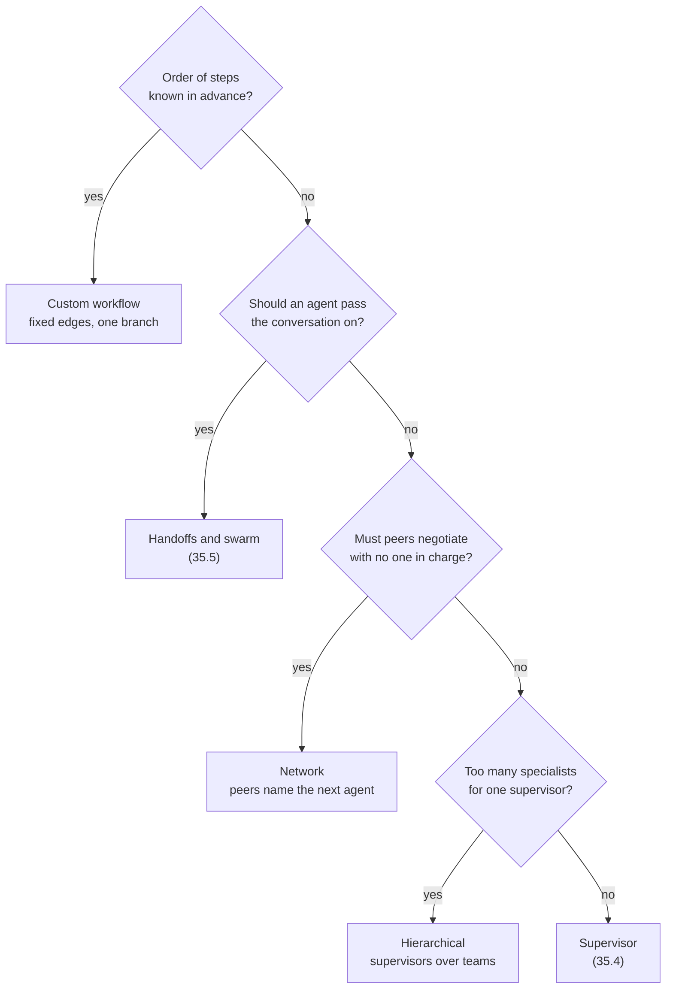
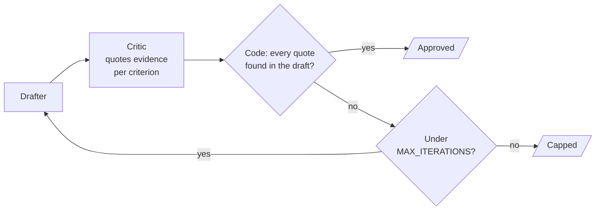

# M35.2 Theory: The five multi-agent architectures and agent communication

*[M35 theory](../README.md) · Lesson 35.2 · Notebooks: [`02a_five_multi_agent_architectures.ipynb`](../../../../course/p10_memory_and_multi_agent/m35_multi_agent_architectures/notebooks/02a_five_multi_agent_architectures.ipynb), [`02b_agent_communication.ipynb`](../../../../course/p10_memory_and_multi_agent/m35_multi_agent_architectures/optional/02b_agent_communication.ipynb) (optional) · [All theory pages](../../../README.md)*

## Five architectures, one primitive

Every architecture in the 35.2 notebook is built from one return value. A node returns `Command(goto="writer", update={...})`: the update is written to state and the graph runs `writer` next. The node's return annotation, such as `Command[Literal["writer", "__end__"]]`, lists the nodes it may jump to, and LangGraph draws those as the graph's edges. `add_edge` fixes a path when the graph is built; `Command(goto=...)` picks one at run time. Most real systems use both.

| Architecture | Who decides what runs next | Fails when | Reach for it when |
|---|---|---|---|
| Network | each agent, for itself | nothing guarantees the run ends | agents need to negotiate |
| Supervisor | one central node | the supervisor becomes a bottleneck | routing must be auditable |
| Tool-calling supervisor | the model, by choosing tools | the same input can route differently | intent classification is the hard part |
| Hierarchical | a coordinator over team coordinators | step budgets grow and team internals are hidden | the problem is shaped like an org chart |
| Custom workflow | mostly the graph, with one dynamic branch | the work is too open-ended for fixed paths | the sequence is known in advance |

The tool-calling supervisor needs no routing code. Each specialist is wrapped as a tool, and `InjectedState` hands it the graph's state without the model having to pass it as an argument. The docstring is the routing rule, because it is the tool description the model reads. The notebook's mixed query ("trouble with my bill and the app keeps crashing") may call one specialist or two, and that variability is the trade.

Two points from the notebook carry through the rest of the module:

- **A router that writes nothing keeps the transcript readable.** The supervisor in Part 2 decides without appending a message, so the transcript holds only the work.
- **Always pass `recursion_limit`.** LangGraph counts super-steps, and its default limit is 10,007. The notebook passes 25 on every run, and a deliberately endless ping-pong between two nodes stops with `GraphRecursionError` in a fraction of a second. The hierarchy run needs twice that, because each team adds steps of its own.

For Larkspur, the choice comes down to a few questions in order:

The support assistant's order is not known in advance (a question may need one specialist or two), so it starts at the second question, and the answer depends on whether conversations stay with one specialist across turns. A swarm is a network in which the handoffs are tools and the graph remembers who holds the conversation; lesson 35.5 builds one. Lesson 35.4 builds the supervisor and the hierarchy.

## Agent communication

Choosing who runs next is half the design. The other half is what agents pass to each other while they run. The optional notebook builds three patterns.

| Pattern | State | Each agent reads | Trade-off |
|---|---|---|---|
| Message passing | one `messages` list with the `add_messages` reducer | the whole conversation so far | simple and transparent; every agent re-reads and parses prose |
| Typed fields | one field per stage (`raw_data`, `analysis`, `confidence_score`, `recommendations`) | only the fields it needs | structured output fills each field with a validated Pydantic object; the schema is rigid |
| Generator and critic | running lists of `drafts` and `critiques` (`operator.add`) | the last draft and the feedback on it | iterates to a better draft; needs a cap |

The generator and critic loop shows how to keep a model from ending its own loop. The critic does not return a yes or no. For each of three criteria it copies the sentence from the draft that meets it, or writes `none`. Code then checks that each quote really is in the draft and computes the verdict, and `MAX_ITERATIONS = 3` ends the loop whether or not the critic approves.

The notebook marks one boundary. This loop is not a blackboard: its order is fixed (draft, critique, draft), and only the exit is decided at run time. A blackboard has a controller that picks which of several specialists acts next from what is on the shared board; M36 builds one.

## Check yourself

1. What does a node return to choose the next agent at run time, and how does LangGraph know which edges to draw for it?

It returns `Command(goto="writer", update={...})`: the update goes into state and the named node runs next. The return annotation, such as `Command[Literal["writer", "__end__"]]`, lists the nodes it may jump to, and LangGraph draws those as edges. `add_edge` fixes a path at build time; `Command(goto=...)` picks one at run time.

2. Larkspur's support assistant may need one specialist or two, so the order is not known in advance. Which question then decides between a swarm and a supervisor?

Whether an agent should pass the conversation on, which comes down to whether conversations stay with one specialist across turns. If yes, use handoffs and a swarm (35.5). If no, and peers need not negotiate and one supervisor can handle the specialists, use a supervisor (35.4).

3. A yes-or-no critic sometimes approves drafts that miss a criterion. How does the notebook's critic design prevent that, and what ends the loop?

The critic never gives the verdict. For each of three criteria it quotes the sentence from the draft that meets it, or writes `none`; code checks that each quote is really in the draft and computes the verdict. `MAX_ITERATIONS = 3` ends the loop whether or not the critic approves.

---
*Previous: [35.1 Monolithic vs multi-agent; a crew from scratch](../01_monolithic_vs_multi_agent_a_crew_from_scratch/README.md). Next: [35.3 Supervisor workflow with human review](../03_supervisor_workflow_with_human_review/README.md).*
