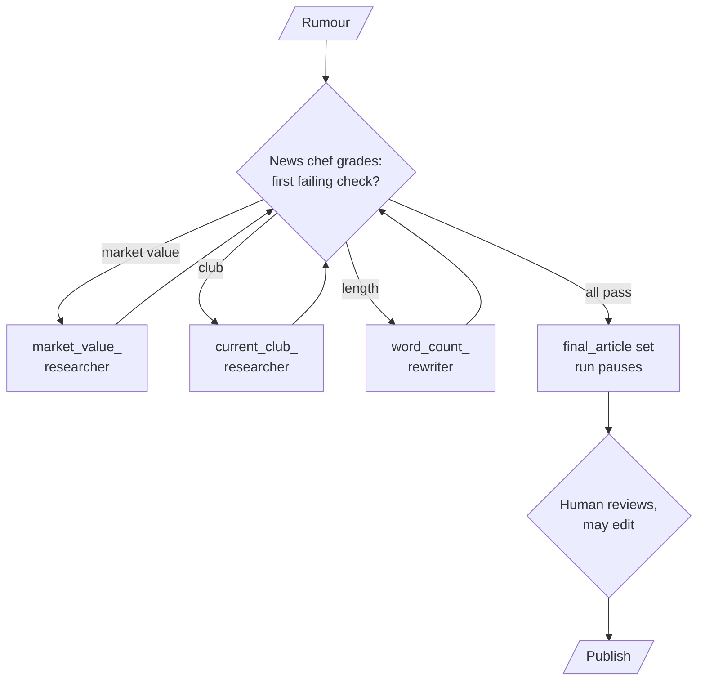

# M35.3 Theory: Supervisor workflow with human review

*[M35 theory](../README.md) · Lesson 35.3 · Notebooks: [`03a_supervisor_workflow_with_human_review.ipynb`](../../../../course/p10_memory_and_multi_agent/m35_multi_agent_architectures/optional/03a_supervisor_workflow_with_human_review.ipynb) (optional) · [All theory pages](../../../README.md)*

## Human review in a supervisor loop

The 35.3 notebook turns a short transfer rumour into a publishable news article. An article passes when it is about football transfers, names the player's current club and market value, and runs to at least 100 words. A supervisor, the "news chef", grades the article and routes it to the specialist that can fix the first failing check. A human reads the result before it is published.

Four design choices make the loop safe to run unattended up to the human step:

- **Grade in code what code can check.** Topic, club and market value need judgement, so a model answers them with structured output. The word count is exact, so code does it and the model is never asked.
- **Route to the first failing check.** After every specialist, control returns to the news chef, which grades the updated article again: market value first, then club, then length. An off-topic article ends the run at once.
- **Cap the passes.** `MAX_PASSES = 5`. A grader that keeps answering "no" cannot keep the loop going past that.
- **Write the output in one place.** Only a full pass copies the article into `final_article`, so the published text is always the version that passed, whether or not any specialist ran.

The workflow then becomes one node of an outer graph, followed by a node that publishes. Compiling the outer graph with a checkpointer and `interrupt_after=["newsagent_node"]` pauses every run after the article is written. The reviewer reads the state, changes it with `update_state` if needed, and resumes with `invoke(None, ...)`. In the notebook the edited article, not the model's, reaches the publishing call.

That interrupt is static: fixed at compile time, it pauses every run at the named node. A dynamic `interrupt(payload)` inside a node pauses only when the node decides to, and the run resumes with `Command(resume=...)`. Larkspur needs the dynamic kind. A refund the billing agent proposes inside the 30-day window can go straight to the customer; one outside the window pauses for a person. The check that decides to pause compares dates in code, for the same reason the word count does.

---
*Previous: [35.2 The five multi-agent architectures and agent communication](../02_the_five_multi_agent_architectures_and_agent_communication/README.md). Next: [35.4 Supervisors and hierarchical teams](../04_supervisors_and_hierarchical_teams/README.md).*
