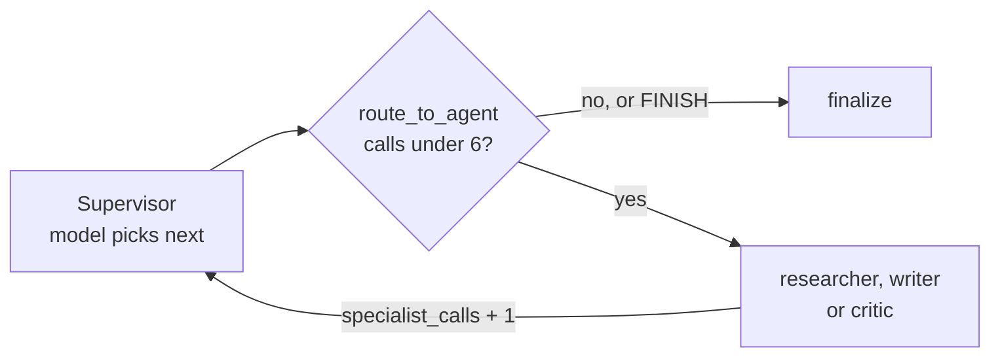
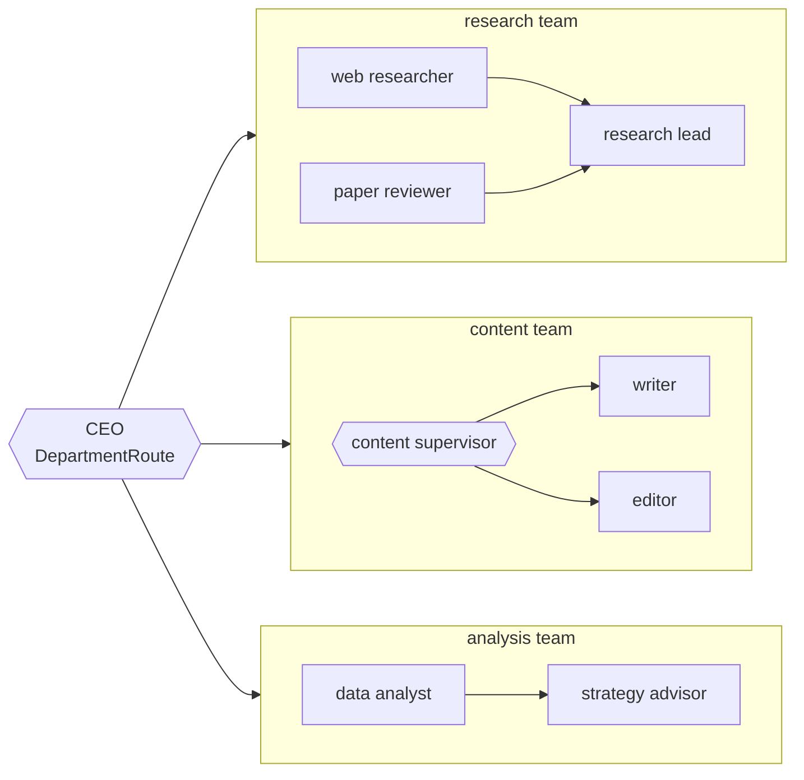

# M35.4 Theory: Supervisors and hierarchical teams

*[M35 theory](../README.md) · Lesson 35.4 · Notebooks: [`04a_supervisor_pattern.ipynb`](../../../../course/p10_memory_and_multi_agent/m35_multi_agent_architectures/notebooks/04a_supervisor_pattern.ipynb), [`04b_hierarchical_agents.ipynb`](../../../../course/p10_memory_and_multi_agent/m35_multi_agent_architectures/notebooks/04b_hierarchical_agents.ipynb) · [All theory pages](../../../README.md)*

## Supervisor

A supervisor is a node that reads the work so far and picks the next specialist, or decides the task is done. Every specialist reports back to it. In the 35.4 notebook the supervisor is a model with structured output: `RouteDecision` holds `next`, a closed `Literal["researcher", "writer", "critic", "FINISH"]`, and a one-line `reasoning`. A typed choice cannot name a node that does not exist, and the graph never parses prose to find out where to go.

The notebook splits deciding from routing:

- The **supervisor** calls the model and writes the decision to state: `next_agent`, `task_complete`, and one entry in `route_log`. It never writes to `messages`, so the transcript holds only the work and the routing history sits in its own key.
- Each **specialist** appends its output to `messages` and returns `specialist_calls: 1`. The `operator.add` reducer sums those, so the count never depends on reading message text.
- **`route_to_agent`** is a pure function on the conditional edge. It reads `specialist_calls` first and sends the run to `finalize` once it reaches `MAX_SPECIALIST_CALLS = 6`, whatever the model chose. Only then does it follow `task_complete` and `next_agent`.

`recursion_limit = 25` stays as the backstop, but it ends a run with an error; the counter ends it with a result. Part 9 of the notebook proves the cap with stubs: a supervisor that never says `FINISH` and a writer that returns numbered drafts without a model. The run stops at 6 specialist calls, and no model is called.

The supervisor's price is one decision before each specialist and one more to finish. On Larkspur's outage request (operations, then billing) that is 5 model calls, 3 of them routing, where a swarm needs 3. Each follow-up costs the supervisor 3 calls, because every turn starts at the supervisor again. The [routing cost lab](../05_handoffs_and_swarms/interactive/routing-cost-lab.html) counts it call by call. In exchange, every routing decision is in one log with its reason, the routing rules are in one prompt you can test, and one counter caps the whole run.

## Hierarchical teams

When one supervisor has too many workers to choose among well, group the workers into teams with a supervisor each, and put a coordinator over the team supervisors. In LangGraph each team is its own `StateGraph`, compiled on its own, and added to the parent graph with `add_node` like any function node. The parent never sees inside it.

After each department the run returns to the CEO, which can send the work on to a second department (research, then content) or finish. The notebook's teams show that a team's inside is its own choice: research fans out to two specialists and merges in a lead, content has its own supervisor, analysis is a fixed pipeline.

Four rules make the hierarchy compose:

- **One shared state contract.** `TeamState` (`messages` and `final_answer`) is what the parent and every team speak, so a compiled team drops in as a node with no adapter code.
- **Extensions stay at their level.** The CEO's `CEOState` adds `department`, `route_log` and `ceo_turns`; the content team's `ContentState` adds `next_step` and `content_turns`. Keys outside `TeamState` never cross the boundary.
- **Counters stay out of the shared contract.** A team hands its whole final state back to the parent. A counter in `TeamState` with an adding reducer would be added a second time on the way up.
- **Cap every level.** `MAX_CEO_TURNS = 4` and `MAX_CONTENT_TURNS = 4`, each read by a pure routing function from its own counter.

Test each team on its own before you assemble the hierarchy; a team that misbehaves is much harder to diagnose once it is one node inside a larger graph. The cost is visibility and steps: the parent sees what a team appended, not why, and in lesson 35.2 the two-level run needs `recursion_limit` raised from 25 to 50.

Larkspur's three specialists do not need a hierarchy. Put billing and data in an accounts team with its own lead and operations in a platform team, and the outage request costs 7 model calls, 5 of them routing, against 5 for a flat supervisor. A hierarchy starts to pay when the flat supervisor's prompt has to describe so many specialists that its routing accuracy drops; measure that before adding the layer.

## Key Takeaways

- Give the supervisor a closed `Literal` of next nodes and keep its decisions out of `messages`. A pure routing function reads a specialist-call counter first, so the cap ends a run with a result, not an error.
- A supervisor pays one routing call before each specialist and one to finish, 5 calls for the outage request against 3 for a swarm. In return, every decision sits in one log with its reason.
- Compose hierarchies through one shared state contract, keep counters out of it and cap every level. Add a layer only after measuring that a flat supervisor's routing accuracy has dropped.

## Check yourself

1. Why does route_to_agent check specialist_calls before it reads the supervisor's decision?

So the cap holds whatever the model chooses: once `specialist_calls` reaches `MAX_SPECIALIST_CALLS = 6`, the run goes to `finalize`. `recursion_limit = 25` is only a backstop and ends a run with an error; the counter ends it with a result. The `operator.add` reducer sums each specialist's `specialist_calls: 1`, so the count never depends on message text.

2. For Larkspur's outage request (operations, then billing), how many model calls does a flat supervisor make, and how many does a two-team hierarchy make?

The flat supervisor makes 5, 3 of them routing. Splitting into an accounts team and a platform team raises it to 7, 5 of them routing. Larkspur's three specialists do not need the hierarchy; it pays only when the flat supervisor's routing accuracy drops with too many specialists.

3. A developer adds a turn counter with an adding reducer to TeamState, and the CEO's count comes out too high. What went wrong?

A team hands its whole final state back to the parent, so a counter in the shared contract is added a second time on the way up. Keep counters at their own level, as `ceo_turns` in `CEOState` and `content_turns` in `ContentState`, outside `TeamState`.

---
*Previous: [35.3 Supervisor workflow with human review](../03_supervisor_workflow_with_human_review/README.md). Next: [35.5 Handoffs and swarms](../05_handoffs_and_swarms/README.md).*
