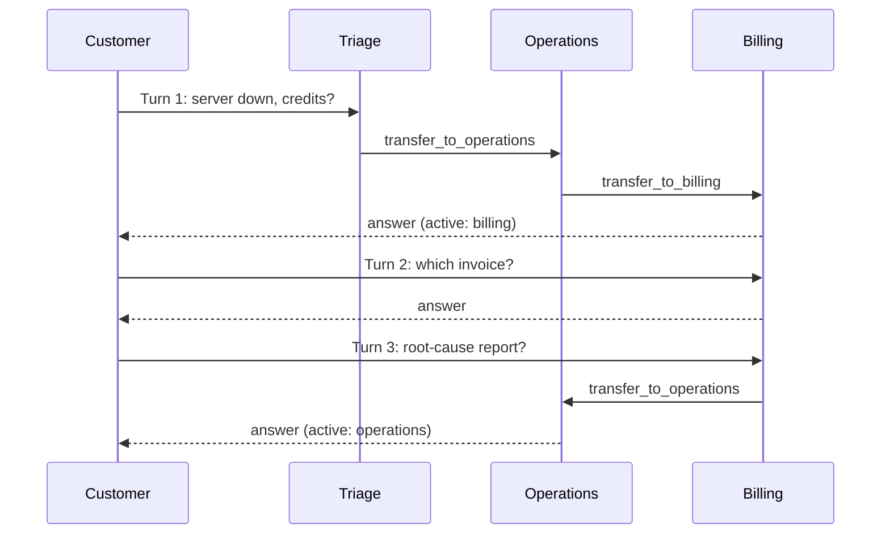

# M35.5 Theory: Handoffs and swarms

*[M35 theory](../README.md) · Lesson 35.5 · Notebooks: [`05a_agent_handoffs.ipynb`](../../../../course/p10_memory_and_multi_agent/m35_multi_agent_architectures/notebooks/05a_agent_handoffs.ipynb), [`05b_multi_agent_swarm.ipynb`](../../../../course/p10_memory_and_multi_agent/m35_multi_agent_architectures/notebooks/05b_multi_agent_swarm.ipynb) · [All theory pages](../../../README.md)*

## Handoffs

A router and a handoff both move a request between agents. They differ in who holds control afterwards.

| | Router or supervisor | Handoff |
|---|---|---|
| Who picks the next agent | the router, after every step | the agent holding the conversation, by calling a tool |
| Where control goes after an agent | back to the router, on a static edge | nowhere: the agent finishes the turn or hands off |
| The next user message starts at | the router | the active agent, read from `active_agent` in state |
| What stops a loop | the router's own cap | nothing built in; only `recursion_limit` |

A structured-output classifier that sends each request to one specialist is still a router. A handoff needs the agent itself to choose, by calling a tool, and the graph to remember the choice.

A handoff tool is an ordinary `@tool` that returns a `Command` instead of a string. It runs inside the calling agent's own graph, but the decision belongs to the parent graph that holds all the agents, so the `Command` is addressed there:

- `goto="billing"` names the parent node to run next.
- `graph=Command.PARENT` applies the `Command` in the closest parent graph, which ends the calling agent's run.
- `update={...}` writes the conversation plus a `ToolMessage` that answers the tool call, and sets `active_agent`.

`InjectedState` gives the tool the agent's messages and `InjectedToolCallId` gives it the id of the call it answers, so the model fills in only one argument in the 35.5 notebook's version: `context`, a note for the next agent so the customer is not asked again. The parent's state is `MessagesState` plus `active_agent`. Its only routing of its own is at `START`: read `active_agent` and send the new message there, or to triage on a new thread.

With a checkpointer, `active_agent` outlives the turn. Here is one Larkspur thread through triage and the three specialists:

<!-- animated: diagrams/handoff-thread.anim.html -->

Turn 2 is the point of the checkpointer: triage does not run, because `START` read `active_agent = billing` from the saved thread. Turn 3 moves sideways, billing to operations, with no coordinator involved. Every move is one tool call, and each one rewrites `active_agent`.

Nothing in this graph forces a stop. If two agents each decide the other should answer, they pass the request back and forth until `recursion_limit` raises `GraphRecursionError`; each agent run is one super-step of the parent graph. The notebook proves both the routes and the guard with a scripted model (LangChain's `GenericFakeChatModel` replaying fixed replies, tool calls included), so the mechanism is tested without an API call.

## Swarm

A swarm is the same mechanism packaged by the `langgraph-swarm` library. `create_handoff_tool` builds the tool, `create_swarm` builds the parent graph with one node per agent and the `START` router, and `SwarmState` is `MessagesState` plus `active_agent`. `default_active_agent` names the agent a new thread starts at. Compile with a checkpointer and the swarm remembers, per `thread_id`, which agent holds each conversation.

The second notebook builds three agents over a music store: a general QA agent that does RAG over company documents, an NL2SQL agent over the Chinook catalogue, and an invoice agent. Each gets its own tools plus handoff tools to the other two. Two details carry over to any swarm:

- **The library tool carries no note.** It takes no arguments, and its `ToolMessage` says only "Successfully transferred". Whatever the next agent needs must already be in the conversation. The hand-built tool's `context` argument exists to fix that.
- **Tools that run model-written queries must be safe whatever the model writes.** The NL2SQL connection opens the file read-only, sets `PRAGMA query_only = ON`, and installs an authorizer that refuses writes, `ATTACH` and `PRAGMA`. The invoice tools bind the customer ID as a parameter and never paste it into the SQL.

A swarm spends routing once per thread. On the outage request, triage hands off to operations, operations answers its part and hands off to billing: 3 model calls, one of them routing, against 5 for a supervisor. After that, each follow-up goes straight to the active agent for 1 call, where the supervisor pays 3 and a hierarchy 5. The [routing cost lab](interactive/routing-cost-lab.html) runs the same three Larkspur requests through all four architectures, with the follow-up turns on a slider.

<!-- lab: interactive/routing-cost-lab.html -->

Over a thread of the outage request and 3 follow-ups the lab counts 6 calls for the swarm, 14 for the supervisor and 22 for the hierarchy. The router (M30) spends 8 and still never asks billing about the credits. The swarm's saving rests on the conversation staying with one specialist. When a follow-up changes topic, the active agent has to recognise that and hand off, and the routing quality now lives in every agent's prompt instead of one supervisor's.

---
*Previous: [35.4 Supervisors and hierarchical teams](../04_supervisors_and_hierarchical_teams/README.md). Next: [M35 interview questions](../README.md#interview-spotlight-5-questions-you-might-get-asked).*
