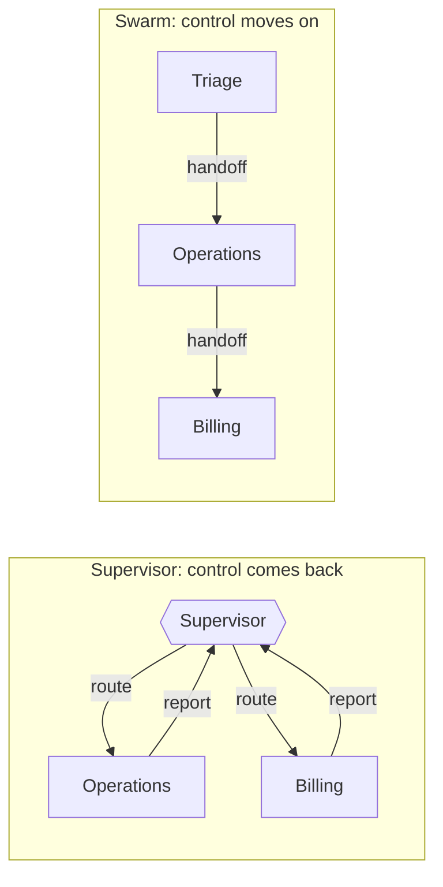

# M35 Theory: Multi-Agent Architectures

*Part X · Memory & Multi-Agent RAG · [Module README](../../../course/p10_memory_and_multi_agent/m35_multi_agent_architectures/README.md) · [All theory pages](../../README.md)*

One agent with every tool and every knowledge base has to pick among all of them on every step. Splitting it gives each agent a short prompt and a few tools, and adds a new problem: something has to decide which agent works next. The M35 notebooks build on four ideas: a supervisor that makes every routing decision, teams of supervisors nested as subgraphs, handoffs that let an agent pass the conversation on, and swarms that remember which agent holds it. Each idea has a page in the folder of the lesson that teaches it, listed under [Lessons](#lessons). This page has the overview, the interview questions and the takeaways.

The running example is the Larkspur Cloud handbook from M11 to M13, split between three specialist RAG agents. The billing agent holds billing, cancellation, refunds and promotional credits; the operations agent holds the availability guarantee, incidents, server sizing and reboots; the data agent holds exports and retention. Three requests come back on every page and in the lab: *How long does a refund take?* (billing), *My server went down last night. Do I get service credits?* (operations, then billing) and *Can I export my data after I cancel my plan?* (data).

## TL;DR

- Split one agent when it has more tools or sources than one prompt can choose among well. A team makes more model calls (the 35.1 notebook's specialist team costs roughly four times the monolith's), so measure it against the single agent on the same requests.
- The five LangGraph architectures share one primitive, `Command(goto=..., update=...)`: a node writes to state and names the next node. They differ in who decides what runs next.
- A supervisor decides every step and takes control back. On the outage request that costs 5 model calls, 3 of them routing, and buys one place to log, test and cap every decision.
- A hierarchy nests compiled team graphs under a top supervisor. With three specialists it only adds overhead (7 calls for the same request); it pays off when one supervisor would face too many workers.
- A handoff is a tool that returns `Command(goto=..., graph=Command.PARENT)`. A swarm stores `active_agent` per thread, so a follow-up costs 1 call against 3 for the supervisor. Nothing ends a handoff loop except `recursion_limit`, whose default is 10,007 steps.

## Mental model

<!-- animated: diagrams/supervisor-vs-swarm.anim.html -->

Both graphs answer the outage request with the same two specialists. The supervisor decides before each specialist and once more to finish, so it spends 3 of its 5 model calls on routing. In the swarm, triage routes once and each agent hands the work on itself: 3 calls. Every architecture in this module sits somewhere between these two, and the choice is about who holds control after an agent finishes.

## Lessons

| Lesson | Topic | Theory |
|---|---|---|
| 35.1 | Monolithic vs multi-agent; a crew from scratch | [When one agent becomes a team](01_monolithic_vs_multi_agent_a_crew_from_scratch/README.md#when-one-agent-becomes-a-team) [A crew is a dependency graph](01_monolithic_vs_multi_agent_a_crew_from_scratch/README.md#a-crew-is-a-dependency-graph) |
| 35.2 | The five multi-agent architectures and agent communication | [Five architectures, one primitive](02_the_five_multi_agent_architectures_and_agent_communication/README.md#five-architectures-one-primitive) [Agent communication](02_the_five_multi_agent_architectures_and_agent_communication/README.md#agent-communication) |
| 35.3 | Supervisor workflow with human review | [Human review in a supervisor loop](03_supervisor_workflow_with_human_review/README.md#human-review-in-a-supervisor-loop) |
| 35.4 | Supervisors and hierarchical teams | [Supervisor](04_supervisors_and_hierarchical_teams/README.md#supervisor) [Hierarchical teams](04_supervisors_and_hierarchical_teams/README.md#hierarchical-teams) |
| 35.5 | Handoffs and swarms | [Handoffs](05_handoffs_and_swarms/README.md#handoffs) [Swarm](05_handoffs_and_swarms/README.md#swarm) |

## Interactive lab

[**Who routes, and what it costs**](05_handoffs_and_swarms/interactive/routing-cost-lab.html): open the file in a browser. Pick the outage request and step through the four architectures: the router (M30) is cheapest at 2 calls and never asks billing about the credits. Then pick Supervisor and Swarm in turn and move the follow-up slider to 3: the supervisor reaches 14 calls, the swarm 6, because every follow-up goes straight to the active agent.

## How it connects

- **Before:** [M25](../../p08_agent_foundations/m25_agentic_workflow_patterns/README.md) introduced routing and orchestrator-worker as workflow patterns; here the workers are whole agents. [M27](../../p08_agent_foundations/m27_human_approval_applied_agents/README.md) added human approval gates, which 35.3 puts inside a supervisor loop. [M30](../../p09_agentic_rag/m30_adaptive_rag_routing/README.md) routed each question to one knowledge base once; the supervisor is that router run in a loop at the agent level. [M33](../m33_conversational_memory_rag/README.md)'s checkpointers and threads are what let a swarm remember its active agent.
- **Next:** [M36](../m36_collaboration_parallel_agents/README.md) covers other ways agents share work: blackboards, debate, STORM and parallel agents. [M37](../m37_multi_agent_builds_deep_agents/README.md) builds full multi-agent systems and hardens them against edge cases and errors.

## Interview Spotlight: 5 Questions You Might Get Asked

*Production questions of the kind asked in applied AI engineering interviews.*

### 1. Larkspur's support swarm sometimes takes a minute to fail. The trace shows billing and operations handing the same customer back and forth until LangGraph raises `GraphRecursionError`. What do you look at, and what do you change?

**What a strong answer covers:**
- Reads the handoff `ToolMessage`s and each agent's prompt: both agents believe the other owns "outage credits", so the ownership line is unclear
- Fixes ownership in the agents' prompts and handoff tool descriptions, and gives one of them the answer instead of another handoff
- Sets `recursion_limit` explicitly on every run (25 in the notebooks), because the default of 10,007 steps is what made the failure take a minute
- Adds a scripted-model test that replays the ping-pong and asserts the run ends with the error, so a prompt change cannot bring the loop back silently

### 2. The M30 router sends each question to one knowledge base. Customers ask "my server went down, do I get credits?" and get an answer about the outage with nothing about credits. Do you replace the router with a supervisor or a swarm?

**What a strong answer covers:**
- Names the failure: a one-shot router picks one specialist, so a two-part request loses its second half
- Supervisor: re-decides after each specialist, so it covers both halves; 5 calls for this request, with every decision in one log
- Swarm: operations answers its part and hands off to billing; 3 calls, and follow-ups go straight to the active agent
- Chooses by traffic shape: many multi-turn conversations with one specialist favour the swarm; audit or compliance needs favour the supervisor's single decision log

### 3. Your lab brief says to compare routing accuracy and cost after replacing the router with a supervisor over three specialist RAG agents. How do you measure it?

**What a strong answer covers:**
- Labels each golden question with the specialists it needs, in order, and scores the route the system took against that label
- Logs routing outside the transcript (`route_log`, one entry per decision with its reason), so routing accuracy is read from state and not parsed from prose
- Reports model calls, tokens and latency per request, split into routing calls and specialist calls, next to answer quality from the M11 baseline
- Looks per question, not only at the mean: single-domain questions get more expensive under a supervisor while multi-part ones get correct

### 4. A swarm thread has `active_agent = billing`. Three days later the same customer writes "Can I export my data?" What happens, and what should happen?

**What a strong answer covers:**
- The `START` router reads the saved `active_agent`, so billing receives a question it has no handbook section for
- Billing needs a handoff tool to the data agent and a prompt that tells it to use it; otherwise it answers from nothing or asks the customer to repeat
- The library handoff tool carries no note, so whatever data needs must already be in the messages; a hand-built tool can pass a `context` note
- Considers expiring or resetting `active_agent` after a quiet period, so a new topic on an old thread starts at triage

### 5. Larkspur wants a human to approve any refund the billing agent offers outside the 30-day window before the customer sees it. Where does the pause go in a supervisor workflow?

**What a strong answer covers:**
- Uses a checkpointer, because a paused run has to be saved and resumed by thread
- Prefers a dynamic `interrupt(payload)` inside the billing node, so only out-of-window refunds pause; a static `interrupt_after` pauses every run
- Lets the reviewer edit state (`update_state`) or resume with `Command(resume=...)`, then sends the edited answer, not the model's
- Checks the window in code from the purchase date, so the decision to pause never rests on the model's judgement

## Key Takeaways

- Split one agent only when its tools or sources are too many to choose among well, and measure the team against the single agent on the same requests.
- Let the model choose the next agent, and let a pure function in code read that typed choice and a counter. The loop ends where the code says, whatever the model says.
- A supervisor pays a routing call per specialist plus one to finish; a swarm pays one routing call per thread and then follows `active_agent`. Pick by whether conversations stay with one specialist and whether you need one decision log.
- Pass `recursion_limit` on every run and add a counter cap to any graph that can cycle; test both with a stub or scripted model.

---
*Previous: [M34 Long-Term & Agentic Memory](../m34_long_term_agentic_memory/README.md). Next: [M36 Collaboration, Control & Parallel Agents](../m36_collaboration_parallel_agents/README.md).*
