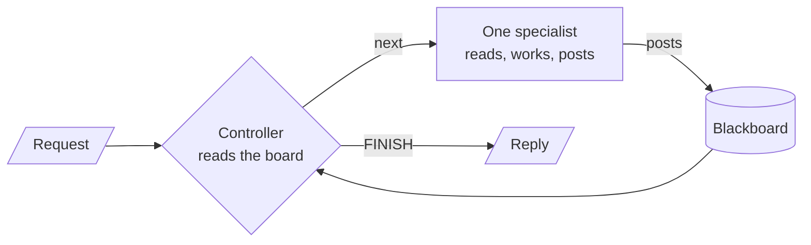

# M36.1 Theory: Blackboard architectures

*[M36 theory](../README.md) · Lesson 36.1 · Notebooks: [`01a_blackboard_intro.ipynb`](../../../../course/p10_memory_and_multi_agent/m36_collaboration_parallel_agents/notebooks/01a_blackboard_intro.ipynb), [`01b_blackboard_research_team.ipynb`](../../../../course/p10_memory_and_multi_agent/m36_collaboration_parallel_agents/optional/01b_blackboard_research_team.ipynb) (optional) · [All theory pages](../../../README.md)*

## Blackboard

A blackboard system coordinates specialists through one shared store, the blackboard. Specialists never call each other. Each one reads the board, does its own job and appends its result. A controller reads the whole board after every contribution and picks the next specialist, or `FINISH`. The design comes from the HEARSAY-II speech-recognition system (Erman et al., 1980). In HEARSAY-II the specialists watched the board for their own trigger conditions and a scheduler chose among them; in the notebooks the controller does all the watching.

<!-- animated: diagrams/blackboard-loop.anim.html -->

The controller is the only part that decides order. The specialists stay narrow, and adding one means adding a node and a name the controller may choose; nothing else is rewired.

### Where a fixed pipeline fails

Lesson 36.1's notebook gives both designs one request with conditional logic: find the latest news, then run a technical analysis if the news is neutral or positive, or a financial analysis if it is negative. The pipeline `news → technical → financial → writer` runs both analyses on every request, because its edges cannot skip a node. The blackboard controller reads the news analyst's post, then picks one branch. The notebook checks this in code from the list of specialists that ran, rather than asking another model whether the instruction was followed:

| Check, computed from `steps` | Sequential pipeline | Blackboard |
|---|---|---|
| Followed the either/or | Never: both branches run by construction | Whatever this run's controller chose |
| Correct branch for the sentiment | Never: both branches run | Checked against a sentiment label from the news post |

The blackboard row can fail too, because the controller is an LLM. That is the reason the check is computed on every run instead of assumed.

On the Larkspur handbook the same shape is an outage escalation: *a customer says their server went down twice this week; if the outages pushed availability below the 99.95% SLA, draft a service-credit reply, otherwise draft a reply that points to the status page and the root-cause report*. An incident analyst posts what the incident log shows, the controller reads it and calls either the credits analyst or the status analyst, and a writer drafts from the board. A pipeline would pay for both analysts on every escalation.

### Guards that keep a controller honest

A controller that re-decides at every step can also loop, stall or name a step that cannot run yet. The notebooks guard it at four points:

- **A typed decision.** `ControllerDecision.next_agent` is a `Literal` of the specialist names plus `FINISH`, so the model can only name a real node. The node writes the decision to state, and a separate, pure routing function reads it.
- **A cap in code.** The controller returns `FINISH` without calling the model once `MAX_SPECIALIST_CALLS = 6` specialists have run. LangGraph's `recursion_limit = 20` is the backstop, and it ends the run with an error rather than a clean stop.
- **Preconditions checked in code.** In the optional research-team notebook, `precondition_problem()` rejects impossible choices (fact-checking an empty board, finishing without a draft) and `rule_based_next()` substitutes the rule-based choice. Every override is printed and counted.
- **Structured contributions.** Posts there are dicts with `agent`, `type` and `content`, so code can tell a finding from a fact-check from a draft, and can pair each finding with its own verdict.

Specialists that search must execute their tool. The notebook runs each one as a small `create_agent` loop; binding the tool with `bind_tools()` alone only lets the model request a search, and nothing runs it.

### What it costs, and when it pays

Every specialist turn sits between two controller turns, so a run with `k` specialists makes up to `k + 1` controller calls on top of the specialists' own. Traces are harder to read than a pipeline's because the path changes from run to run; in the research-team notebook a fact-check that flags a finding sends the controller back to the researcher, a loop-back no edge in the graph spells out.

Use a blackboard when the next step depends on what earlier steps found: diagnosis, triage, research with verification. When the order is known before the run starts, a pipeline or a fan-out ([lesson 36.5](../05_parallel_agents_async_nodes_and_streaming/README.md)) is cheaper and easier to test.

## Check yourself

1. A request asks for a technical or a financial analysis depending on the news sentiment. Why does the fixed pipeline never follow it, while the blackboard can?

The pipeline's edges cannot skip a node, so `news → technical → financial → writer` runs both analyses on every request. The blackboard controller reads the news analyst's post and then picks one branch. It can still choose wrong, because it is an LLM, so the notebook computes the check from `steps` on every run.

2. In the Larkspur outage escalation, the incident analyst posts that availability stayed above the 99.95% SLA. Which specialists should run next?

The controller should call the status analyst, not the credits analyst, and then the writer drafts a reply that points to the status page and the root-cause report. A fixed pipeline would pay for both analysts on every escalation.

3. A blackboard controller keeps picking specialists and never returns FINISH. What in the notebooks stops the run, and why is that better than relying on recursion_limit?

A cap in code: once `MAX_SPECIALIST_CALLS = 6` specialists have run, the controller returns `FINISH` without calling the model, so the run ends with a reply. `recursion_limit = 20` is only the backstop, and it ends the run with an error rather than a clean stop.

---
*Previous: [M36 overview](../README.md). Next: [36.2 Debate](../02_debate/README.md).*
