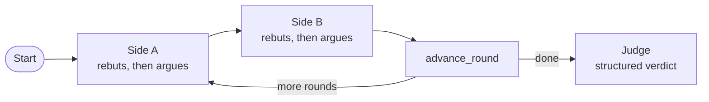

# M36.2 Theory: Debate

*[M36 theory](../README.md) · Lesson 36.2 · Notebooks: [`02a_debate.ipynb`](../../../../course/p10_memory_and_multi_agent/m36_collaboration_parallel_agents/optional/02a_debate.ipynb) (optional) · [All theory pages](../../../README.md)*

## Debate

In a debate two agents argue opposite sides of a question over several rounds, each reading the whole transcript and rebutting the other's latest point, and a neutral judge writes the verdict. The blackboard agents cooperate on one artifact; debaters disagree on purpose, so the judge sees the strongest case for both sides before deciding.

Two research setups share the name. The notebook follows Liang et al.'s *MAD* (EMNLP 2024): fixed affirmative and negative sides, and a judge that reads the debate and extracts the answer. In Du et al.'s *multiagent debate* (2023) every agent gets the same prompt, answers on its own, then reads the others' answers and revises until they converge: no assigned sides and no judge.

The control flow is a small round-robin graph. A round counter in state drives the conditional edge after `advance_round`, and because that routing function is plain Python, the notebook checks it without a model call: after rounds 1 and 2 it routes back to side A, after round 3 to the judge.

### What makes a debate worth reading

- **Honest sides that engage.** Each persona must argue its side without inventing facts, and after its opening turn must rebut the opponent's strongest recent point before adding one or two of its own (120 words at most in the notebook). Without the rebuttal rule the debate turns into two parallel monologues and the judge has nothing to weigh.
- **A judge that reasons past the debate.** The judge fills a Pydantic `DebateVerdict`: the strongest point from each side, the weak or overstated claims, a final recommendation and a confidence. Its prompt asks it not to name a winner, so the recommendation may be conditional ("start with a monolith, split out services when …").
- **A baseline beside it.** The notebook asks the same question in one call with a neutral prompt. A capable model often hedges on its own, so the debate does not always add anything.

### Cost against value

| Approach | LLM calls | What you get |
|---|---|---|
| Single call | 1 | One answer, often already balanced |
| Debate, `N` rounds | `2N + 1` | A transcript, the strongest point from each side, a judged recommendation |
| Debate, `N = 3` (the notebook) | 7 | Six turns and one verdict |

Debate earns its cost on questions with legitimate trade-offs and no single correct answer: architecture choices, build or buy, policy. The notebook's question is whether a six-person team should start a new B2B SaaS product with microservices or a monolith. For a factual question with one correct answer, the single call is the better choice.

On the Larkspur handbook that line is easy to draw. "How long does a refund take?" has one answer, 5 to 10 business days, and belongs to retrieval. "Should the support assistant stop retrieving and put the whole handbook in a long-context prompt?" is a trade-off between cost per call, accuracy on facts buried mid-context and access control ([M11](../../../p04_rag_foundations/m11_rag_lifecycle/README.md#interview-spotlight-5-questions-you-might-get-asked)'s fifth interview question); a debate transcript and its judged verdict are a useful input to that decision. When two retrieved chunks disagree, for example an old and a new refund policy, fix the index first with version metadata and a filter ([M12](../../../p05_ingestion_and_indexing/m12_document_ingestion/README.md)) rather than asking two agents to argue about which one is current.

Known weaknesses: both debaters can miss a consideration neither persona was primed to raise, a weak persona makes the debate lopsided, and the judge is a single point of bias unless its prompt keeps it even-handed.

## Key Takeaways

- A debate runs two opposing sides over `N` rounds, each rebutting the other's latest point, then a judge fills a structured verdict. It costs `2N + 1` calls, 7 at three rounds, against 1 for a single call.
- Require each side to rebut before adding its own points, or the debate becomes two monologues. Ask the judge for the strongest point from each side and a recommendation rather than a winner.
- Debate questions with real trade-offs, such as build or buy. Send factual questions like the refund time to retrieval, and fix disagreeing chunks in the index with version metadata.

## Check yourself

1. Why must each debater rebut the opponent's strongest recent point before adding one or two of its own?

Without the rebuttal rule the debate turns into two parallel monologues, and the judge has nothing to weigh. Engagement is what lets the judge's verdict name the strongest point from each side and the weak or overstated claims.

2. How many LLM calls does the notebook's three-round debate cost against a single call, and what do the extra calls buy?

`2N + 1` calls, so 7 for `N = 3` (six turns and one verdict), against 1. They buy a transcript, the strongest point from each side and a judged recommendation. A capable model often hedges on its own, so the single call is the baseline to compare against.

3. Two retrieved Larkspur chunks give an old and a new refund policy. Should two agents debate which one is current?

No. Fix the index first with version metadata and a filter (M12). Debate earns its cost on trade-offs with no single correct answer; a factual question such as how long a refund takes (5 to 10 business days) belongs to retrieval.

---
*Previous: [36.1 Blackboard architectures](../01_blackboard_architectures/README.md). Next: [36.3 STORM: multi-perspective research and writing](../03_storm_multi_perspective_research_and_writing/README.md).*
