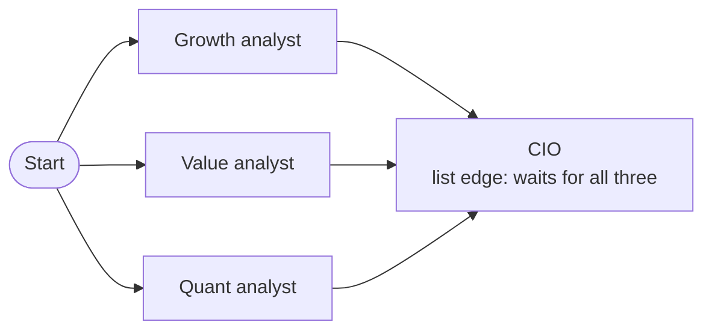

# M36.4 Theory: Meta-controllers, ensembles and emergent systems

*[M36 theory](../README.md) · Lesson 36.4 · Notebooks: [`04a_meta_controller.ipynb`](../../../../course/p10_memory_and_multi_agent/m36_collaboration_parallel_agents/optional/04a_meta_controller.ipynb) (optional), [`04b_ensemble_parallel_exploration.ipynb`](../../../../course/p10_memory_and_multi_agent/m36_collaboration_parallel_agents/optional/04b_ensemble_parallel_exploration.ipynb) (optional), [`04c_cellular_automata.ipynb`](../../../../course/p10_memory_and_multi_agent/m36_collaboration_parallel_agents/optional/04c_cellular_automata.ipynb) (optional) · [All theory pages](../../../README.md)*

## Three kinds of controller

A router, a meta-controller and a blackboard controller are all one structured-output call that picks from a fixed set. They differ in what they pick and how often:

| Controller | What it decides | When | Calls per request |
|---|---|---|---|
| Router | Which specialist answers, inside one fixed graph | Once, before any specialist runs | 1 |
| Meta-controller | Which whole architecture runs: one call, a search agent, a planner or a debate | Once, before any architecture runs | 1 |
| Blackboard controller ([36.1](../01_blackboard_architectures/README.md#blackboard)) | Which specialist acts next, given the whole board | After every contribution, until done | Up to one per specialist turn, plus one |

A router differs from a handoff (M35) in who holds the decision: the router decides before any specialist runs, and the specialist cannot pass the request on; in a handoff the agent holding the conversation transfers it by calling a tool.

The meta-controller wraps each architecture as a plain callable, `(query: str) -> str`, so it never sees inside one. Its decision is a `Strategy` Enum, and a registry maps each member to its callable instead of a chain of `if`s; a registry check catches a strategy with no callable. The notebook's four strategies, mapped onto Larkspur support traffic:

| Strategy | Shape of request | A Larkspur request of that shape |
|---|---|---|
| `direct_answer` | Self-contained fact the model already knows | "What is a vCPU?" (general knowledge, no handbook needed) |
| `search_agent` | Live or external information | "Is there an incident right now?" (only the live status page knows) |
| `multi_step_planning` | Several bundled sub-questions | The lab's refund, timing, export and credits question |
| `debate` | Trade-off with no single answer | "Should we move from a monthly to an annual plan?" |

The main weakness is that classification errors cascade. A misrouted request still gets an answer, from the wrong specialist or architecture, and nothing downstream notices. The notebook's guard is a table of requests with the route each was written for, compared in code with the route each controller chose. That table is the regression test to run on every prompt or model change. One choice per request also cannot handle a mixture ("look up X, then debate whether it is a good idea"), and the classification call adds latency before any real work starts.

## Ensembles: vote against verdict

An ensemble runs several independent agents on the same question at the same time, each with a different persona, and an aggregator combines their conclusions. The notebook's committee has a bullish growth analyst, a cautious value analyst and a quantitative analyst, and a chief investment officer (CIO) who writes the recommendation.

The graph uses every piece of lesson 36.5. One edge from `START` to each analyst puts all three in one superstep. All three write the shared `analyses` key in that superstep, so it carries the `operator.or_` reducer, which merges their one-entry dicts. A list edge from the three analysts makes the CIO wait for every report.

The analysts never see each other's work, so none anchors on another. That independence is what an ensemble buys, and the notebook checks the parts that are easy to assume:

- **Overlap.** Each analyst records its start and end time; the check passes when all three windows were open at once.
- **Vote against verdict.** Each analyst ends its report with `Recommendation: Buy|Hold|Sell`, and the CIO's recommendation is a `Literal` of the same three values, so code can set the majority vote beside the verdict. A CIO that departs from the majority is fine if its summary says why. A CIO that departs with no reason given is the failure to look for.

For Larkspur, the same shape fits an answer review: three graders read one drafted reply, one for faithfulness to the retrieved chunks, one for tone, one for policy, and an aggregator decides whether it ships. Each grader costs its own model calls, so the committee is priced like three agents, while its latency is set by the slowest grader.

## Emergent systems

The cellular-automata notebook has no controller at all. Every cell of a warehouse grid is a small agent with one local rule: its distance to the packing station is 1 plus the smallest distance among its neighbours. Applied to every cell at once, tick after tick, the rule spreads a distance wave around the walls, and a carrier reaches the station by always stepping to the neighbour with the lowest value. The notebook checks the emergent paths against a global breadth-first search over the same grid, then walls off a cell next to the station and shows the path rerouting with no change to the code.

This is the far end of the control range in this module: no controller, only a local rule applied everywhere in synchronous ticks. It solves a global problem without a planner, at the cost of many cheap updates, and the notebook trusts the result only after the breadth-first check.

---
*Previous: [36.3 STORM: multi-perspective research and writing](../03_storm_multi_perspective_research_and_writing/README.md). Next: [36.5 Parallel agents, async nodes and streaming](../05_parallel_agents_async_nodes_and_streaming/README.md).*
