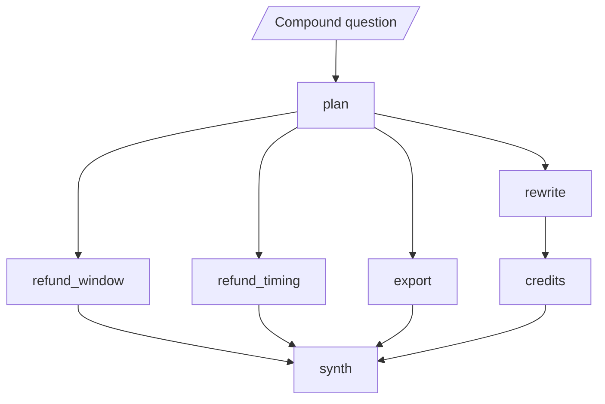

# M36.5 Theory: Parallel agents, async nodes and streaming

*[M36 theory](../README.md) · Lesson 36.5 · Notebooks: [`05a_parallel_agents.ipynb`](../../../../course/p10_memory_and_multi_agent/m36_collaboration_parallel_agents/notebooks/05a_parallel_agents.ipynb), [`05b_async_multi_agent_streaming.ipynb`](../../../../course/p10_memory_and_multi_agent/m36_collaboration_parallel_agents/notebooks/05b_async_multi_agent_streaming.ipynb) · [All theory pages](../../../README.md)*

## Map-reduce / async

An agent spends almost all of its time waiting: for a model, a search, a database. Three agents that each wait one second take 3 s one after another and about 1 s together, because the waits overlap; nothing runs faster. Notebook 05b measures exactly that with `asyncio.sleep(1)` standing in for a model call. The rest of this page is how LangGraph arranges the overlap and where it goes wrong.

The running example is the compound Larkspur question from the [module page](../README.md), split into four sub-questions. Three are answered directly; the outage one first rewrites "outages" into the handbook's own words (availability, service credits), because TF-IDF missed that evidence in M11.


<!-- animated: diagrams/supersteps.anim.html -->

### Supersteps

LangGraph runs a graph in supersteps. In each superstep it runs every node that the previous superstep triggered, waits for all of them, applies their state updates together, and only then works out what runs next. Several edges out of one node (a fan-out) put all their targets in the same superstep, so they run in parallel: `async def` nodes on the event loop, plain `def` nodes in a thread pool. Notebook 05a proves the layout with stub nodes and `stream_mode="debug"`, which reports the superstep of every task: `plan` alone, then the three searchers together, then `report` once.

The barrier at the end of a superstep has a cost when branches have different lengths. In the graph above, `rewrite` finishes at 0.9 s, but `credits` cannot start until the whole superstep ends at 1.6 s, when `export` (the slowest, 1.2 s) finishes. The outage branch waits 0.7 s for work it does not depend on. Moving the rewrite inside the `credits` node keeps every branch one node long, and the answer lands at 2.7 s instead of 3.4 s.

### The join

A join is a node with several incoming branches. With separate edges (`add_edge("a", "join")`, `add_edge("b2", "join")`) it runs once for every superstep in which one of its predecessors finished. Notebook 05a builds one unequal-branch graph three ways and counts the join's runs:

| Join style | Join runs | What happens |
|---|---|---|
| Separate edges | 2 | The first run sees only the short branch; the second sees both |
| List edge, `add_edge(["a", "b2"], "join")` | 1 | Waits until every listed node has finished |
| `add_node("join", ..., defer=True)` | 1 | Held back until the run has nothing else to do |

In the lab's graph the separate-edges synthesizer runs in superstep 3 with 3 of 4 sub-answers, writes a reply with nothing about outage credits, and runs again after `credits`. Use a list edge when you know the predecessors at build time. It waits for every node it names, so if a conditional edge skips one of them, the join never runs. `defer=True` waits for the run to go quiet instead, which also suits branches chosen at run time.

### Reducers

Nodes of one superstep write their updates together when it ends. If two of them write the same key and the key has no reducer, LangGraph cannot choose a winner and raises `InvalidUpdateError`. A reducer in the state schema, `Annotated[type, reducer]`, says how to combine the writes:

- `Annotated[list, operator.add]` concatenates lists: every branch appends its sub-answer.
- `Annotated[int, operator.add]` adds counters.
- A dict merge (`merge_dicts`, or `operator.or_`) combines one-entry dicts into one dict keyed by branch.

The notebook runs the same two nodes against both schemas: the plain one raises, the reduced one keeps both writes. The combined list comes out in the same order on every run, whichever branch finished first, because LangGraph applies a superstep's writes in a fixed order. A key that only one node per superstep writes needs no reducer.

### Map-reduce with `Send`

Fixed edges cannot express a fan-out whose size is known only at run time: one branch per document, or one per sub-question when the decomposer (M18) returns three for one question and five for the next. A routing function that returns a list of `Send` objects can:

```python
def fan_out(state):
    return [Send("answer_one", {"index": i, "question": q}) for i, q in enumerate(state["sub_questions"])]

graph.add_conditional_edges("plan", fan_out, ["answer_one"])
graph.add_edge("answer_one", "synth")
```

Each `Send` runs `answer_one` with its own private input, and all of them land in one superstep. An `operator.add` reducer collects the results; since branches can finish in any order, the reduce step sorts them by their tag before combining. Notebook 05a maps an LLM summary over three documents this way and counts one map branch per document.

### Async nodes and what `astream` shows

Making nodes `async def` and calling `await graph.ainvoke(...)` changes nothing about which nodes are parallel: edges from one source do that. A chain of async nodes still runs in order. What `async` adds is overlap on one event loop, and `astream` lets you watch it:

| `stream_mode` | Emits | Use it for |
|---|---|---|
| `"updates"` | One event per node, as that node finishes | Progress: "the refund branch is done" |
| `"values"` | The full state: the input, then once per superstep | Debugging the shared state |
| `"messages"` | Model output token by token, tagged with the node | Showing two agents writing at once |

In 05b three agents wired to `START` and sleeping 1.0, 1.5 and 0.5 s report through `updates` at 0.5, 1.0 and 1.5 s, in finish order, and the whole team takes about 1.5 s against 3.0 s for the sum. `values` reports two snapshots, empty and full, because all three share one superstep.

In the lab, with the rewrite inside the agent node, the first sub-answer (`refund_timing`) streams through `updates` at 1.2 s, while `values` stays silent until the superstep ends at 1.9 s, when `credits` (1.5 s with its rewrite) finishes. The [interactive lab](interactive/parallel-subquestions-lab.html) runs this graph with stub latencies and draws every superstep. Its schedule matches LangGraph 1.2.18 running the same graph with `asyncio.sleep` at all 39 settings, to within 0.04 s:

| Setting in the lab | Answer lands | Synthesizer runs | Supersteps |
|---|---|---|---|
| One at a time, rewrite as its own node | 5.7 s | 1 | 7 |
| In parallel, rewrite as its own node, separate edges | 3.4 s | 2 (the first saw 3 of 4) | 4 |
| In parallel, rewrite as its own node, list edge or `defer=True` | 3.4 s | 1 | 4 |
| In parallel, rewrite inside the agent | 2.7 s | 1 | 3 |
| In parallel, rewrite inside the agent, `max_concurrency` 2 | 3.7 s | 1 | 3 |
| In parallel, rewrite inside the agent, `max_concurrency` 1 | 5.7 s | 1 | 3 |
| In parallel, rewrite as its own node, separate edges, `max_concurrency` 1 | 6.5 s | 2 | 4 |

<!-- lab: interactive/parallel-subquestions-lab.html -->

`max_concurrency` in the run config caps how many tasks run at once, which is how you stay under a provider's rate limit. LangGraph starts a superstep's tasks in node-name order, so under a cap the later names wait for a free slot. At a cap of 1 the parallel graph takes as long as the chain; with separate edges it takes longer, 6.5 s against 5.7 s, because the synthesizer still runs twice.

### When parallelism buys nothing

- **A chain.** If the writer needs the researcher's output, it cannot start early. 05b's three dependent one-second steps take about 3 s whether or not they are async.
- **A single agent.** One agent waiting is one wait. Streaming can still show progress, but there is no time to win.
- **Fast local work.** Arithmetic and string handling are work, not waiting; async adds overhead to them.

Whole runs can overlap too. `asyncio.gather` over three `ainvoke` calls runs three complete team runs in about the time of one (1.5 s against about 4.5 s), with no change to the graph. In a notebook, `await` directly; `asyncio.run(...)` fails inside a running event loop.

## Check yourself

<details>
<summary>1. Three agents that each wait one second finish in about one second together. Why, and what does making nodes async not change?</summary>

The waits overlap; nothing runs faster. Edges from one source put nodes in the same superstep, and that is what makes them parallel. Making nodes `async def` adds overlap on one event loop but does not change which nodes are parallel, so a chain of async nodes still runs in order.

</details>

<details>
<summary>2. In the lab, moving the rewrite inside the credits node brings the answer from 3.4 s to 2.7 s. Where does the saving come from?</summary>

As its own node, `rewrite` finishes at 0.9 s, but `credits` cannot start until the superstep ends at 1.6 s, when `export` finishes. The outage branch waits 0.7 s at the barrier for work it does not depend on. Inside one node, every branch is one node long and that wait disappears.

</details>

<details>
<summary>3. The synthesizer writes a reply with nothing about outage credits, then runs a second time. What causes this, and how do you fix it?</summary>

The join uses separate edges, so it runs once for every superstep in which a predecessor finished; its first run saw 3 of 4 sub-answers. Use a list edge, `add_edge([...], "synth")`, when the predecessors are known at build time, or `defer=True` when branches are chosen at run time. A list edge never runs if a conditional edge skips one of its named nodes.

</details>

---
*Previous: [36.4 Meta-controllers, ensembles and emergent systems](../04_meta_controllers_ensembles_and_emergent_systems/README.md). Next: [M36 interview questions](../README.md#interview-spotlight-5-questions-you-might-get-asked).*
