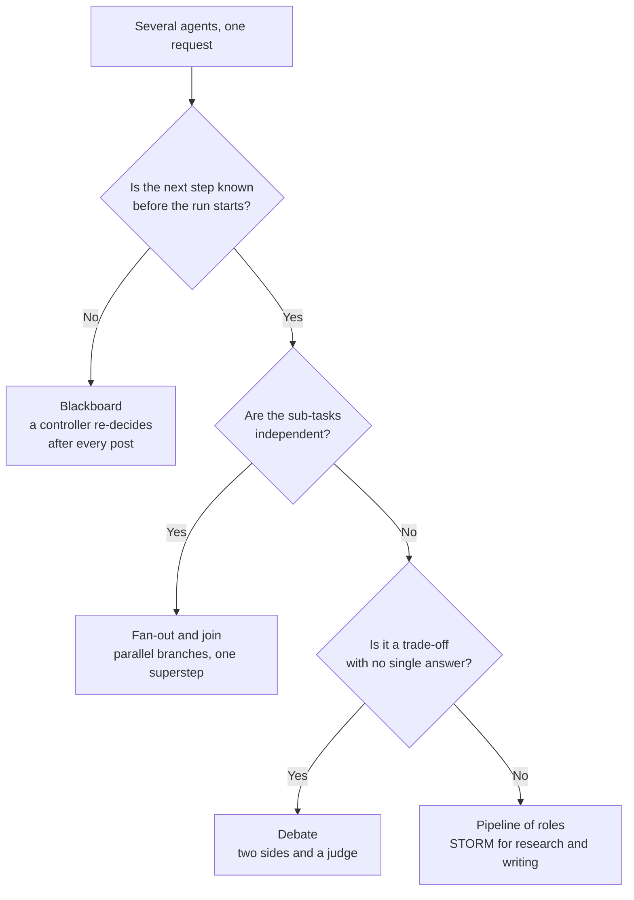

# M36 Theory: Collaboration, Control & Parallel Agents

*Part X · Memory & Multi-Agent RAG · [Module README](../../../course/p10_memory_and_multi_agent/m36_collaboration_parallel_agents/README.md) · [All theory pages](../../README.md)*

M35 put several agents behind a supervisor. This module changes how they work together: through a shared board, by arguing, by interviewing each other, and by running at the same time. The M36 notebooks build on four ideas: a blackboard that every agent reads and a controller that re-decides after each contribution, a debate judged by a third agent, STORM's perspective interviews, and LangGraph's superstep model for parallel branches. Each idea has a page in the folder of the lesson that teaches it, listed under [Lessons](#lessons). This page has the overview, the interview questions and the takeaways.

The running example is the Larkspur Cloud handbook from M11 to M13. One compound support question carries the parallel lessons and the lab: *"I'm cancelling my annual plan after this week's outages. Can I get a full refund, how long will it take, can I still export my data, and do I get credits for the outages?"* It splits into four sub-questions whose evidence is the handbook's refund-window, refund-timing, export and retention, and SLA chunks. The blackboard lesson uses an outage escalation from the same handbook; debate and STORM use a decision and an article about it.

## TL;DR

- A **blackboard** is one shared list that every specialist reads and appends to. A controller re-reads it after every contribution and picks the next specialist, so it can skip a branch that a fixed pipeline always runs. Guard it with a typed decision and a call cap (the notebook stops at 6 specialist calls, with a recursion limit of 20 behind it).
- **Debate** gives two agents opposite sides and a judge who reasons past both. It costs `2N + 1` calls for `N` rounds (7 at `N = 3`), so keep it for trade-offs; a factual question is better answered in one call.
- **STORM** researches from several perspectives before it writes: personas, simulated interviews, one merged outline, one draft per section. Its cost is countable: `1 + P × (2T + 1) + 1 + S + 1` calls, 22 to 24 in the notebook.
- LangGraph runs parallel branches in **supersteps**: every node of a step runs at once and the next step starts when the slowest one ends. In the lab, the four sub-questions take 5.7 s one at a time, 3.4 s in parallel, and 2.7 s once the outage rewrite moves inside its agent node.
- Parallel branches need a **join** that waits (a list edge or `defer=True`) and a **reducer** on every key they share; without them the synthesizer answers from half the evidence, or the run raises `InvalidUpdateError`.

## Mental model

The patterns differ in who decides what runs next and when that decision is made. A pipeline and STORM fix the order when you build the graph. A fan-out fixes the shape but lets the branches overlap in time. A blackboard leaves the order to a controller at run time, which buys flexibility and costs a model call per step. All four write to one shared state, so all four need the same guards: typed decisions, reducers on shared keys and a cap on the number of steps.

## Lessons

| Lesson | Topic | Theory |
|---|---|---|
| 36.1 | Blackboard architectures | [Blackboard](01_blackboard_architectures/README.md#blackboard) |
| 36.2 | Debate | [Debate](02_debate/README.md#debate) |
| 36.3 | STORM: multi-perspective research and writing | [STORM](03_storm_multi_perspective_research_and_writing/README.md#storm) |
| 36.4 | Meta-controllers, ensembles and emergent systems | [Three kinds of controller](04_meta_controllers_ensembles_and_emergent_systems/README.md#three-kinds-of-controller) [Ensembles: vote against verdict](04_meta_controllers_ensembles_and_emergent_systems/README.md#ensembles-vote-against-verdict) [Emergent systems](04_meta_controllers_ensembles_and_emergent_systems/README.md#emergent-systems) |
| 36.5 | Parallel agents, async nodes and streaming | [Map-reduce / async](05_parallel_agents_async_nodes_and_streaming/README.md#map-reduce--async) |

## Interactive lab

[**Parallel sub-question agents**](05_parallel_agents_async_nodes_and_streaming/interactive/parallel-subquestions-lab.html): open the file in a browser. It opens on a parallel run with the outage rewrite as its own node and separate edges into the synthesizer: the synthesizer runs twice, and its first run saw 3 of 4 sub-answers. Switch the join to a list edge and it runs once, at 3.4 s. Then move the rewrite inside the agent and the answer lands at 2.7 s, against 5.7 s one at a time. Finally drag `max_concurrency` down to 1 and watch the parallel graph give the time back.

## How it connects

- **Before:** [M35](../m35_multi_agent_architectures/README.md) builds supervisors and handoffs; this module adds shared-state collaboration and parallel execution to them. M10 covers the LangGraph runtime (streaming, retries, checkpoints) that 36.5 relies on, and [M18](../../p06_retrieval_quality/m18_query_transformation/README.md) decomposes a question into the sub-questions the lab runs in parallel. The lab reports against the baseline from [M11](../../p04_rag_foundations/m11_rag_lifecycle/README.md).
- **Next:** [M37](../m37_multi_agent_builds_deep_agents/README.md) builds full multi-agent applications, including a research system that dispatches a variable number of workers with `Send` and streams the run.

## Interview Spotlight: 5 Questions You Might Get Asked

*Production questions in the style of OpenAI, Anthropic and Google interviews for applied AI roles.*

### 1. Larkspur's support assistant now answers each part of a compound question in a parallel branch. Since the change, some replies to "refund, export and outage credits" questions say nothing about credits, and the trace shows two synthesizer outputs for one request. What happened, and how do you fix it?

**What a strong answer covers:**
- Reads the trace by superstep: the outage branch has one more node (a query rewrite) than the others, so it finishes a superstep later
- With separate edges into the synthesizer, the join runs once per superstep in which a predecessor finished: first with three sub-answers, then again with four. The reply that went out was the first
- Fixes the join with a list edge (`add_edge([...], "synth")`) or `defer=True`, or keeps every branch one node long by moving the rewrite inside the agent
- Adds a deterministic test with stub nodes that counts synthesizer runs and the sub-answers each run saw, so the fix stays fixed

### 2. Escalations ask for one of two follow-ups depending on what the incident log shows: a service-credit reply if availability fell below the SLA, a status-page reply otherwise. Would you build this as a fixed pipeline, a router or a blackboard?

**What a strong answer covers:**
- A fixed pipeline cannot skip a step, so it runs both follow-ups on every escalation and pays for both
- A router decides once, before any specialist has run, so it cannot branch on what the incident analyst finds
- A blackboard controller re-reads the board after each post and can choose the credit branch only after the incident finding lands; that is the behaviour the request needs
- Guards it: a `Literal` decision so the controller can only name a real node, a call cap enforced in code, a recursion limit as a backstop, and a computed check of which branches ran

### 3. You parallelised the four sub-question agents. Median latency fell, but p95 barely moved and the provider started returning rate-limit errors. How do you measure what is going on, and what do you change?

**What a strong answer covers:**
- Wall time is the sum, over supersteps, of the slowest task in each, so p95 follows the slowest branch's tail; logs per-node latency from the `updates` stream to find it
- Caps concurrency (`max_concurrency` in the run config) to stay under the rate limit and measures what it costs: in the lab a cap of 2 takes the answer from 2.7 s to 3.7 s
- Tracks time to the first streamed sub-answer separately from time to the final answer, since that is what the user sees first
- Re-runs the golden set from the M11 baseline to confirm the faster path did not change answer quality

### 4. One of the four branches times out on a provider call. What happens to the three sub-answers that finished, and how should the assistant reply?

**What a strong answer covers:**
- A task error fails the whole superstep; the synthesizer never runs on that attempt
- With a checkpointer, LangGraph keeps the writes of the tasks that succeeded in that superstep, so a resume re-runs only the failed one
- Adds a retry policy to the flaky node, and decides whether a missing sub-answer should block the reply or become an explicit "could not check outage credits" line the synthesizer must state
- Alerts on the per-branch failure rate, since one flaky dependency now takes down every compound question that touches it

### 5. A product manager wants every refund answer to go through a three-round debate "so the assistant considers both sides". What do you say?

**What a strong answer covers:**
- A three-round debate costs 7 calls instead of 1; the notebook's own advice is that a factual question with one correct answer is better served by a single call
- Refund policy is a fact in the handbook; if two retrieved chunks disagree (an old and a new policy), the fix is version metadata and filtering at retrieval, not an argument
- Debate earns its cost on real trade-offs, such as whether to replace RAG with a long-context prompt, where the transcript and the judge's strongest point from each side are the deliverable
- Proposes a test: run debate and single-call answers on the golden set and compare correctness, faithfulness, cost and latency before deciding

## Key Takeaways

- Choose the collaboration pattern by who decides the next step and when: fixed at build time (pipeline, STORM), shaped but overlapping (fan-out), or decided at run time (blackboard).
- Give every LLM controller a typed decision, a call cap enforced in code and a computed check of what actually ran.
- Parallel branches cost as much as the slowest task in each superstep; keep branches the same length, join with a list edge or `defer=True`, and put a reducer on every shared key.
- Debate and STORM multiply calls by design. Count them, run the cheap baseline beside them, and keep them for trade-offs and research where the trail is the product.

---
*Previous: [M35 Multi-Agent Architectures](../m35_multi_agent_architectures/README.md). Next: [M37 Multi-Agent Applied Builds & Deep Agents](../m37_multi_agent_builds_deep_agents/README.md).*
