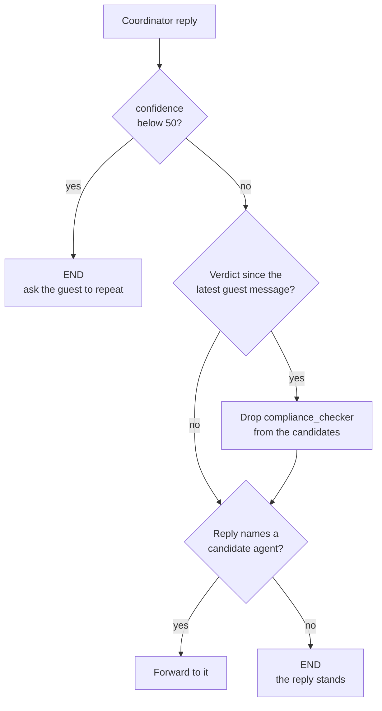

# M37.2 Theory: Hardening: edge cases, testing and system-wide error handling

*[M37 theory](../README.md) · Lesson 37.2 · Notebooks: [`02a_hotel_edge_cases_and_errors.ipynb`](../../../../course/p10_memory_and_multi_agent/m37_multi_agent_builds_deep_agents/notebooks/02a_hotel_edge_cases_and_errors.ipynb), [`02b_hotel_testing_the_system.ipynb`](../../../../course/p10_memory_and_multi_agent/m37_multi_agent_builds_deep_agents/notebooks/02b_hotel_testing_the_system.ipynb), [`02c_hotel_system_wide_error_handling.ipynb`](../../../../course/p10_memory_and_multi_agent/m37_multi_agent_builds_deep_agents/optional/02c_hotel_system_wide_error_handling.ipynb) (optional) · [All theory pages](../../../README.md)*

## System testing

A multi-agent system fails quietly. The coordinator misreads a request, skips the compliance check, or forwards a booking before it has dates, and the guest still gets a polite reply. Notebook 02b catches these failures at three levels, from cheapest to most realistic:

| Level | What it checks | Model calls | How the result is read |
|---|---|---|---|
| Router unit tests | The routing rules, on 7 hand-built states | None | The route the pure router function returns |
| A confidence gate | That an unclear request stops the turn instead of forwarding | One per guest message | `confidence` in state, an `int` from structured output |
| A regression table | 5 guest requests, end to end | Every agent's | The nodes that ran (`stream_mode="updates"`) and the database |

The router can be unit-tested because it is a pure function of the state: no model call, no I/O. 02b's router checks three rules in order:

The confidence comes from the coordinator itself. On each new guest message it asks the model for a `SelfAssessment`, a score from 0 to 100 and a one-line reason. The assessor's prompt defines three bands: 80 to 100 when the intent is clear, 50 to 79 when it is clear but details are missing (a booking without dates), and 0 to 49 when the model cannot tell what the guest wants. Only the last band should stop the turn, so `CONFIDENCE_THRESHOLD` is 50. Below it the coordinator apologises, says what was unclear and asks the guest to rephrase. The score is a heuristic, not a calibrated probability; its job is to trigger the "ask again" path, and the tests check that it does.

The seven router tests pin each rule down: forward to the checker, forward to reservations after a verdict, the loop guard, an old verdict that does not count for a new guest message, low confidence that never forwards, a plain answer that ends the turn, and one **known issue**. The known issue is a reply that refuses to forward but mentions the agent: *I can't involve the reservation assistant until you give me dates*, with confidence 70. String routing sends it to the reservation agent. The suite keeps it as a test that is expected to fail, which documents the gap and will flag the day a change, such as a typed router, fixes it.

The [interactive lab](interactive/router-test-bench-lab.html) runs 02b's router and its seven tests in the page, ported line for line from `hotel_common.py`. Its routes match the Python router on 146,363 states, every threshold from 0 to 100 included. Moving the threshold shows what a gate can hide:

| Threshold | Tests passing | What changes |
|---|---|---|
| 0 to 20 | 5 of 7 | The confidence-20 reply clears the gate and forwards to `reservation_assistant` |
| 21 to 70 | 6 of 7 | Only the known issue fails, as recorded |
| 71 to 90 | 7 of 7 | The known issue passes because the gate ends its turn before the name check runs |
| 91 to 100 | 4 of 7 | The gate blocks the confident forwards, scored 90 |

All seven green at 75 is the wrong result. String routing is as fragile as at 50, and every guest whose booking lacks dates, which the assessor puts at 50 to 79, now gets an apology instead of a question about the dates.

<!-- lab: interactive/router-test-bench-lab.html -->

Unit tests cannot tell whether the model still behaves. The regression table can. Each row is a guest request with its expected outcome, run on a fresh thread after the database is rebuilt:

| Case | Confident | Verdict | Reservation agent runs | Booked |
|---|---|---|---|---|
| General question (jacuzzi) | yes | `COMPLIANT` | no | |
| Another guest's data (Bob Johnson's dates) | yes | `VIOLATION` | no | |
| Booking, dates missing | yes | `COMPLIANT` | no | |
| Complete booking (Dana Lee, Deluxe) | yes | `COMPLIANT` | yes | one row for Dana Lee |
| Ambiguous ("same as last time, but…") | no | not checked | no | |

`observe()` reads the actual outcome from the final state, the list of nodes that ran and a `COUNT(*)` on `reservations`, never from the reply text. Each failure names the field that broke: `verdict: expected COMPLIANT, got None` means the coordinator skipped the check; `reservation: expected False, got True` means it forwarded a booking without dates. Model output varies between runs, so a single failure is a lead to investigate, and the number to track is the pass rate over several runs. Re-run the table after every prompt or model change.

## Edge cases and error paths

Notebook 02a pushes on three edges of the core system, and puts each safeguard in code:

- **Injection-style input.** A guest hides `' OR '1'='1` in the room type. If the agent pastes it into a `WHERE`, the condition matches every room, but it can only widen a `SELECT`: `run_query` refuses every write, and `book_room` binds its values as parameters. The notebook checks the SQL the agent actually executed and the table sizes before and after. The durable fixes are structural, a read-only connection and a narrow parameterised write tool, not a prompt.
- **A violation that should reach a person.** A `human_review` node calls `interrupt(payload)`: the graph saves a checkpoint and pauses. `get_state(config).next` shows which node waits, and `graph.invoke(Command(resume=decision), config)` continues from that point. A resumed node runs again from its first line, so side effects such as writing to the review log go after `interrupt()`, where they run once. `get_state_history()` replays a thread checkpoint by checkpoint, which is how you investigate a guest's complaint.
- **Dates in the past.** The model extracts the dates with structured output (`BookingDates`), given today's date so it can resolve "next Friday". A plain function compares them with `date.today()`. Comparing dates is not a job for the model, and the function is testable without an API call.

Notebook 02c handles failures that do not fix themselves. A failing node catches its exception and writes a small record to an `error` field in state, with no message added; routers read `state["error"]`, so a guest who types the word "error" cannot trigger the error path. One `error_handler` logs every failure with the `thread_id` from the config, and a pure `decision_router` picks the recovery:

| Failure | Recovery node | What it does |
|---|---|---|
| `LLMCallException` | `alternative_model` | Answers as the coordinator with a second model, `gpt-4o` |
| `RetrievalException` | `degraded_retrieval` | Skips the vector store and sends the hard-coded rules straight to `generate` with `Command(goto="generate")` |
| Anything else, including a failing fallback | `human_intervention` | A stub that writes a handoff message |

A fallback that fails raises a different error type, so the router sends it to a person instead of looping. Transient failures get a cheaper fix first: `RetryPolicy(max_attempts=3)` re-runs a node that raises. With a node that fails twice, the run waits 0.2 s and then 0.4 s and succeeds on the third attempt; with three failures the exception reaches the caller. A retry smooths over a brief outage and does not replace the error path. Every failure in 02c is injected with a `SIMULATE` flag, so each recovery path runs on every run and a table computed from the node paths proves which one ran.

## Key Takeaways

- Test at three levels: unit tests on the pure router with no model calls, a confidence gate that stops unclear turns, and an end-to-end regression table read from the nodes that ran and the database.
- A threshold that turns every test green can still be wrong. At 75 all seven router tests pass, yet every booking that lacks dates gets an apology instead of a question about the dates.
- Record failures in an `error` field in state and let a pure router pick the recovery, with a failed fallback raising a different error so it reaches a person. Keep `RetryPolicy` for brief outages.

## Check yourself

1. Why can notebook 02b unit-test the router without a model call, and what does the regression table catch that those tests cannot?

The router is a pure function of the state, with no model call and no I/O, so seven hand-built states pin down its rules. The unit tests cannot tell whether the model still behaves. The regression table runs 5 guest requests end to end and reads the nodes that ran and the `reservations` table, never the reply text.

2. In the router test bench lab, a threshold of 75 makes all seven tests pass. Should you set CONFIDENCE_THRESHOLD to 75?

No. The known issue passes only because the gate ends its turn before the name check runs, so string routing is as fragile as at 50. And every guest whose booking lacks dates, which the assessor scores 50 to 79, would get an apology instead of a question about the dates.

3. A regression run fails with verdict: expected COMPLIANT, got None. What happened, and is one such failure enough to act on?

The coordinator skipped the compliance check, so no verdict was recorded. Model output varies between runs, so a single failure is a lead to investigate, not a conclusion; the number to track is the pass rate over several runs, re-run after every prompt or model change.

---
*Previous: [37.1 Hotel system: environment, coordinator, reservation agent, compliance](../01_hotel_system_environment_coordinator_reservation_agent_compliance/README.md). Next: [37.3 Scaling: parallel agents, memory merging, language and sentiment, web search](../03_scaling_parallel_agents_memory_merging_language_and_sentiment_web_search/README.md).*
