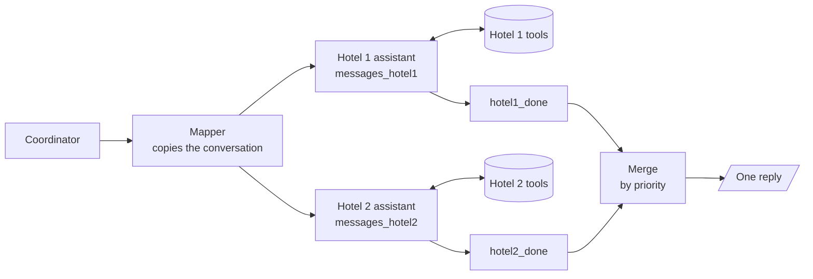

# M37.3 Theory: Scaling: parallel agents, memory merging, language and sentiment, web search

*[M37 theory](../README.md) · Lesson 37.3 · Notebooks: [`03a_hotel_parallel_reservation_agents.ipynb`](../../../../course/p10_memory_and_multi_agent/m37_multi_agent_builds_deep_agents/optional/03a_hotel_parallel_reservation_agents.ipynb) (optional), [`03b_hotel_merging_and_conversation_memory.ipynb`](../../../../course/p10_memory_and_multi_agent/m37_multi_agent_builds_deep_agents/optional/03b_hotel_merging_and_conversation_memory.ipynb) (optional), [`03c_hotel_guest_language_and_sentiment.ipynb`](../../../../course/p10_memory_and_multi_agent/m37_multi_agent_builds_deep_agents/optional/03c_hotel_guest_language_and_sentiment.ipynb) (optional), [`03d_hotel_web_search_integration.ipynb`](../../../../course/p10_memory_and_multi_agent/m37_multi_agent_builds_deep_agents/optional/03d_hotel_web_search_integration.ipynb) (optional) · [All theory pages](../../../README.md)*

## Memory merging

Once several agents work on one request, their outputs have to come back together: the answers of parallel branches into one reply, and old turns into something smaller than the full transcript. Notebooks 03a and 03b do both on a chain with two hotels. Hotel 1 has rooms 101 to 104, Hotel 2 rooms 105 to 108, each in its own database with its own read-only SQL tools.

Notebook 03a reaches that shape in three attempts, and each failure is a LangGraph rule:

| Attempt | What breaks | The rule |
|---|---|---|
| Two nodes write one plain key in the same step | LangGraph raises `InvalidUpdateError` | A key written by parallel nodes needs a reducer, such as `Annotated[list, operator.add]` |
| Both tool loops share `messages` | A `ToolNode` answers the latest tool call in its list, which may be the other branch's; with same-named tools (`run_query` in both) the wrong database answers silently | One message key per branch, with `ToolNode(..., messages_key=...)` and `partial(tools_condition, messages_key=...)` |
| Each branch's end goes straight to the merge node | The merge runs once per branch, so the guest gets two replies and the first misses a hotel | A sync node at the end of each branch and a join, `add_edge(["hotel1_done", "hotel2_done"], "merge_answers")` |

Two more choices keep the branches honest. Both assistants come from one factory, so each is bound to its own hotel's tools; copying the first assistant to make the second is how Hotel 2's agent ends up answering from Hotel 1's database. And the branches cannot book: both run the same request at the same time, so a `book_room` in each would create two reservations. They report availability and prices, and booking waits until the guest picks a hotel.

Notebook 03b turns the merge into an agent. The merge node reads the guest's request and each hotel's final answer, listed in priority order (`PRIORITY = ["hotel1", "hotel2"]`), and writes one reply: recommend the first hotel that can help and offer the other as an alternative, ignore a hotel that cannot help unless none can, and keep room numbers, prices and dates exactly as the assistants gave them. Only the merged reply enters `messages`; each branch's tool calls stay in its own key. The two test turns:

| Guest asks | Ground truth from SQLite | The reply should |
|---|---|---|
| A Deluxe room in two months | Hotel 1 room 104, Hotel 2 room 108 | Name 104 before 108 |
| The Family Suite during Bob's stay | None free: Hotel 1 has no Family Suite, Hotel 2's is booked | Say plainly that none is free |

The code checks the first case by the position of the room numbers in the reply, against the ground truth from `free_rooms()`, not against the model's claim.

Every turn now adds several agent messages to the thread, so the second half of 03b keeps it small by **summarizing into state**. A `summarize_conversation` node runs at `START` when the stored conversation has more than `SUMMARIZE_AFTER = 6` messages:

1. It keeps the last `KEEP_TURNS = 1` guest turn word for word; everything before it is old. The cut is always at a guest message, so no tool call is separated from its result.
2. It asks the model to fold the old messages into the running `summary` field, keeping every concrete fact: names, room types and numbers, prices, dates, what was offered and refused.
3. It returns `RemoveMessage(id=...)` for each old message, and the `add_messages` reducer deletes them.

The summary goes into the coordinator's and assistants' prompts as a system message, never into the guest's reply. The test turn asks *Remind me: which Deluxe room did you recommend, and at what price?* after the summarizer removed every earlier message, so the model can only answer from the summary. The new graph continues the same thread because both graphs share one checkpointer.

| | Trimming (M33) | Summarizing into state |
|---|---|---|
| What changes | What the model sees on this call | What the thread stores |
| Old turns | Dropped from view, still stored | Folded into `summary`, deleted by id |
| Cost | No model call | One model call when the thread passes the limit |
| Risk | Facts outside the window are forgotten | Facts the summary leaves out are gone for good |

## Adding agents around the core

Notebooks 03c and 03d add capabilities without changing the coordinator, the checker or the reservation agent:

- **Language and sentiment.** `translate_in` detects the guest's language and replaces the message with an English version (one structured-output call returns the language code and the text); `sentiment_analysis` scores the English text with TextBlob's word lexicon; the coordinator adds a de-escalation instruction only when the message reads as negative; `translate_out` translates the final reply back. The language is a per-thread state field, because a global `user_language` breaks the moment two guests write at once. The lexicon is English-only and word-level: raw German scores nothing, and sarcasm still fools it.
- **Web search.** A `web_search_assistant` with `TavilySearch(max_results=3)` answers questions about the neighbourhood, which no hotel database holds. It is one more tool loop and one more name the coordinator can route to, and the test checks which node ran for a nearby-places question and for a booking question.

Each notebook adds its capability to the core from 37.1 on its own; no notebook composes all of them into one graph.

## Check yourself

1. Why does each parallel hotel branch need its own message key instead of sharing messages?

A `ToolNode` answers the latest tool call in its list, which may be the other branch's. Both hotels have a tool called `run_query`, so the wrong database can answer silently. Give each branch its own key with `ToolNode(..., messages_key=...)` and `partial(tools_condition, messages_key=...)`.

2. For a Deluxe room in two months, Hotel 1 has room 104 free and Hotel 2 has room 108. What should the merged reply say, and how is it checked?

It should recommend Hotel 1 first, because `PRIORITY = ["hotel1", "hotel2"]`, so 104 appears before 108, and offer Hotel 2 as the alternative with numbers, prices and dates exactly as the assistants gave them. Code checks the position of the room numbers in the reply against the ground truth from `free_rooms()`, not against the model's claim.

3. In the two-hotel graph, the guest gets two replies and the first one misses a hotel. What is wrong with the wiring?

Each branch's end goes straight to the merge node, so the merge runs once per branch. Add a sync node at the end of each branch and a join, `add_edge(["hotel1_done", "hotel2_done"], "merge_answers")`, so the merge waits for both.

---
*Previous: [37.2 Hardening: edge cases, testing and system-wide error handling](../02_hardening_edge_cases_testing_and_system_wide_error_handling/README.md). Next: [37.5 Research systems: supervisor financial research, summarisation, full research system](../05_research_systems_supervisor_financial_research_summarisation_full_research_system/README.md).*
