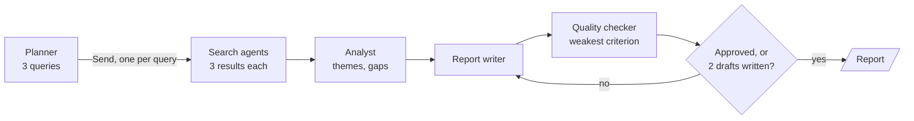

# M37.5 Theory: Research systems: supervisor financial research, summarisation, full research system

*[M37 theory](../README.md) · Lesson 37.5 · Notebooks: [`05c_multi_agent_research_system.ipynb`](../../../../course/p10_memory_and_multi_agent/m37_multi_agent_builds_deep_agents/notebooks/05c_multi_agent_research_system.ipynb), [`05a_supervisor_financial_research.ipynb`](../../../../course/p10_memory_and_multi_agent/m37_multi_agent_builds_deep_agents/optional/05a_supervisor_financial_research.ipynb) (optional), [`05b_multi_agent_research_summarization.ipynb`](../../../../course/p10_memory_and_multi_agent/m37_multi_agent_builds_deep_agents/optional/05b_multi_agent_research_summarization.ipynb) (optional) · [All theory pages](../../../README.md)*

## Planner, supervisor or router

The three research notebooks answer one question differently: who decides which agent works next, and when. That choice sets how many model calls a request costs and what can go wrong.

| | Supervisor (05a) | Typed router (05b) | One-shot planner (05c) |
|---|---|---|---|
| Decides | After every worker report, who acts next or whether to finish | Once per question, which one specialist runs | Once, up front, the list of search queries |
| Sees results | Yes | No | No |
| Workers per request | Any number, in sequence | Exactly one, then a summarizer | One per planned query, in parallel |
| How the choice reaches the graph | The model writes `next` into state; a pure function follows it | `with_structured_output(RouteDecision)` with `route: Literal["web_research", "rag", "llm"]` | `Send("search_agent", ...)` per query |
| Bound in code | `MAX_SUPERVISOR_TURNS = 6` | One route per question | `NUM_QUERIES = 3`, and `MAX_DRAFTS = 2` on the revision loop |

The supervisor is the most flexible and the hardest to bound, which is why 05a proves its turn cap with a stub supervisor that never finishes. Its researcher also returns a validated `MarketData` object, numbers only, and the coder sees just the user's request and that JSON, so no web text reaches the agent that runs code. The typed router is the fix for the hotel's string routing: the choice is a field, not a word to search for in a reply. Its RAG agent answers only from chunks above a relevance floor, and when nothing clears it, it skips the model call and says so. The planner never sees a result, which is what separates it from a supervisor: it cannot adapt, but its cost is known before the first search runs.

The module's lab brief asks for a research team on the Larkspur Cloud handbook: a supervisor, a RAG researcher over the handbook, a web researcher and a writer that cites its sources, tested on three edge cases. Each has a mechanism in this module:

| Edge case | Mechanism | Where |
|---|---|---|
| No results | The RAG agent skips the model call when no chunk clears the relevance floor, and says so | 05b |
| Conflicting sources | The analyst lists gaps and contradictions across all findings before anyone writes | 05c |
| Tool failure | The failing node records an error in state, a pure router picks a fallback, and a cap ends retries | 02c, 05a |

For Larkspur, a conflict is real: a web forum post can quote an old refund window while the handbook gives the current one. The writer should cite both and say which is the policy, which it can only do if the findings keep their sources.

## A quality loop with a cap in code

Notebook 05c is the module's full research pipeline. A planner splits the topic into search queries, search agents run them in parallel and append to one shared findings list, an analyst and a writer turn the findings into a report, and a quality checker sends the report back for revision until it passes or the cap is reached.

<!-- animated: diagrams/quality-loop.anim.html -->

The settings are in one cell and the code enforces each of them:

| Setting | Value | Enforced by |
|---|---|---|
| `NUM_QUERIES` | 3 | The planner's list is cut to this length, so the fan-out never depends on the model counting |
| `RESULTS_PER_QUERY` | 3 | Each DuckDuckGo search keeps this many hits |
| `QUALITY_THRESHOLD` | 0.7 | Every review criterion must reach it |
| `MAX_DRAFTS` | 2 | `quality_gate` ends the loop at this many reviewed drafts, whatever the scores say |

Four details carry the design:

- **A reducer on the findings.** `findings: Annotated[list[dict], operator.add]` lets parallel search agents append to one list. Each search agent extracts 2 or 3 findings, each tied to a result URL, and code marks `url_verified` when the URL is one the search actually returned, so an invented source shows up.
- **The weakest criterion decides.** The reviewer scores completeness, clarity and actionability from 0.0 to 1.0, and `quality_score` is the minimum. The one criterion code can check exactly, that the four required sections (Executive Summary, Key Findings, Analysis, Recommendations) are present, is checked in code.
- **Revisions see the previous draft.** The writer runs at temperature 0.7 and, on a revision, gets its previous draft and the reviewer's feedback. At temperature 0 a revision tends to repeat the draft.
- **The exit is code.** `quality_gate` is a pure function: approve when the minimum score reaches 0.7 and no section is missing, otherwise go back to the writer, unless `iteration` has reached `MAX_DRAFTS`. The reviewer is never asked to be lenient on a later pass.

The notebook proves the wiring before it spends a token. `create_research_system(nodes=...)` takes replacement nodes, and stubs plan four queries with two findings each: all eight findings survive the parallel writes, a reviewer that always scores 0.1 stops at 2 drafts, and one that scores 0.9 stops at 1. The real run is then checked against its streamed updates: one search agent per planned query, every query represented in the findings, and as many drafts as reviews, never more than 2.

---
*Previous: [37.3 Scaling: parallel agents, memory merging, language and sentiment, web search](../03_scaling_parallel_agents_memory_merging_language_and_sentiment_web_search/README.md). Next: [37.6 Deep agents: orchestrator, sub-agents, skills and long-term memory](../06_deep_agents_orchestrator_sub_agents_skills_and_long_term_memory/README.md).*
