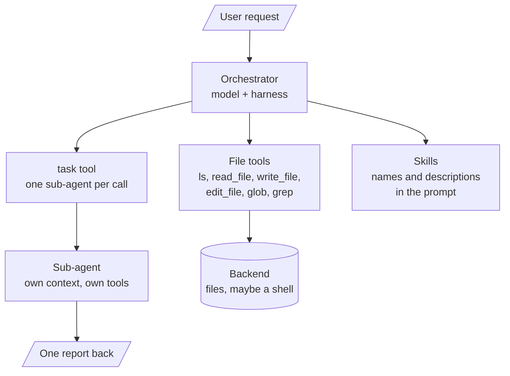

# M37.6 Theory: Deep agents: orchestrator, sub-agents, skills and long-term memory

*[M37 theory](../README.md) · Lesson 37.6 · Notebooks: [`06a_simple_coding_agent.py`](../../../../course/p10_memory_and_multi_agent/m37_multi_agent_builds_deep_agents/notebooks/06a_simple_coding_agent.py), [`06b_long_term_memory_agent.py`](../../../../course/p10_memory_and_multi_agent/m37_multi_agent_builds_deep_agents/optional/06b_long_term_memory_agent.py) (optional), [`06c_skills`](../../../../course/p10_memory_and_multi_agent/m37_multi_agent_builds_deep_agents/optional/06c_skills) (optional) · [All theory pages](../../../README.md)*

## Deep-agent harness

The hotel system and the research pipeline are graphs you wire node by node. A deep agent starts from the other end: one orchestrator model inside a ready-made **harness** that gives it files, sub-agents, skills, an execution backend and memory, and you configure the harness instead of drawing the graph. Lesson 37.6 uses the `deepagents` library's `create_deep_agent`, in two command-line scripts. The tool and backend behaviour below is that of `deepagents` 0.7.32, the version in this course's lock file.

The parts, as the scripts configure them:

| Part | What it gives the orchestrator | In 06a and 06b |
|---|---|---|
| Built-in tools | File operations (`ls`, `read_file`, `write_file`, `edit_file`, `glob`, `grep`), `execute` for shell commands, and `task` to call a sub-agent | Added by `create_deep_agent`; `execute` returns an error unless the backend can run commands |
| Custom tools | Domain actions | 06a: `name_project`, `internet_search` (Tavily) and four Databricks Genie tools for an insurer's customer, distribution, policy and claims data. 06b adds `save_memory`, `recall_memories`, `forget_memory` |
| Sub-agents | Specialists, each a dict of `name`, `description`, `system_prompt`, `skills` and `tools` | 06a: 7 (`senior-developer`, `code-reviewer`, `research-agent` and four insurer analytics agents). 06b adds `memory-manager` |
| Skills | Instructions in `SKILL.md` files, loaded from `/skills/` | 8 skills in `06c_skills`, one per sub-agent; each sub-agent's prompt is "Follow the … skill instructions" |
| Backend | Where files live and whether commands run | `FilesystemBackend(root_dir=..., virtual_mode=True)` by default; `LocalShellBackend` when `USE_SANDBOX=true` |
| Checkpointer | Memory within one thread | `MemorySaver`, one `thread_id` per task |
| Model | The orchestrator's model | `databricks-claude-opus-4-6`, temperature 0.1 |

**Sub-agents keep the orchestrator's context small.** A call to `task` runs the sub-agent with its own messages and tools, and only its final message returns to the orchestrator. The research agent's search calls (up to 5 results each by default) and its notes stay in its own context; the orchestrator reads its report.

**Skills are read on demand.** A `SKILL.md` starts with YAML frontmatter, a `name` and a `description`. The harness puts only those two fields in the system prompt and tells the model to `read_file` the full instructions when a task matches the description. This is progressive disclosure: eight skills cost eight short lines until one is needed. The `memory-manager` skill, for example, sets a workflow (assess, then save, recall or forget), five categories, and a rule to confirm before deleting unless the request is unambiguous.

**The backend decides what the agent can do to your machine.** Two settings in the scripts look safer than they are:

- `FilesystemBackend(virtual_mode=True)` anchors paths under `root_dir` and blocks traversal such as `..`. The library's own docstring says it provides no sandboxing or process isolation.
- The script's comment says `USE_SANDBOX=true` selects a LangSmith cloud sandbox. The code selects `LocalShellBackend`, which the library documents as unrestricted shell execution on the host, with no isolation.

Code execution belongs in a real sandbox backend, with a person approving each command; `create_deep_agent` takes `interrupt_on` for that. Notebook 05a gives the same advice for its Python tool.

**Long-term memory outlives the thread.** 06b keeps three layers apart:

| Layer | Scope | Store in 06b | Store in the deployed version |
|---|---|---|---|
| Conversation | One thread | `MemorySaver` checkpointer, lost on restart | The same |
| Long-term | Every thread, every session | A JSON file, `long_term_memories.json`, under the key `memories:<user id>` | A Delta table, `agent_memories`, with `user_id`, `content`, `category` and `saved_at` |
| Artifacts | Project files the developer agent writes | `projects/` beside the script | A Unity Catalog volume |

The orchestrator's prompt tells it to recall memories at the start of each conversation and to save preferences, facts, decisions, project context and feedback as they come up. Two limits are visible in the code: `CURRENT_USER_ID` is fixed to `default-user`, so every user shares one namespace until it comes from authentication, and `recall_memories` matches a substring of the stored text, so a paraphrase finds nothing. The script's comment names `PostgresStore` as the production replacement.

The module's deployed design, in [`deep_agent_overview.md`](../../../../course/p10_memory_and_multi_agent/m37_multi_agent_builds_deep_agents/assets/deep_agent_overview.md), runs the same harness behind a FastAPI backend with Server-Sent Events, eight sub-agents and a recursion limit of 100.

## Key Takeaways

- A deep agent is one orchestrator configured with file tools, sub-agents through `task`, skills and a backend, instead of a graph wired node by node. Only a sub-agent's final message returns, so the orchestrator's context stays small.
- Skills put only their `name` and `description` in the prompt and are read in full when a task matches. Eight skills cost eight short lines until one is needed.
- Check what the backend really allows. `FilesystemBackend(virtual_mode=True)` blocks traversal without isolating anything, and `LocalShellBackend` runs unrestricted shell on the host, so use a real sandbox with `interrupt_on` approval.

## Check yourself

1. How does a call to the task tool keep the research agent's searches out of the orchestrator's context?

The `task` tool runs the sub-agent with its own messages and tools, and only its final message returns to the orchestrator. The search calls and notes stay in the sub-agent's context; the orchestrator reads only the report.

2. The harness loads eight skills from 06c_skills. What does the orchestrator's system prompt hold for them before any is needed?

Only each skill's `name` and `description` from the `SKILL.md` frontmatter, eight short lines in all. When a task matches a description, the model calls `read_file` for the full instructions. This is progressive disclosure.

3. A teammate sets USE_SANDBOX=true, believing the agent's commands now run in a cloud sandbox. Are they safe?

No. Despite the script's comment, the code selects `LocalShellBackend`, which the library documents as unrestricted shell execution on the host with no isolation. Code execution belongs in a real sandbox backend, with a person approving each command through `interrupt_on`.

---
*Previous: [37.5 Research systems: supervisor financial research, summarisation, full research system](../05_research_systems_supervisor_financial_research_summarisation_full_research_system/README.md). Next: [M37 interview questions](../README.md#interview-spotlight-5-questions-you-might-get-asked).*
