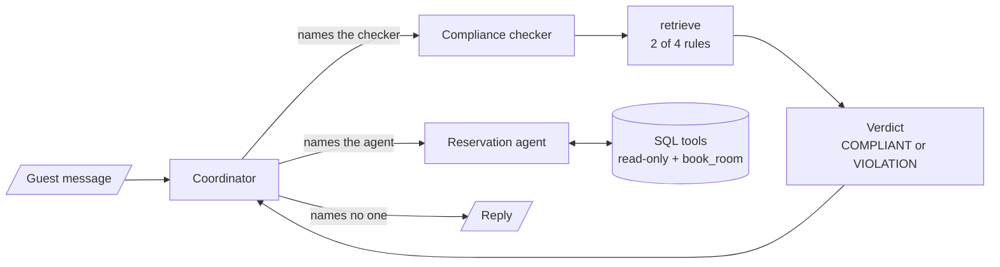

# M37 Theory: Multi-Agent Applied Builds & Deep Agents

*Part X · Memory & Multi-Agent RAG · [Module README](../../../course/p10_memory_and_multi_agent/m37_multi_agent_builds_deep_agents/README.md) · [All theory pages](../../README.md)*

M35 and M36 teach multi-agent patterns one at a time. M37 builds whole systems from them and spends most of its time off the happy path: the request that breaks a rule, the reply that names the wrong agent, the node that fails, the conversation that outgrows the context. The M37 notebooks build on four ideas: a compliance agent that screens every request before anyone acts on it, tests that check routes and side effects in code, merging the outputs of parallel agents and of old turns back into one state, and the harness that turns a model into a deep agent. Each idea has a page in the folder of the lesson that teaches it, listed under [Lessons](#lessons). This page has the overview, the interview questions and the takeaways.

Lessons 37.1 to 37.3 follow the notebooks' hotel support desk: a coordinator that talks to the guest, a compliance checker over four hotel rules, and a reservation agent over a SQLite database of eight rooms. Room 105, the Family Suite, is booked from today+30 to today+33, and the notebooks use it to show a clash. Lesson 37.5 and the interview questions move the same designs onto Larkspur Cloud, the fictional cloud host whose handbook runs through M11 to M13: its support desk, its refund and export policies, and a research team that answers from the handbook and the web.

## TL;DR

- The compliance checker is a small RAG agent. It retrieves the 2 most relevant of the hotel's 4 rules and returns a typed verdict, `COMPLIANT` or `VIOLATION`. The coordinator sends every new request to it first, and a loop guard in code stops it being asked twice.
- The guards that matter live in tools and code, not in prompts: a read-only SQL connection whose authorizer hides guest names, one parameterised `book_room` tool, a date check in plain Python, a hard cap on revision loops.
- Test the router as a pure function. Notebook 02b's seven router tests need no model. In the lab, any threshold from 71 to 90 turns all seven green, because the confidence gate hides the known issue instead of fixing it.
- Parallel agents need one message key per branch, a join that waits for every branch, and one merge that writes one reply. Long threads fold old messages into a summary and delete them by id.
- A deep agent is a harness around a model: file tools, a `task` tool that runs sub-agents in their own context, skills read only when they apply, a backend that decides whether code can run, and memory that outlives the thread.

## Mental model

<!-- animated: diagrams/core-system.anim.html -->

One node talks to the guest, specialists do the work, and plain functions between them decide where the turn goes. Every later build in the module keeps that split: the research system in 37.5 and the deep agent in 37.6 change who the specialists are, while routing, caps and checks stay in code where a test can reach them.

## Lessons

| Lesson | Topic | Theory |
|---|---|---|
| 37.1 | Hotel system: environment, coordinator, reservation agent, compliance | [Compliance agent](01_hotel_system_environment_coordinator_reservation_agent_compliance/README.md#compliance-agent) [Guards in the tools](01_hotel_system_environment_coordinator_reservation_agent_compliance/README.md#guards-in-the-tools) |
| 37.2 | Hardening: edge cases, testing and system-wide error handling | [System testing](02_hardening_edge_cases_testing_and_system_wide_error_handling/README.md#system-testing) [Edge cases and error paths](02_hardening_edge_cases_testing_and_system_wide_error_handling/README.md#edge-cases-and-error-paths) |
| 37.3 | Scaling: parallel agents, memory merging, language and sentiment, web search | [Memory merging](03_scaling_parallel_agents_memory_merging_language_and_sentiment_web_search/README.md#memory-merging) [Adding agents around the core](03_scaling_parallel_agents_memory_merging_language_and_sentiment_web_search/README.md#adding-agents-around-the-core) |
| 37.4 | Developer vs tester agents | *planned* |
| 37.5 | Research systems: supervisor financial research, summarisation, full research system | [Planner, supervisor or router](05_research_systems_supervisor_financial_research_summarisation_full_research_system/README.md#planner-supervisor-or-router) [A quality loop with a cap in code](05_research_systems_supervisor_financial_research_summarisation_full_research_system/README.md#a-quality-loop-with-a-cap-in-code) |
| 37.6 | Deep agents: orchestrator, sub-agents, skills and long-term memory | [Deep-agent harness](06_deep_agents_orchestrator_sub_agents_skills_and_long_term_memory/README.md#deep-agent-harness) |

## Interactive lab

[**Router test bench**](02_hardening_edge_cases_testing_and_system_wide_error_handling/interactive/router-test-bench-lab.html): open the file in a browser. Start at threshold 50: six of the seven router tests pass, and the seventh is the known issue the suite records on purpose. Slide to 75 and all seven pass, because the confidence gate now ends the known-issue turn before the name check runs. Then write your own coordinator reply under *Route your own reply* and find one that forwards while saying it will not.

## How it connects

- **Before:** [M33](../m33_conversational_memory_rag/README.md) and [M34](../m34_long_term_agentic_memory/README.md) teach the checkpointers, threads, summaries and stores these builds use for memory. [M35](../m35_multi_agent_architectures/README.md) and [M36](../m36_collaboration_parallel_agents/README.md) teach supervisors, routers, parallel branches and `Send` one at a time. [M24](../../p08_agent_foundations/m24_react_agents/README.md) covers `create_agent` and middleware, and [M27](../../p08_agent_foundations/m27_human_approval_applied_agents/README.md) human approval with `interrupt()`.
- **Next:** [M38](../../p11_agent_protocols/m38_mcp_foundations/README.md) to M41 move tools and agents behind protocols: MCP servers for tools, A2A between agents. The coordinator and specialist split stays the same.

## Interview Spotlight: 5 Questions You Might Get Asked

*Production questions in the style of OpenAI, Anthropic and Google interviews for applied AI roles.*

### 1. Larkspur's support desk is built like the hotel system: a coordinator, a compliance checker over account-privacy rules, and a billing agent. A customer asked for the billing email of another company's account and got it. The trace shows the compliance checker never ran. How do you find out why, and how do you stop it happening again?

**What a strong answer covers:**
- Reads the node path for that turn (`stream_mode="updates"`), then the coordinator's reply: the checker runs only when the reply names it, which the prompt asks for and nothing forces
- Makes the check structural: an unconditional edge from the guest message to the checker, instead of routing by mention
- Enforces privacy in the tool as well, the way the hotel's authorizer makes `guest_name` read as NULL, so a skipped check cannot leak the field
- Adds the request to the regression table and tracks its pass rate over several runs, since one green run proves little

### 2. The coordinator forwards to the billing agent whenever its reply contains `billing_agent` or "billing agent". A reply saying "I can't involve the billing agent until you confirm the refund date" forwarded anyway. A teammate proposes raising the confidence threshold from 50 to 80. What do you say?

**What a strong answer covers:**
- The threshold does not touch the cause, string matching on reply text; in the router lab, thresholds from 71 to 90 turn the known-issue test green by ending the turn early, not by routing correctly
- It also costs real traffic: the assessor scores a request with missing details at 50 to 79, so those customers get "please repeat" instead of a question about the missing detail
- The fix is a typed router: structured output with a `Literal` route, read by a pure function, as in notebook 05b
- Keeps the known-issue test, which flips to passing when the fix lands, and unit-tests the router on hand-built states with no model

### 3. Larkspur runs a research team for its support engineers: a planner, three parallel searchers, a writer and a quality checker with a two-draft cap. How do you know it is still working, and what it costs, a month after launch?

**What a strong answer covers:**
- Logs per run the number of search agents against planned queries, the number of drafts, and whether the run ended approved or stopped by the cap
- Watches the share of runs stopped by the cap: a rise means the writer or the sources got worse, since the cap hides quality problems from the user
- Tracks the share of findings whose URL was one the search returned (`url_verified`), the early sign of invented sources
- Reports cost and latency per run, which scale with queries times results and with drafts, and re-runs a fixed set of handbook questions after every prompt or model change

### 4. To speed up refunds, Larkspur splits billing into two parallel agents, one per region, both with a `refund` tool. A customer was refunded twice. What went wrong, and how do you design it?

**What a strong answer covers:**
- Parallel branches run the same request at the same time, so any write tool in both branches can fire twice
- Gives the branches read-only tools and makes the one write after a single choice, as the hotel's branches report availability but cannot book
- Adds an idempotency key to the refund tool so a retry or a duplicate call cannot pay twice
- Checks the wiring: one message key per branch, sync nodes and a join so the merge runs once, and a test that counts merge runs and rows written

### 5. You ship a deep agent to Larkspur's support engineers, built like notebook 06b. Someone sets `USE_SANDBOX=true` expecting cloud isolation, and the memory panel shows one engineer's notes in another's session. What is wrong?

**What a strong answer covers:**
- The script's comment promises a LangSmith sandbox, but the flag selects `LocalShellBackend`, which runs shell commands on the host with no isolation
- `FilesystemBackend(virtual_mode=True)` blocks path traversal; it is not a sandbox either, so code execution needs a real sandbox backend and approval on `execute` (`interrupt_on`)
- Long-term memory is keyed by `CURRENT_USER_ID`, fixed to `default-user`, so every engineer reads and writes one namespace; the key must come from the authenticated user
- `recall_memories` matches a substring, so it misses paraphrases; a store with search, and a review of what gets saved, come before scale

## Key Takeaways

- Put every rule that must hold in code or in a tool: a read-only connection, a parameterised write, a pure router, a loop cap. Prompts ask; code enforces.
- Test routing as a pure function on hand-built states, keep known issues as tests, and check side effects in the database, never in the agent's wording.
- Fan out with one state key per branch, join before you merge, keep writes out of parallel branches, and summarize old turns into state before the thread outgrows the context.
- A deep agent's safety comes from its harness: the backend decides what code can do, sub-agents keep their own context, and memory needs a real user key.

---
*Previous: [M36 Collaboration, control and parallel agents](../m36_collaboration_parallel_agents/README.md). Next: [M38 MCP foundations](../../p11_agent_protocols/m38_mcp_foundations/README.md).*
